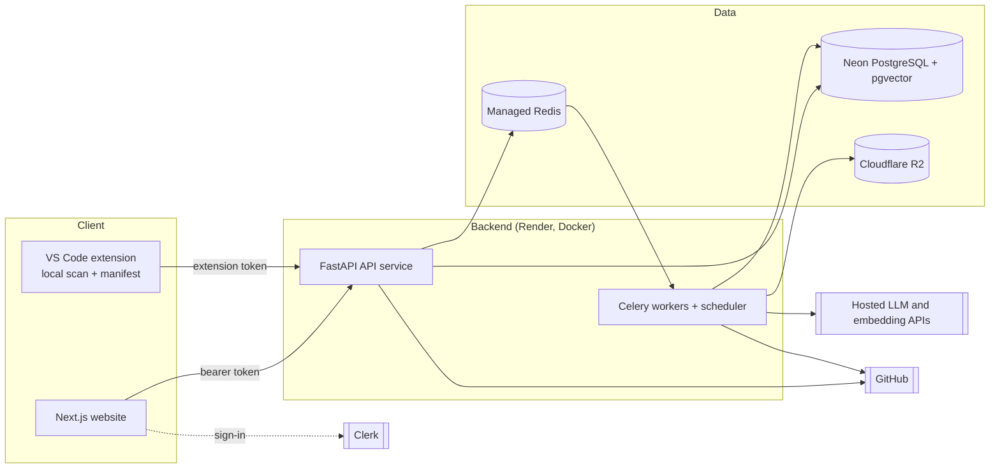

# DevMind

> An agentic AI software engineering system that maintains a shared, continuously updated understanding of a software project (the **Project Brain**) and uses specialized agents to help developers understand code, find security weaknesses, remember bugs, keep documentation current, review changes, diagnose deployments, prioritize work, and evaluate project health.

**Implementation status: SPECIFICATION PHASE. No application code exists yet.**
Everything in `docs/` is a proposed design, not evidence that a feature is built, tested, or secure. See [Current implementation status](#11-current-implementation-status).

---

## 1. Problem

A single change to one authentication route can ripple through security, API behavior, tests, documentation, and deployment, yet typical tooling treats these as separate activities. Codebases outgrow memory, bugs are re-solved from scratch, documentation decays silently, review quality depends on the reviewer, and nobody has an honest answer to "is this ready to ship?" (Source: `DevMind_Project_Document.md`, sections 1 and 2.)

## 2. Solution

Instead of nine disconnected tools, DevMind builds **one shared model of the project** and lets specialized agents read from and write to it. Something found in one place (a missing authorization check) becomes immediately useful elsewhere (a review finding, a documentation gap, a PR risk, a health score).

## 3. Differentiators

| Differentiator | What it means concretely |
|---|---|
| Shared Project Brain | One version-aware, structured model of code, symbols, relationships, findings, bugs, docs, and history; not a giant prompt ([04](docs/04-project-brain-and-rag.md)) |
| Evidence-based findings | Every finding carries a location, evidence, confidence, and an **evidence level E0 to E3**; "possible" is never presented as "proven" ([13](docs/13-glossary-and-domain-terminology.md)) |
| Human in the loop | AI finds, explains, suggests; a human approves anything that matters |
| Deterministic first | Scanners and parsers produce facts; LLMs explain and reason over them ([05](docs/05-agents-and-llm-workflows.md)) |
| Local-first scanning | The VS Code extension scans locally and sends only consented, task-specific context ([06](docs/06-vscode-extension-and-local-scanning.md)) |
| Lifecycle continuity | Understand, build, review, secure, fix, document, deploy, evaluate, improve |

## 4. The nine capabilities

| ID | Capability | Release |
|---|---|---|
| CAP-01 | Code Intelligence | MVP |
| CAP-02 | Security Intelligence (focused: authentication/authorization first) | MVP |
| CAP-05 | Code Review Intelligence | 1.1 |
| CAP-06 | Pull Request Intelligence | 1.1 |
| CAP-03 | Bug Memory | 1.2 |
| CAP-04 | Living Documentation | 1.2 |
| CAP-08 | Project Mentor | 1.3 |
| CAP-09 | Project Evaluation | 1.3 |
| CAP-07 | Deployment Diagnosis | 1.4 |

Details and acceptance criteria: [01](docs/01-product-requirements.md) §9. The MVP breadth (depth on two capabilities) is an open decision, OQ-10 / ADR-038.

## 5. Two interfaces

| | Website (primary) | VS Code extension (companion) |
|---|---|---|
| Role | Projects, AI conversations, reports, findings, Brain exploration, GitHub/PRs (later), settings | Detect workspace, scan locally, local manifest, diagnostics, consented sync, links to the website |
| AI chat | Yes | **No** (version one) |
| Uploads whole repository | n/a | **Never silently**; sync modes `metadata_only` or `indexed`, plus per-request consented snippets |
| Technology | Next.js, TypeScript | TypeScript (VS Code extension host) |

## 6. High-level architecture



Full detail: [02](docs/02-system-architecture.md).

## 7. Stack and decision status

| Layer | Choice | Status |
|---|---|---|
| Frontend | Next.js, TypeScript, deployed separately | Confirmed (ADR-002) |
| Backend | Python, FastAPI modular monolith, Docker, Render | Confirmed (ADR-004) |
| API and workers | Separate deployables, one image | Confirmed (ADR-005) |
| Agent orchestration | LangGraph (agent workflows only) | Confirmed (ADR-006) |
| Database | PostgreSQL on Neon with pgvector | Confirmed (ADR-007) |
| Queue | Redis-backed queue on managed Redis | Confirmed (ADR-008); provider Open (ADR-031) |
| Workers | Celery | Recommended (ADR-009) |
| Authentication | Clerk; authorization implemented by DevMind | Confirmed (ADR-010) |
| Object storage | Cloudflare R2, suitable artifacts only | Confirmed (ADR-013) |
| Email | Resend, only when a feature needs it | Deferred (ADR-014) |
| GitHub | OAuth first; GitHub App evaluated | Confirmed direction (ADR-015) |
| LLM layer | Provider adapters, config-driven routing | Confirmed (ADR-016); **providers and models Open (ADR-017)** |
| Retrieval | Hybrid inside PostgreSQL | Confirmed (ADR-018) |
| Embeddings | Hosted API, versioned embedding spaces | Confirmed approach (ADR-019); model Open |
| Frontend hosting | Vercel Hobby (free; public repo) | Recommended (ADR-032); free profile Confirmed (ADR-046) |
| Backend hosting | One Render free web service (API + embedded worker), Render free Key Value, Neon Free | Free profile Confirmed (ADR-046) |

Authoritative register: [12](docs/12-architecture-decisions-and-open-questions.md).

## 8. MVP summary

A vertical slice: open a TypeScript/JavaScript or Python workspace in VS Code, scan it locally, see authentication/authorization findings as diagnostics, sync metadata (and, with explicit consent, source snippets) to DevMind, then explore the project, findings with evidence, and a citation-grounded conversation on the website. Definition: [01](docs/01-product-requirements.md) §14. Build order: [11](docs/11-mvp-and-implementation-roadmap.md) (milestones M1 to M10 and M13 for the MVP).

## 9. Local development prerequisites (planned)

| Tool | Purpose | Notes |
|---|---|---|
| Node.js LTS and `pnpm` | Frontend, extension | Versions pinned at repository setup |
| Python and `uv` | Backend | Version pinned at setup (ADR-036) |
| Docker and Docker Compose | Local PostgreSQL (pgvector, pg_trgm), Redis, API, worker, scheduler | |
| VS Code | Extension development host | |
| Accounts and keys for development | Clerk development instance; at least one LLM provider key and one embedding provider key (or the built-in fake provider); optional GitHub OAuth app | Never committed; see `.env.example` |

## 10. Planned repository structure

```text
DevMind/
├── README.md  AGENTS.md  PLAN.md  BRAIN.md  render.yaml  .env.example  .gitignore
├── package.json  pnpm-workspace.yaml
├── docs/                      # documentation package (00 to 13), runbooks, showcase kit
├── brand/                     # logo, icons, social images, design tokens
├── client/                    # Next.js website            (was: frontend/)
├── extension/                 # VS Code extension          (was: vscode-extension/)
├── common/                    # shared TypeScript: generated API client, shared data, tokens (was: packages/)
├── server/                    # FastAPI + Celery (Python)  (was: backend/)
│   ├── Dockerfile  pyproject.toml  README.md
│   ├── alembic/               # migrations
│   ├── configs/llm/           # providers.yaml, models.yaml, tasks.yaml (no secrets)
│   ├── app/
│   │   ├── api/  core/  domain/  persistence/
│   │   ├── brain/  analysis/  llm/  orchestration/
│   │   ├── integrations/  workers/
│   │   └── llm/prompts/       # versioned prompt files
│   └── tests/
├── evals/                     # scanner, retrieval, answer-quality fixtures and results
├── infra/                     # docker-compose.yml for local development
├── scripts/                   # test-all, brand sync, docs link check
└── .github/workflows/         # CI
```

Folder names are owner-approved (ADR-039). Additions beyond the initial concept (`common/`, `evals/`, `infra/`, `scripts/`, `.github/`) are design recommendations ([02](docs/02-system-architecture.md) §5). The layout is a plan; no implementation files exist yet.

## 11. Current implementation status

| Area | Status |
|---|---|
| Product and architecture specification | Drafted; pending human review |
| Client, server, extension code | Not started |
| Database schema and migrations | Specified logically only |
| LLM provider and model selection | Unresolved; requires evaluation ([05](docs/05-agents-and-llm-workflows.md) §16) |
| Vendor facts (pricing, limits, scopes, versions) | Not verified; see the register in [12](docs/12-architecture-decisions-and-open-questions.md) §5 |
| Tests, benchmarks, security validation | None exist; no accuracy or performance claims are made |

## 12. Documentation map

| # | Document | Purpose |
|---|---|---|
| 00 | [Documentation index](docs/00-documentation-index.md) | Map, precedence, reading order |
| 01 | [Product requirements](docs/01-product-requirements.md) | What and why; MVP |
| 02 | [System architecture](docs/02-system-architecture.md) | How it fits together |
| 03 | [Data model and API](docs/03-data-model-and-api.md) | Tables, endpoints, schemas |
| 04 | [Project Brain and retrieval](docs/04-project-brain-and-rag.md) | Knowledge model, RAG |
| 05 | [Agents and LLM workflows](docs/05-agents-and-llm-workflows.md) | LangGraph, routing, configuration |
| 06 | [VS Code extension and local scanning](docs/06-vscode-extension-and-local-scanning.md) | Local-first scanning, sync, consent |
| 07 | [Security, privacy, threat model](docs/07-security-privacy-and-threat-model.md) | Controls and risks |
| 08 | [UI/UX design specification](docs/08-ui-ux-design-specification.md) | Visual identity, screens, motion |
| 09 | [Testing and quality](docs/09-testing-and-quality-strategy.md) | Tests, evaluations, gates |
| 10 | [Deployment and operations](docs/10-deployment-and-operations.md) | Runbook |
| 11 | [MVP and roadmap](docs/11-mvp-and-implementation-roadmap.md) | Milestones M1 to M13 |
| 12 | [Decisions and open questions](docs/12-architecture-decisions-and-open-questions.md) | ADR register |
| 13 | [Glossary](docs/13-glossary-and-domain-terminology.md) | Terms |

Brand assets (logo, favicons, tokens): [brand/BRAND-GUIDE.md](brand/BRAND-GUIDE.md). Build plan for the AI coding agent: [docs/ANTIGRAVITY_PROMPT.md](docs/ANTIGRAVITY_PROMPT.md). Owner setup manual: [docs/SETUP-GUIDE.md](docs/SETUP-GUIDE.md).

AI coding agents: read [AGENTS.md](AGENTS.md) first.

## 13. License

Not yet chosen. Decide before the repository becomes public.
