<p align="center">
  <picture>
    <source media="(prefers-color-scheme: dark)" srcset="brand/svg/devmind-lockup-horizontal-for-dark.svg">
    <source media="(prefers-color-scheme: light)" srcset="brand/svg/devmind-lockup-horizontal-for-light.svg">
    
  </picture>
</p>

<p align="center">
  <em>An agentic AI software engineering system with a shared Project Brain.</em><br>
  Continuous architectural graph, deterministic code tracing, and privacy-first VS Code companion.
</p>

<p align="center">
  <a href="https://github.com/Warish-Labs/DevMind"></a>
  <a href="https://github.com/Warish-Labs/DevMind/actions/workflows/ci.yml"></a>
  <a href="https://github.com/Warish-Labs/DevMind/actions/workflows/codeql.yml"></a>
  
  
  
  
  
  <a href="https://marketplace.visualstudio.com/items?itemName=WarishLabs.devmind-vscode"></a>
  <a href="LICENSE"></a>
</p>

<p align="center">
  <a href="#1-what-is-devmind"><strong>Overview</strong></a> ·
  <a href="#2-screenshots--interface"><strong>Screenshots</strong></a> ·
  <a href="#3-how-it-works"><strong>How It Works</strong></a> ·
  <a href="#5-the-project-brain"><strong>Project Brain</strong></a> ·
  <a href="#7-system-architecture"><strong>Architecture</strong></a> ·
  <a href="#8-privacy-by-design--data-boundary"><strong>Privacy</strong></a> ·
  <a href="#11-getting-started"><strong>Getting Started</strong></a> ·
  <a href="#14-roadmap--honest-status"><strong>Roadmap</strong></a> ·
  <a href="docs/00-documentation-index.md"><strong>Documentation</strong></a>
</p>

---

## 1. What is DevMind?

**DevMind** is an agentic software engineering system designed around a central, version-aware mental model of your codebase—the **Project Brain**.

### The Problem

Software engineering tools are currently fragmented into blind silos. Your linter evaluates files in isolation; your security scanner runs periodically in CI without context; your documentation decays silently; your pull request reviews miss cross-module ripple effects; and when a production incident occurs, engineers sift through logs trying to manually reconstruct which commit introduced the failure.

Consider this classic vulnerability:

```typescript
// src/routes/admin.ts
router.get("/admin/users", requireAuth, async (req, res) => {
  const users = await db.user.findMany();
  res.json({ users });
});
```

A standard syntax checker or linter passes this without comment—the syntax is valid. A unit test verifying that unauthenticated users receive a `401 Unauthorized` passes. Yet a critical security gap exists: **the route lacks an administrative role guard**. Any authenticated tenant member can enumerate user accounts.

### How DevMind Solves It

DevMind maintains an interconnected semantic graph of your application:

1. **One Project Brain**: Unifies AST symbols, call graphs, guard policies, test mappings, bug histories, and living documentation across repository versions.
2. **Deterministic-First Analysis**: Ground truth is established with fast AST parsers (tree-sitter) and static policy solvers before calling LLMs.
3. **Evidence, Not Eloquence**: Every finding is backed by an evidence tier (**E0 to E3**). AI never presents speculative guesses as proven facts.
4. **Local-First & Privacy-Preserving**: The VS Code companion scans locally. Source code never leaves your workstation without explicit, recorded consent.
5. **Human in the Loop**: Agent actions, refactors, and pull request changes are proposals requiring explicit human approval.

---

## 2. Screenshots & Interface

> [!NOTE]
> _Screenshots show the interface with example/fixture data. See the [Roadmap & Status](#14-roadmap-honest-status) table for verified implementation state._

<p align="center">
  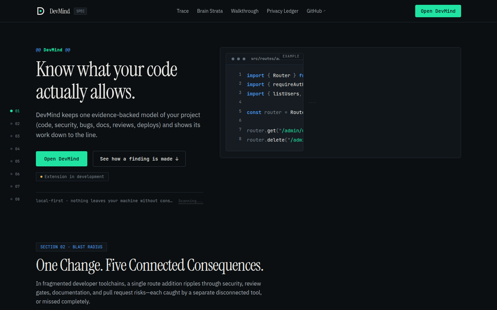
  <em>DevMind Web Platform: Interactive Project Brain hero and deterministic code tracer.</em>
</p>

### Web Platform & Visual Architecture Gallery

| Component & Section                                                                                                               | View & Capture                                                                 |
| --------------------------------------------------------------------------------------------------------------------------------- | ------------------------------------------------------------------------------ |
| **01 · Interactive Code Trace Sequence**<br>Step-by-step deterministic AST code trace and ripple tag execution.                   | 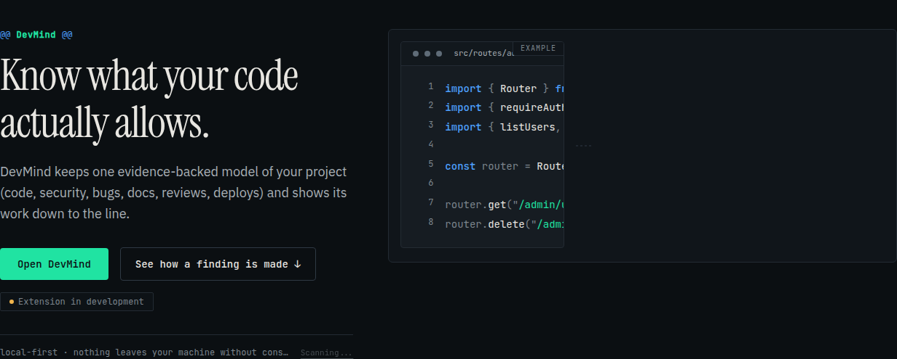     |
| **03 · Project Brain Strata Explorer**<br>Interactive multi-strata mental model inspecting symbols, edges, and living docs.       | 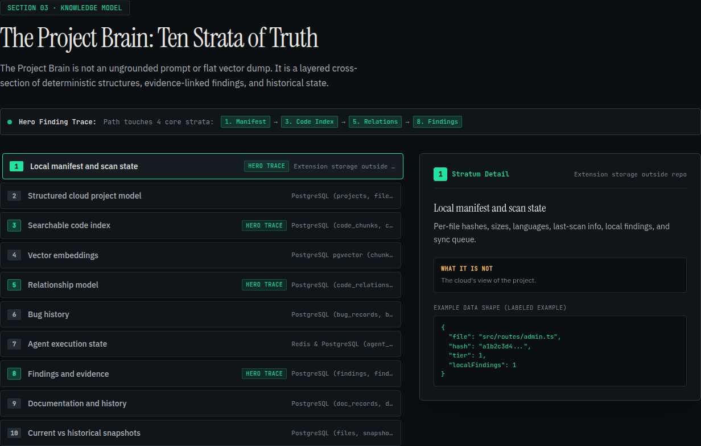     |
| **05 · Architectural Walkthrough**<br>14-step continuous lifecycle sticky timeline from local scan to PR review.                  | 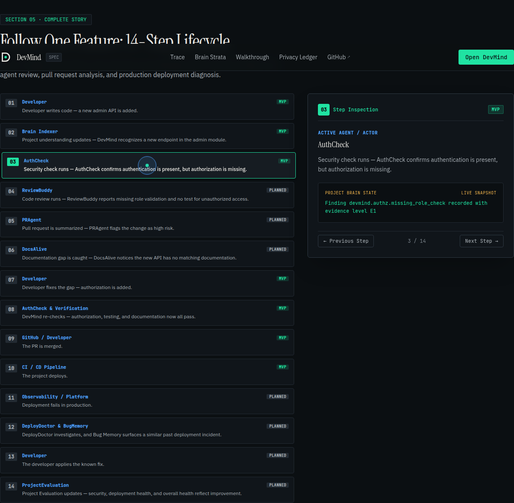 |
| **07 · Cryptographic Privacy Ledger**<br>Verifiable data classification ledger defining strict local vs remote egress boundaries. | 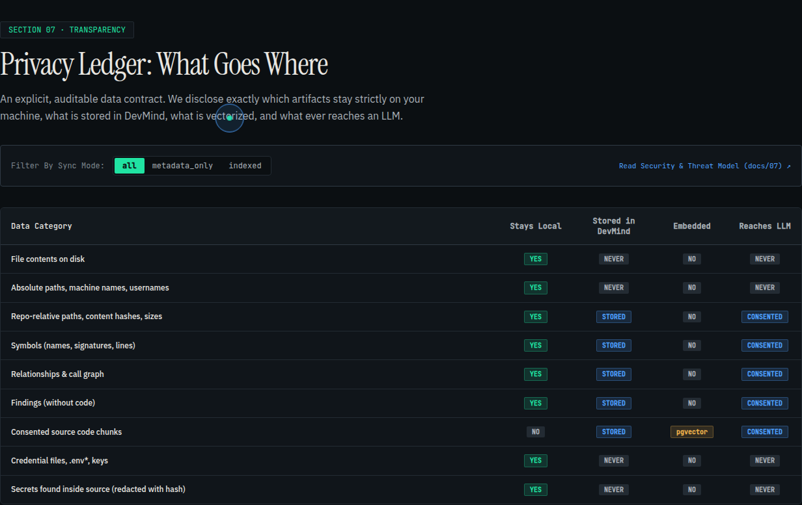  |
| **08 · Preferences & Motion Control**<br>Custom magnetic cursor, reduced-motion preferences, and Early Access CTA.                | 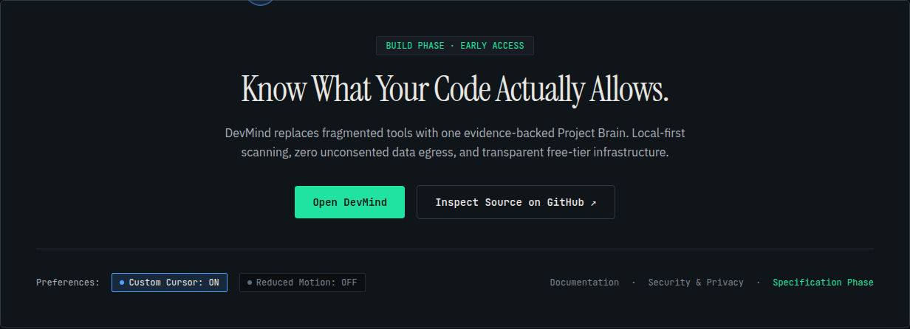           |
| **Responsive Tablet Viewport**<br>Adaptive layout tested against iPad and tablet viewports meeting WCAG 2.1 AA.                   | 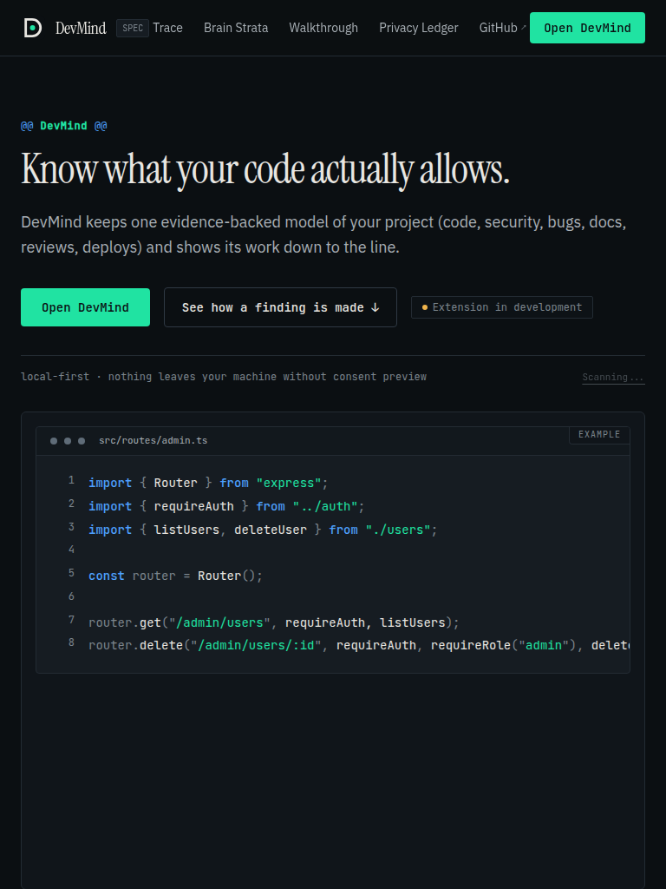             |
| **Accessible Mobile Viewport**<br>Compact touch-optimized mobile viewport with fluid typography and accessible touch targets.     | 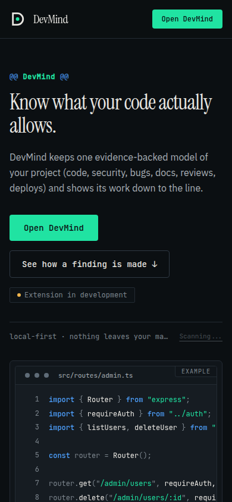                    |

---

## 3. How It Works

DevMind operates across the entire development lifecycle, synchronizing insights back to the Project Brain so that every finding, fix, and review informs subsequent workflows.

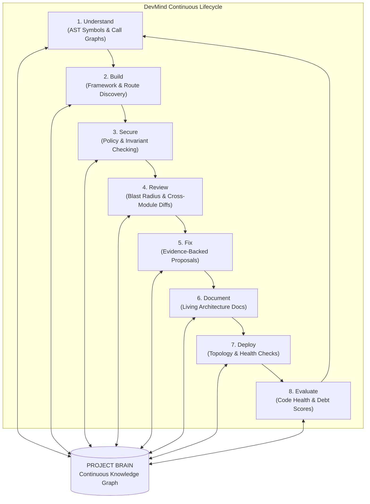

---

## 4. The Nine Intelligence Capabilities

All nine capabilities operate against the unified Project Brain (specification defined in [docs/01-product-requirements.md](docs/01-product-requirements.md)):

| ID         | Capability                    | What It Answers                                                             | Target Release | Status  |
| ---------- | ----------------------------- | --------------------------------------------------------------------------- | -------------- | ------- |
| **CAP-01** | **Code Intelligence**         | _"How does auth state flow from Next.js middleware to backend routes?"_     | MVP (M8)       | Planned |
| **CAP-02** | **Security Intelligence**     | _"Which administrative routes lack explicit role verification?"_            | MVP (M7)       | Planned |
| **CAP-03** | **Bug Memory**                | _"Has this specific race condition or edge case occurred before?"_          | v1.2 (M12)     | Planned |
| **CAP-04** | **Living Documentation**      | _"Is our architectural documentation outdated relative to our recent PRs?"_ | v1.2 (M12)     | Planned |
| **CAP-05** | **Code Review Intelligence**  | _"What cross-module invariants could break if this PR is merged?"_          | v1.1 (M11)     | Planned |
| **CAP-06** | **Pull Request Intelligence** | _"What is the automated rollback plan if this migration fails?"_            | v1.1 (M11)     | Planned |
| **CAP-07** | **Deployment Diagnosis**      | _"Which recent AST commit correlates to this production error trace?"_      | v1.4 (M12)     | Planned |
| **CAP-08** | **Project Mentor**            | _"How does this repository handle multitenancy and tenant isolation?"_      | v1.3 (M12)     | Planned |
| **CAP-09** | **Project Evaluation**        | _"What are our quantified codebase health, modularity, and debt scores?"_   | v1.3 (M12)     | Planned |

---

## 5. The Project Brain

The **Project Brain** is not a simple vector dump of text files. It is a structured, ten-layer knowledge graph that combines deterministic AST facts with semantic retrieval:

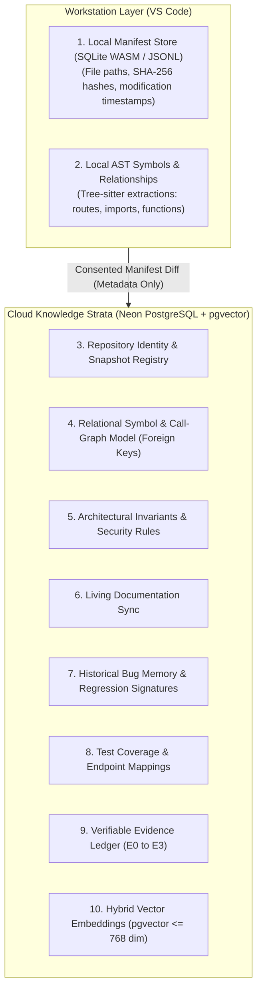

### Manifest vs. Model vs. Embeddings

- **Local Manifest**: Lives entirely on your workstation in VS Code storage (`ExtensionContext.storageUri`). Tracks file hashes and parse status.
- **Relational Model**: Lives in PostgreSQL. Holds relational tables (`symbols`, `relationships`, `routes`, `guards`) queryable by foreign key.
- **Embeddings**: Stored in `pgvector` with dimensions capped at 768 to remain within Neon Free limits. Used strictly for hybrid semantic retrieval.

---

## 6. Evidence, Not Eloquence

DevMind rejects conversational AI hallucinations. Every finding surfaced in the extension or web interface is assigned a strict **Evidence Level**:

| Level  | Classification           | Meaning                                                                    | UI Representation         |
| ------ | ------------------------ | -------------------------------------------------------------------------- | ------------------------- |
| **E0** | **Direct Fact**          | Proven statically by an AST parser (e.g. route exists at line 14).         | Ground truth              |
| **E1** | **Pattern Heuristic**    | Pattern match indicating potential risk (e.g. auth present, role missing). | Prefixed with `Possible:` |
| **E2** | **Model-Verified Proof** | Multi-file graph invariant verified by cloud relational engine.            | Verified Invariant        |
| **E3** | **Formal Proof**         | Mathematically proven invariant. Reserved for future release.              | _Never emitted in v1_     |

> [!IMPORTANT]
> Diagnostics and findings with evidence level **E1** are always prefixed with `Possible:` per specification ([docs/06](docs/06-vscode-extension-and-local-scanning.md)). Status is never conveyed by color alone.

---

## 7. System Architecture

DevMind is built as a modular monolith deployed across free-tier profiles (ADR-046).

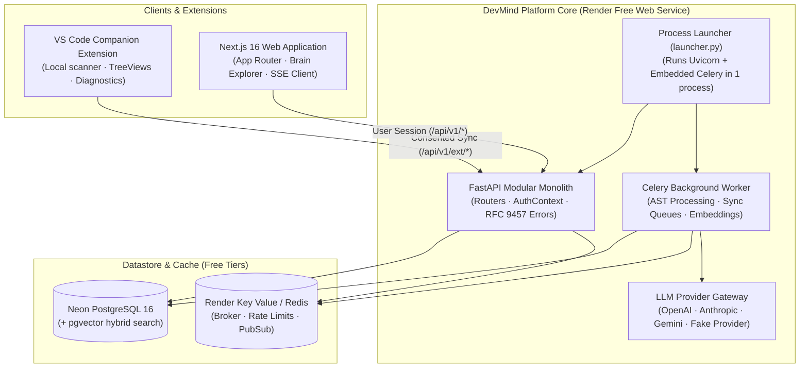

### Scan & Consent Sequence

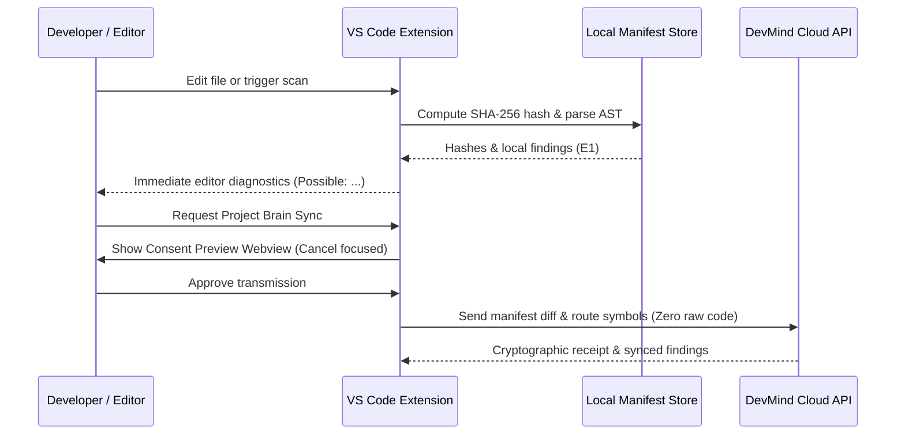

---

## 8. Privacy by Design & Data Boundary

DevMind operates under strict, verifiable data boundaries governed by **ADR-022** and **ADR-047**.

### Synchronization Modes

| Dimension             | `metadata_only` (Default)                           | `indexed` (Explicit Project Opt-in)    |
| --------------------- | --------------------------------------------------- | -------------------------------------- |
| **What Uploads**      | Manifest diffs, symbol signatures, route invariants | Plus consented, redacted source chunks |
| **Raw Code Chunks**   | **Strictly Zero (Never leaves machine)**            | Stored in encrypted database           |
| **Vector Embeddings** | None                                                | Computed over consented chunks         |
| **LLM Reasoning**     | Grounded in structured facts & route schemas        | Grounded in facts + consented snippets |
| **Consent Model**     | Per-workspace review                                | Project-level consent record           |

### Data Transmission Ledger

| Category                               | Stays Local               | Stored in Cloud                       | Embedded | Reaches LLM?            |
| -------------------------------------- | ------------------------- | ------------------------------------- | -------- | ----------------------- |
| **File contents on disk**              | :heavy_check_mark: Always | :x: Never (in default mode)           | :x:      | Only consented snippets |
| **Absolute paths / usernames**         | :heavy_check_mark: Always | :x: Never                             | :x:      | :x: Never               |
| **Repo-relative paths & hashes**       | Copy                      | :heavy_check_mark: (Metadata)         | :x:      | As structured facts     |
| **Symbols & route signatures**         | Copy                      | :heavy_check_mark: (Metadata)         | :x:      | As structured facts     |
| **Credential files (`.env*`, `.pem`)** | :heavy_check_mark: Always | :x: Never (Path-only finding)         | :x:      | :x: Never               |
| **Source secrets (tokens, keys)**      | Local                     | Replaced with `[REDACTED:type:hash8]` | :x:      | Redacted                |

---

## 9. Technology Stack & Decision Records

Every major architectural choice is governed by an **Architectural Decision Record (ADR)** in [docs/12-architecture-decisions-and-open-questions.md](docs/12-architecture-decisions-and-open-questions.md):

| Domain                   | Choice                                 | Rationale                                                                   | Governing ADR                                                                                                             |
| ------------------------ | -------------------------------------- | --------------------------------------------------------------------------- | ------------------------------------------------------------------------------------------------------------------------- |
| **Web Client**           | Next.js 16 (App Router) + Tailwind CSS | React Server Components, zero secrets on client, rapid initial loads.       | [ADR-002](docs/12-architecture-decisions-and-open-questions.md#adr-002-nextjs-typescript-frontend-separate-deploy)        |
| **Backend API**          | FastAPI + Pydantic v2 (Python 3.12)    | Asynchronous I/O, native OpenAPI spec generation, strict schema boundaries. | [ADR-004](docs/12-architecture-decisions-and-open-questions.md#adr-004-fastapi-modular-monolith-on-render-with-docker)    |
| **Extension**            | VS Code Extension API + esbuild        | Fast packaging, zero heavy dependencies, local-first responsiveness.        | [ADR-021](docs/12-architecture-decisions-and-open-questions.md#adr-021-local-first-scanning-selective-synchronization)    |
| **Database**             | Neon PostgreSQL 16 + pgvector          | Hybrid relational model + vector search on serverless Postgres.             | [ADR-007](docs/12-architecture-decisions-and-open-questions.md#adr-007-postgresql-on-neon-with-pgvector)                  |
| **Task Queue**           | Celery + Render Key Value (Redis)      | Reliable asynchronous background task execution on free infrastructure.     | [ADR-005](docs/12-architecture-decisions-and-open-questions.md#adr-005-api-and-worker-are-separate-deployables)           |
| **Agent Orchestration**  | LangGraph                              | Stateful multi-step agent reasoning, branching, and human approval gates.   | [ADR-006](docs/12-architecture-decisions-and-open-questions.md#adr-006-langgraph-for-agents-services-for-everything-else) |
| **Free Tier Deployment** | Vercel Hobby + Render Free + Neon      | 100% sustainable operations on zero-dollar free cloud tiers.                | [ADR-046](docs/12-architecture-decisions-and-open-questions.md#adr-046-free-only-constraint-and-free-deployment-profile)  |
| **Public Repository**    | GitHub Public (`Warish-Labs/DevMind`)  | Total open-source transparency; zero private secrets committed.             | [ADR-047](docs/12-architecture-decisions-and-open-questions.md#adr-047-repository-ownership-and-visibility)               |

---

## 10. Repository Structure

This monorepo is managed with **pnpm workspaces** (Node.js 24) and **uv** (Python 3.12):

```text
DevMind/
├── .github/                   # CI/CD workflows (ci-gate, CodeQL, main-push-guard)
├── brand/                     # Brand design tokens, SVG lockups, icons, and brand guide
├── client/                    # Next.js 16 App Router website & Brain explorer
│   ├── app/                   # App Router pages and API routes
│   ├── components/            # Design system components, hero, and walkthrough
│   ├── tests/                 # Vitest unit & accessibility tests
│   └── e2e/                   # Playwright end-to-end integration tests
├── common/                    # @devmind/common: Shared Zod schemas, tokens, and data
├── extension/                 # VS Code Companion extension (devmind-vscode)
│   ├── src/views/             # 5 TreeView providers (Findings, Structure, Scan, Sync, DB)
│   ├── src/services/          # DiagnosticsCollection, StatusBar, Logger, Settings
│   └── tests/                 # Extension unit and packaging tests
├── server/                    # FastAPI modular monolith & Celery workers (Milestone M1)
├── evals/                     # Ground-truth scanner fixtures (Express, FastAPI)
├── infra/                     # Docker Compose local development environment
├── scripts/                   # Test runner, brand sync, and doc link checkers
└── docs/                      # Authoritative specifications, ADRs, and runbooks
```

---

## 11. Getting Started

### Prerequisites

- **Node.js**: `v24.22.0+`
- **pnpm**: `v12.11.2+`
- **Python**: `3.12+` with `uv` installed (`v0.12.17+`)
- **VS Code**: `^1.90.0` (for companion extension development)

### Installation

```bash
# 1. Clone the public repository
git clone https://github.com/Warish-Labs/DevMind.git
cd DevMind

# 2. Install workspace dependencies
pnpm install

# 3. Verify workspace health & execute test suite
pnpm verify
```

### Running the Web Platform

```bash
# Start Next.js client development server
pnpm dev:client
# Open http://localhost:3000 in your browser
```

### Installing the VS Code Extension

Install the official companion extension directly from the [Visual Studio Marketplace](https://marketplace.visualstudio.com/items?itemName=WarishLabs.devmind-vscode):

```bash
# Install via VS Code CLI:
code --install-extension WarishLabs.devmind-vscode
```

Or inside VS Code:

1. Press `Ctrl+P` (or `Cmd+P` on macOS) to open the Quick Open palette.
2. Enter:
   ```text
   ext install WarishLabs.devmind-vscode
   ```
3. Press `Enter`.

### Developing the VS Code Extension Locally

1. Open the repository root in VS Code: `code .`
2. Press `F5` to launch the **Extension Development Host**.
3. In the host window, open `evals/scanner/fixtures/express-admin`.
4. Inspect the **DevMind Activity Bar** container to explore all 5 live views with fixture data.

---

## 12. Quality Verification & Testing

Every pull request and push is guarded by an integrated fast test runner:

```bash
# Run fast test suite (lint, typecheck, unit tests, brand drift, packaging)
pnpm verify

# Run documentation relative link validator
pnpm docs:links

# Run brand asset consistency validator
pnpm brand:check

# Run Playwright full browser integration tests
pnpm test:e2e
```

Full details on test layout and evaluation baselines are documented in [docs/09-testing-and-quality-strategy.md](docs/09-testing-and-quality-strategy.md).

---

## 13. Branching, CI & Deployment

- **Branching Strategy**: Branch-per-slice (`feature/s1-*`, `feature/s2-*`, `feature/m1-*`).
- **Commit Standards**: Conventional Commits (`feat(...)`, `test(...)`, `docs(...)`, `fix(...)`).
- **CI Status Gate**: The `ci-gate` job aggregates linting, typing, unit testing, and link integrity into a single mandatory GitHub check.
- **Hosting Topology (ADR-046 Free Profile)**:
  - Client deployed to **Vercel Hobby**.
  - Backend API deployed as **one Render Free Web Service** with `DEVMIND_RUN_MODE=all` (embedded Celery worker).
  - _Note on free profile_: The Render free web service spins down after 15 minutes of inactivity. First requests after sleep can take ~60–90 seconds while the instance wakes. The web client and extension display a graceful _"Server waking up..."_ state.

---

## 14. Roadmap & Honest Status

All progress is tracked against [PLAN.md](PLAN.md) and recorded in [BRAIN.md](BRAIN.md):

| Phase        | Milestone  | Focus Area                                                                         | Status          | Verified Commit |
| ------------ | ---------- | ---------------------------------------------------------------------------------- | --------------- | --------------- |
| **Phase P0** | **B1–B3**  | Monorepo layout, ADRs 001–049, tooling, brand, and CI gate                         | **Complete**    | `c2a6327`       |
| **Phase S1** | **B4–B8**  | Screenshot-first Next.js homepage, custom cursor, trace explorer                   | **Complete**    | `351880d`       |
| **Phase S2** | **B9–B12** | VS Code companion UI shell, 5 views, diagnostics, consent webview, VSIX packaging  | **Complete**    | `7bc34c6`       |
| **Phase R1** | **B13**    | Professional GitHub showcase README, setup guide verification, personal repo guide | **Complete**    | `0ba4d5d`       |
| **Phase M**  | **M1**     | Server foundation (FastAPI app factory, Dockerfile, render.yaml, free launcher)    | **Complete**    | `537a3bc`       |
| **Phase M**  | **M2**     | Authentication (Clerk), workspaces, projects, database schemas, and permissions    | **In Progress** | Active          |
| **Phase M**  | **M3**     | VS Code extension real local tree-sitter scanning (replaces fixture source)        | Planned         |                 |
| **Phase M**  | **M4–M13** | Project Brain ingestion, hybrid RAG, LangGraph agents, and release hardening       | Planned         |                 |

<details>
<summary><strong>Click to expand Milestone M1–M13 Details</strong></summary>

- **M1 · Repository Foundation & Docker**: FastAPI app factory, Docker Compose, render.yaml Blueprint.
- **M2 · Auth & Multi-Tenancy**: Clerk authentication, workspace tenant isolation, Neon DB schemas.
- **M3 · Local AST Scanning**: Tree-sitter WASM parser in VS Code extension, local SQLite manifest.
- **M4 · Project Brain Ingestion**: Cloud manifest diffing, snapshot logic, relationship extraction.
- **M5 · Hybrid Retrieval & pgvector**: Consent-governed chunking, embeddings, reciprocal rank fusion.
- **M6 · LLM Gateway**: Provider adapter abstraction, quotas, token usage tracking.
- **M7 · LangGraph Agents**: CodeMate, AuthCheck, and Verifier agent state machines.
- **M8 · Web Application**: Authenticated dashboard, conversation interface, live SSE streaming.
- **M9 · Privacy Controls**: Granular sync toggles, data retention windows, purge queues.
- **M10 · Hardening & Observability**: Cross-tenant authorization matrix tests, OpenTelemetry traces.
- **M11 · PR & Review Intelligence**: GitHub webhook handlers, blast-radius reviews (v1.1).
- **M12 · Bug Memory & Living Docs**: Historical bug correlation, Living Documentation engine (v1.2–v1.4).
- **M13 · Production Readiness**: Release packaging, final performance audit, and launch.

</details>

---

## 15. Documentation Index

The repository contains 18 comprehensive technical specifications and operational runbooks in [`docs/`](docs/00-documentation-index.md):

| Document                                                                                                     | Topic                                                              |
| ------------------------------------------------------------------------------------------------------------ | ------------------------------------------------------------------ |
| [docs/00-documentation-index.md](docs/00-documentation-index.md)                                             | Master documentation sitemap and cross-reference index             |
| [docs/01-product-requirements.md](docs/01-product-requirements.md)                                           | Product vision, nine capabilities, and release criteria            |
| [docs/02-system-architecture.md](docs/02-system-architecture.md)                                             | Monolith architecture, layer boundaries, and import constraints    |
| [docs/03-data-model-and-api.md](docs/03-data-model-and-api.md)                                               | Database schemas, RFC 9457 error codes, and REST endpoints         |
| [docs/04-project-brain-and-rag.md](docs/04-project-brain-and-rag.md)                                         | Ingestion pipeline, AST symbols, chunking, and pgvector retrieval  |
| [docs/05-agents-and-llm-workflows.md](docs/05-agents-and-llm-workflows.md)                                   | LangGraph multi-agent workflows and evidence verification          |
| [docs/06-vscode-extension-and-local-scanning.md](docs/06-vscode-extension-and-local-scanning.md)             | Extension architecture, tree views, diagnostics, and sync protocol |
| [docs/07-security-privacy-and-threat-model.md](docs/07-security-privacy-and-threat-model.md)                 | Threat model, secret redaction, and prompt injection defense       |
| [docs/08-ui-ux-design-specification.md](docs/08-ui-ux-design-specification.md)                               | Design tokens, typography, motion system, and accessibility rules  |
| [docs/09-testing-and-quality-strategy.md](docs/09-testing-and-quality-strategy.md)                           | Test hierarchy, evaluation harnesses, and ground-truth fixtures    |
| [docs/10-deployment-and-operations.md](docs/10-deployment-and-operations.md)                                 | Free-tier deployment profile (Render + Vercel + Neon)              |
| [docs/11-mvp-and-implementation-roadmap.md](docs/11-mvp-and-implementation-roadmap.md)                       | Milestone specifications from M1 through M13                       |
| [docs/12-architecture-decisions-and-open-questions.md](docs/12-architecture-decisions-and-open-questions.md) | Register of 49 accepted Architectural Decision Records (ADRs)      |
| [docs/13-glossary-and-domain-terminology.md](docs/13-glossary-and-domain-terminology.md)                     | Standard domain glossary and terminology definitions               |
| [docs/SETUP-GUIDE.md](docs/SETUP-GUIDE.md)                                                                   | Step-by-step developer and owner operational setup manual          |
| [brand/BRAND-GUIDE.md](brand/BRAND-GUIDE.md)                                                                 | DevMind visual identity, typography, tokens, and lockup rules      |

---

## 16. Security Policy

Security is a foundational tenet of DevMind. Please review [SECURITY.md](SECURITY.md) for our vulnerability disclosure guidelines.

- Repository code is treated as **untrusted input**; neither the server nor the extension ever runs untrusted project scripts (docs/07 §15).
- Tenant queries are strictly scoped by `workspace_id` and `project_id`.
- Credentials and private tokens are masked prior to indexing or transmission.

---

## 17. License & Credits

### License

This repository is licensed under the [MIT License](LICENSE).

### Credits & Typography

- **IBM Plex Sans**: Neutral UI and body typography (SIL Open Font License).
- **JetBrains Mono**: Code and terminal monospace typography (SIL Open Font License).
- **Instrument Serif**: Editorial and display serif typography (SIL Open Font License).
- Built by **[WarishLabs](https://warishlabs.in)** · Personal showcase: [@mdwarishansari/DevMind](https://github.com/mdwarishansari/DevMind).
