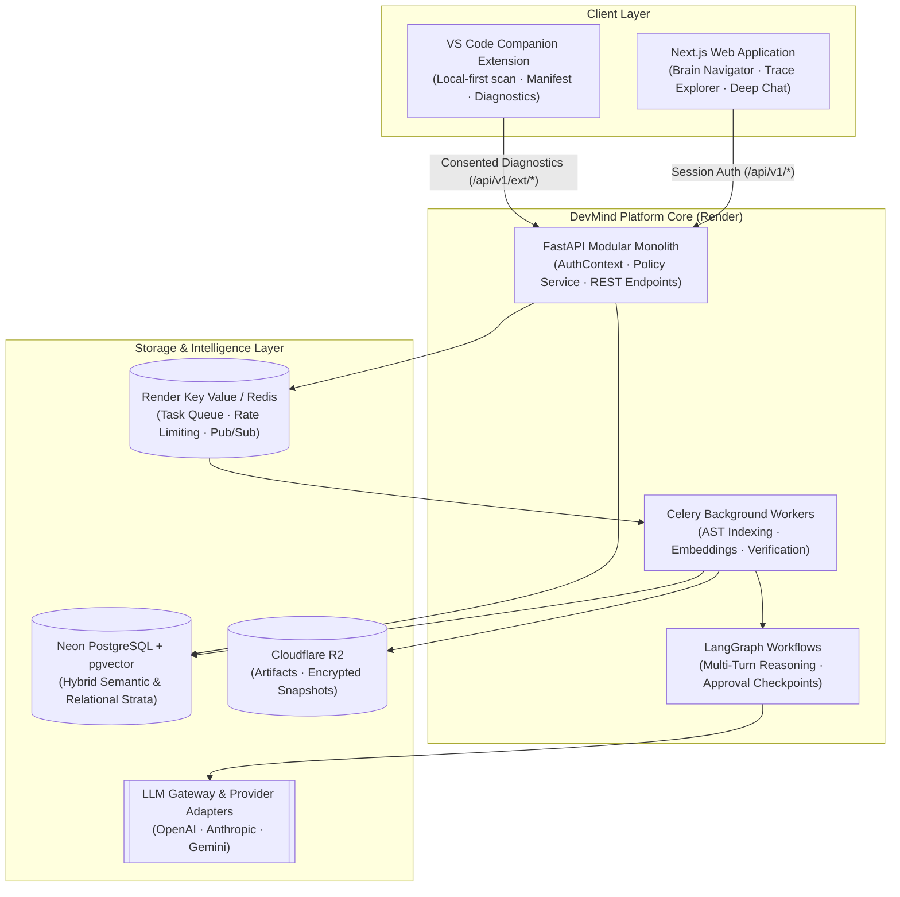

<p align="center">
  <picture>
    <source media="(prefers-color-scheme: dark)" srcset="brand/svg/devmind-lockup-horizontal-for-dark.svg">
    <source media="(prefers-color-scheme: light)" srcset="brand/svg/devmind-lockup-horizontal-for-light.svg">
    
  </picture>
</p>

<h3 align="center">Continuous Project Brain · Deterministic Code Tracing · Local-First Companion</h3>

<p align="center">
  <a href="https://github.com/Warish-Labs/DevMind/actions/workflows/ci.yml"></a>
  <a href="https://github.com/Warish-Labs/DevMind/actions/workflows/codeql.yml"></a>
  
  
  
  
  
</p>

<p align="center">
  <a href="https://devmind.warishlabs.in"><strong>Live Platform</strong></a> ·
  <a href="docs/00-documentation-index.md"><strong>Documentation</strong></a> ·
  <a href="docs/02-system-architecture.md"><strong>Architecture</strong></a> ·
  <a href="docs/SETUP-GUIDE.md"><strong>Setup Guide</strong></a> ·
  <a href="docs/07-security-privacy-and-threat-model.md"><strong>Security & Threat Model</strong></a> ·
  <a href="CONTRIBUTING.md"><strong>Contributing</strong></a>
</p>

---

## 1. What is DevMind?

**DevMind** is an agentic software engineering system that maintains a shared, continuously synchronized mental model of an entire codebase—the **Project Brain**.

Traditional developer tools treat linting, security scans, review comments, documentation, and deployment debugging as fragmented silos. When an authentication handler changes in one route, its ripple effects across API permissions, architectural invariants, test coverage, and living documentation are lost.

DevMind changes this paradigm:

1. **One Project Brain**: A version-aware knowledge strata linking AST symbols, call graphs, security boundaries, documentation, and bug history.
2. **Deterministic-First Analysis**: Static parsers and deterministic linters establish ground truth; LLMs are reserved for semantic reasoning and architectural explanation.
3. **Evidence-Based Findings**: Every finding is scored with rigorous evidence levels (**E0 to E3**). AI never presents speculative hunches as proven defects.
4. **Local-First Privacy**: The VS Code companion scans on your machine and never transmits source code to the cloud without explicit, recorded consent.

---

## 2. High-Level Architecture

DevMind is composed of a Next.js web application, a FastAPI modular monolith backend with Celery workers, a companion VS Code extension, and shared core packages.



---

## 3. The Nine Intelligence Capabilities

DevMind structures software engineering intelligence into nine core capabilities:

| ID         | Capability                    | Description                                                                         | Release |
| ---------- | ----------------------------- | ----------------------------------------------------------------------------------- | ------- |
| **CAP-01** | **Code Intelligence**         | Deep semantic search, call-graph navigation, and AST symbol tracing across versions | **MVP** |
| **CAP-02** | **Security Intelligence**     | Authentication & authorization vulnerability detection with verifiable evidence     | **MVP** |
| **CAP-03** | **Bug Memory**                | Automatic regression memory; links past bug fixes to newly proposed code diffs      | v1.2    |
| **CAP-04** | **Living Documentation**      | Continuously self-updating architectural docs; detects documentation decay on PRs   | v1.2    |
| **CAP-05** | **Code Review Intelligence**  | Architectural blast-radius reviews; flags cross-boundary invariant violations       | v1.1    |
| **CAP-06** | **Pull Request Intelligence** | Multi-file risk scoring and automated rollback / mitigation generation              | v1.1    |
| **CAP-07** | **Deployment Diagnosis**      | Correlates production error logs and stack traces directly back to Brain AST nodes  | v1.4    |
| **CAP-08** | **Project Mentor**            | Onboarding guide; explains unfamiliar patterns and organizational invariants        | v1.3    |
| **CAP-09** | **Project Evaluation**        | Measurable codebase health scores covering modularity, test quality, and tech debt  | v1.3    |

---

## 4. The Companion VS Code Extension

The DevMind extension is a lightweight, local-first companion designed around privacy and zero bloat:

- **Local scanning only**: Extracts AST and manifest diagnostics without live database connections or direct LLM dependencies.
- **Strict consent barrier**: Source code never leaves your workstation unless you explicitly review and approve a redacted snippet transmission.
- **In-editor diagnostics**: Surfaced directly in the Problems tab (`devmind.authz.*`) with clickable deep links to the Web Platform for full trace inspection.

---

## 5. Repository Structure

This monorepo is managed via **pnpm workspaces** and enforces strict layer boundaries:

```text
DevMind/
├── .github/                   # Workflows (ci-gate, CodeQL, main-guard, dependabot)
├── brand/                     # Design tokens, SVG/PNG logos, brand sheet, and icons
├── client/                    # Next.js 16 App Router website (TypeScript strict)
├── common/                    # @devmind/common: Zod schemas, tokens, and data models
├── extension/                 # VS Code Companion extension (TypeScript)
├── server/                    # FastAPI modular monolith + Celery workers (Python 3.12)
├── evals/                     # Retrieval & scanner eval suites with ground truth fixtures
├── infra/                     # Local developer infrastructure (Docker Compose)
├── scripts/                   # Verification runners, brand sync, and link checkers
└── docs/                      # Architectural Decisions (ADRs), specifications, runbooks
```

---

## 6. Development & Quality Verification

DevMind uses a unified test runner with automatic report logging.

```bash
# 1. Install workspace dependencies
pnpm install

# 2. Fast verification (lint, typecheck, unit tests, brand drift check)
pnpm verify

# 3. Check and sync brand assets
pnpm brand:check
pnpm brand:sync

# 4. Run client in development
pnpm dev:client
```

### Quality Gates

- **`ci-gate`**: Single mandatory status check in GitHub Actions; executes lint, types, unit tests, security audits, and docs verification across all PRs.
- **Conventional Commits**: Enforced on git commit and PR titles via `@commitlint/cli` and `pr-title.yml`.
- **Pre-Push Guard**: Local hook preventing accidental direct pushes to `main` and ensuring all tests pass before pushing.

---

## 7. Security & Non-Negotiable Tenets

1. **Untrusted Code Isolation**: Customer/repository code is treated as completely untrusted input (prompt injection and remote code execution risk). It is never executed in production environments (docs/07 §15).
2. **Deterministic Redaction**: Proprietary secrets, credentials, and API keys are scrubbed prior to any LLM prompt submission.
3. **Free-Tier Sustainability (ADR-046)**: Designed and verified to deploy on free cloud tiers (Vercel Hobby, Render Free Web Service + Key Value, Neon PostgreSQL Free).
4. **Public Repository Transparency (ADR-047)**: All code is open and audited; zero private secrets or proprietary user source data are committed.

---

## 8. Roadmap & Current Status

- [x] **Phase P0 · Layout & ADRs**: Monorepo structure, 47 ADRs, and brand system established.
- [x] **Phase P0 · Tooling & Common**: pnpm workspace, `@devmind/common`, git hooks, and `test-all` runner.
- [x] **Phase P0 · CI & GitHub**: GitHub Actions suite, CodeQL analysis, and `ci-gate` aggregator.
- [~] **Phase S1 · Home Page**: Screenshot-first Next.js homepage with scripted Trace sequence, Brain strata, and custom motion.
- [ ] **Phase S2 · VS Code Extension**: Companion extension UI shell with local diagnostics and consent preview.
- [ ] **Milestone M1 · Server Core**: FastAPI modular monolith with PostgreSQL + pgvector and Celery worker.

---

## 9. License

This repository is currently UNLICENSED. All rights reserved. Formal open-source licensing will be determined prior to public v1.0 release (see ADR-Open).
