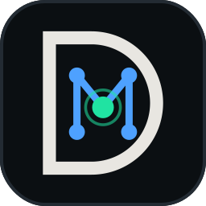

<p align="center">
  <picture>
    <source media="(prefers-color-scheme: dark)" srcset="../brand/svg/devmind-icon-dark.svg">
    <source media="(prefers-color-scheme: light)" srcset="../brand/svg/devmind-icon-light.svg">
    
  </picture>
</p>

<h2 align="center">DevMind Web Platform</h2>

<p align="center">
  <strong>Next.js 16 App Router · TypeScript Strict · Tailwind CSS · WAAPI Motion System</strong>
</p>

<p align="center">
  <a href="#overview">Overview</a> ·
  <a href="#design-system--tokens">Design System</a> ·
  <a href="#getting-started">Getting Started</a> ·
  <a href="#testing--verification">Testing</a> ·
  <a href="#structure">Structure</a>
</p>

---

## Overview

The `client/` package hosts the official **DevMind Web Application**. It is the primary developer interface for exploring the **Project Brain**, inspecting evidence-grounded code traces, initiating deep multi-turn architectural conversations, reviewing security findings, and tracking living documentation.

### Core Architectural Principles

- **No Direct Database Access**: All persistence flows exclusively through the DevMind FastAPI gateway via typed REST APIs (`@devmind/common`).
- **No Client Secrets**: Authentication is managed securely via Clerk session tokens; zero third-party AI provider keys are exposed to the client.
- **Strict Accessibility (WCAG 2.1 AA)**: Skip links, keyboard navigation traps avoided, proper landmark regions, and automated `axe-core` verification.
- **Reduced-Motion First**: All micro-interactions, cursor animations, and hero sequences honor `prefers-reduced-motion` immediately.

---

## Design System & Tokens

DevMind employs a custom, brand-aligned visual identity rooted in precision engineering aesthetics:

- **Tokens Source of Truth**: The design tokens originate in [`brand/tokens/tokens.json`](../brand/tokens/tokens.json) and are compiled into [`client/app/tokens.css`](app/tokens.css) via `pnpm brand:sync`.
- **No Hard-Coded Hex**: Components must never contain hard-coded hex colors. All styles reference CSS variables (`var(--devmind-*)`) or Tailwind preset utilities.
- **Typography**:
  - Headings & Editorial: _Instrument Serif_ (self-hosted)
  - UI & Body: _IBM Plex Sans_ (self-hosted)
  - Code & AST Traces: _JetBrains Mono_ (self-hosted)

---

## Getting Started

Run the client application from the monorepo root:

```bash
# Start development server on http://localhost:3000
pnpm dev:client

# Or directly from client directory
cd client
pnpm dev
```

### Environment Configuration

Copy the provided environment template:

```bash
cp .env.example .env.local
```

| Variable                            | Description                                                                |
| ----------------------------------- | -------------------------------------------------------------------------- |
| `NEXT_PUBLIC_CLERK_PUBLISHABLE_KEY` | Clerk public authentication key                                            |
| `NEXT_PUBLIC_API_URL`               | Base URL of the DevMind FastAPI backend (default: `http://localhost:8000`) |

---

## Testing & Verification

The client package enforces automated type safety, unit testing, and browser automation:

```bash
# Run TypeScript compilation check
pnpm --filter client typecheck

# Run ESLint check
pnpm --filter client lint

# Run Vitest unit tests
pnpm --filter client test

# Run Playwright end-to-end tests (headless Chromium)
pnpm --filter client exec playwright test
```

---

## Structure

```text
client/
├── app/                       # Next.js App Router
│   ├── globals.css            # Base styles and reset
│   ├── tokens.css             # Synced DevMind design tokens (brand/tokens)
│   ├── layout.tsx             # Root layout with header, gutter rail, and footer
│   ├── page.tsx               # Homepage with hero Trace sequence & Brain strata
│   ├── early-access/          # Waitlist and early access registration
│   └── not-found.tsx          # Custom 404 page
├── components/                # Modular React components
│   ├── brain/                 # Project Brain interactive strata explorer
│   ├── hero/                  # Hero Trace with scripted WAAPI sequence
│   ├── layout/                # Gutter rail, header, footer, navigation
│   └── ui/                    # Buttons, modals, tooltips, diff view
├── lib/
│   ├── motion/                # Custom cursor, reveal animations, reduced-motion hooks
│   └── api/                   # Typed API client connected to backend
├── public/                    # Static assets, self-hosted fonts, favicons, OG images
└── tests/                     # Vitest unit and Playwright e2e test suites
```
