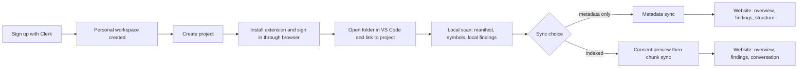

# 01 · Product Requirements

**Purpose.** Defines *what* DevMind must do and for whom, which parts belong to the MVP, and how each requirement is accepted. *How* it is built is in [02](02-system-architecture.md) and later documents. This PRD is authoritative for product scope.

**Status.** Specification only. No requirement below is implemented. Terms follow the [glossary](13-glossary-and-domain-terminology.md). Decision IDs refer to [12](12-architecture-decisions-and-open-questions.md).

**Source.** Original vision: `DevMind_Project_Document.md`. Items that go beyond it are marked *(design recommendation)*.

---

## 1. Executive summary

DevMind is an agentic AI software engineering system that maintains a shared, continuously updated understanding of a software project (the **Project Brain**) and uses specialized agents to help developers understand code, find potential security weaknesses, investigate bugs, remember previous fixes, keep documentation consistent, review changes and pull requests, diagnose deployment failures, prioritize work, and evaluate project health and release readiness.

Its differentiator is not nine tools. It is nine capabilities sharing one understanding, so that something found in one place (an authorization gap) becomes immediately useful in others (a review comment, a documentation gap, a task, a health score).

Two interfaces: the **website** (primary: conversations, reports, project management) and the **VS Code extension** (companion: local scanning, diagnostics, synchronization control). See ADR-001.

## 2. Vision and mission

- **Vision.** Every developer has an engineering teammate that remembers the whole project, never skims, and always shows its evidence.
- **Mission.** Remove the disconnection between development, security, bugs, documentation, review and deployment by giving them one shared, evidence-based model of the project.

## 3. Problem statement

From the source document, the problems are connected but handled separately today:

| Developer question | Today |
|---|---|
| What does this codebase do? | Read files, ask a teammate |
| Is this endpoint actually protected? | Trace auth logic by hand |
| Have I seen this bug before? | Memory, old chats, search |
| Did this change make the docs wrong? | Nobody checks |
| Is this PR safe to merge? | A tired reviewer skimming |
| Why does it work locally but fail in production? | Logs and guesswork |
| What should I do next? | Gut feeling |
| Is this project ready to ship? | Nobody really knows |

Root causes: codebases outgrow memory; authentication is confused with authorization; bugs have no memory; documentation decays silently; review quality varies with the reviewer; PRs hide blast radius; deployment failures waste time; direction drifts; no unified health answer exists.

## 4. Target users and personas

| Persona | Context | What they need from DevMind |
|---|---|---|
| **Solo / student developer** (primary for v1) | Builds full-stack apps alone; no reviewer; ships under time pressure | A second pair of eyes on auth and structure, memory of past bugs, a sense of priority |
| **Small-team developer** | 2–8 people, informal review | Consistent review criteria, PR blast-radius summaries, docs that stay current |
| **Reviewer / tech lead** | Reviews many PRs | Fast change-impact view, evidence-backed findings |
| **New contributor** | Joins an unfamiliar codebase | Grounded answers to "how does X work" with file references |
| **Workspace admin** | Manages access and privacy | Control over who sees a project, what leaves the machine, retention, usage limits |

## 5. Jobs to be done

1. When I open an unfamiliar codebase, I want grounded answers about how it works so I can contribute in hours, not days.
2. When I add or change a sensitive route, I want to know whether authorization is enforced so I do not ship a hole.
3. When an error appears, I want to know if this project has seen it and how it was fixed.
4. When I merge code, I want to know whether docs and tests still match.
5. When I open a PR, I want to see what it can affect before a reviewer does.
6. When a deployment fails, I want the probable cause and next step, not just a log.
7. When I sit down to work, I want to know the next most valuable task.
8. When I consider shipping, I want an honest verdict with reasons.
9. When I use AI on my code, I want to know exactly what leaves my machine and to be able to stop it.

## 6. Use cases (end-to-end)

| ID | Use case | Capabilities involved |
|---|---|---|
| UC-1 | Onboard a local project, scan, ask "How does authentication work?" | CAP-01 |
| UC-2 | Add an admin route; see the missing-authorization finding in VS Code; open the evidence on the website | CAP-02 |
| UC-3 | Open a PR; receive a summary with change impact, a security finding, a review finding and a docs gap | CAP-06, CAP-02, CAP-05, CAP-04 |
| UC-4 | Paste a failing deployment log; get probable cause and a similar past incident | CAP-07, CAP-03 |
| UC-5 | Ask "Is this ready to deploy?"; Agent Manager runs security, review, bug, docs and deployment checks and returns one verdict | CAP-09 plus others |
| UC-6 | Ask "What should I work on today?" | CAP-08 |
| UC-7 | Revoke consent and delete a project's synchronized data | Privacy controls |

The complete walkthrough in the vision (§6 of the source) is the reference for UC-3 and UC-5 and is reproduced as the homepage story in [08](08-ui-ux-design-specification.md).

## 7. Product principles

1. **Evidence over eloquence.** Every finding cites locations and a verifiable basis. See ADR-024.
2. **Human decides.** DevMind recommends; the developer approves anything that matters.
3. **Local first, send less.** Scan locally; transmit only what a task needs, redacted, with consent.
4. **One brain.** A result in one workflow is available to the others without re-analysis.
5. **Detect is not prove.** The product says "possible" when it is possible.
6. **Deterministic where possible, LLM where useful.** Scanners find; models explain and reason over evidence.
7. **Honest uncertainty.** Confidence is stated; no invented scores or guarantees.
8. **Useful before comprehensive.** Ship a vertical slice that works end to end.

## 8. Functional requirements

Priority: **M** = MVP, **R1.1–R1.4** = later releases (see §14), **F** = future. IDs are stable; reference them in code comments, tests and commits.

### 8.1 Platform and account

| ID | Requirement | Pri |
|---|---|---|
| FR-PLT-01 | Users sign in on the website through Clerk; the API verifies tokens server-side on every request. | M |
| FR-PLT-02 | Each user has a personal workspace created on first sign-in. | M |
| FR-PLT-03 | Users can create projects in a workspace and see only projects they are authorized for. | M |
| FR-PLT-04 | Workspace roles (`owner`, `admin`, `member`, `viewer`) and project roles are enforced by explicit permission checks on every sensitive operation. | M |
| FR-PLT-05 | Workspace invitations and multi-user membership management. | R1.1 |
| FR-PLT-06 | Usage is recorded per workspace, project, job and LLM task, and quotas are configurable and visible. | M |
| FR-PLT-07 | Audit events are recorded for sensitive actions (membership changes, consent changes, deletions, token issuance and revocation, integration changes). | M |

### 8.2 Project onboarding and Brain

| ID | Requirement | Pri |
|---|---|---|
| FR-BRN-01 | A project can be created and linked to a local workspace through the extension. | M |
| FR-BRN-02 | The Project Brain stores file records, file versions, symbols, relationships, chunks (when consented), embeddings (when consented), findings, history. | M |
| FR-BRN-03 | Changes update the Brain incrementally using content hashes; unchanged files are never re-uploaded or re-embedded. | M |
| FR-BRN-04 | Derived data tied to superseded file versions is marked stale and cleaned up per retention rules. | M |
| FR-BRN-05 | Every answer or finding that cites code resolves to a real file version, path and line range. | M |
| FR-BRN-06 | The website shows Brain contents: structure, files, symbols, relationships, snapshots. | M |
| FR-BRN-07 | Projects can be sourced from a GitHub repository. | R1.1 |

### 8.3 Website

| ID | Requirement | Pri |
|---|---|---|
| FR-WEB-01 | Public homepage describing real capabilities; no fabricated metrics, logos or testimonials. | M |
| FR-WEB-02 | Workspace and project selection; project overview with findings summary. | M |
| FR-WEB-03 | AI conversation scoped to a project, streaming responses, citations as clickable references. | M |
| FR-WEB-04 | Findings list and detail with evidence, severity, confidence, evidence level, status transitions. | M |
| FR-WEB-05 | Project Brain explorer (files, symbols, relationships). | M |
| FR-WEB-06 | Settings: project, sync mode, consent, retention, members, integrations, account and privacy. | M (subset) |
| FR-WEB-07 | Job center: live status, cancellation, failure reasons. | M |
| FR-WEB-08 | Bug history, documentation analysis, PR views, deployment diagnosis, tasks, health and release-readiness screens. | per capability |

### 8.4 VS Code extension

| ID | Requirement | Pri |
|---|---|---|
| FR-EXT-01 | Detect the opened workspace and offer to link it to a DevMind project. | M |
| FR-EXT-02 | Discover files using ignore rules and size limits; never read excluded paths. | M |
| FR-EXT-03 | Maintain a local manifest with hashes; scan incrementally on change. | M |
| FR-EXT-04 | Run language-aware local analysis for TypeScript/JavaScript and Python. | M |
| FR-EXT-05 | Show findings as VS Code diagnostics with locations and a findings view. | M |
| FR-EXT-06 | Show project structure and database-related information derived from project files. | M |
| FR-EXT-07 | Synchronize metadata to the backend under user control; show what will be sent. | M |
| FR-EXT-08 | Send source snippets for a user-requested cloud analysis only after a preview and explicit consent. | M |
| FR-EXT-09 | Open the matching project, finding or report on the website. | M |
| FR-EXT-10 | Scan progress and cancellation. | M |
| FR-EXT-11 | No AI chat and no full project management inside the extension in v1. | Non-goal |

### 8.5 Non-functional requirements

| ID | Requirement |
|---|---|
| NFR-SEC-01 | No cross-tenant data access. Verified by an automated authorization test suite covering every route. |
| NFR-SEC-02 | No secret appears in committed files, logs, prompts or cloud storage. Secrets detected in source are redacted before transmission. |
| NFR-SEC-03 | Repository content is treated as untrusted input at every stage, including LLM prompts. |
| NFR-SEC-04 | No execution of repository code by the backend in v1. |
| NFR-PRV-01 | Source leaves the machine only with recorded consent covering the project, provider and data category. |
| NFR-PRV-02 | Users can revoke consent and delete project data; deletion is verifiable per store. |
| NFR-REL-01 | Long work is asynchronous; job state survives API and worker restarts. |
| NFR-REL-02 | Retried jobs and repeated requests are idempotent. |
| NFR-REL-03 | Provider outages degrade gracefully: queued, retried or failed with a clear reason, never silently wrong. |
| NFR-PERF-01 | Extension scanning must not block the editor; it runs off the main extension thread and is cancellable. |
| NFR-PERF-02 | Latency and capacity targets are set only after measurement; none are promised here. |
| NFR-OBS-01 | Structured logs, traces, metrics and error reporting exist for API and workers, excluding source payloads. |
| NFR-ACC-01 | The website meets WCAG 2.2 AA for contrast, keyboard and focus, with reduced-motion support ([08](08-ui-ux-design-specification.md) §16). |
| NFR-MNT-01 | Types are shared through a generated API client; schema changes go through migrations and versioned APIs. |
| NFR-COST-01 | Cloud inference spend is bounded by configurable quotas and per-job budgets. |

## 9. The nine capabilities

Each capability preserves the intent of the source document. Phase: where it ships ([§14](#14-mvp-definition)).

### CAP-01 Code Intelligence — MVP

| | |
|---|---|
| **Purpose** | Remove "I don't understand this codebase yet." Answer plain-language questions grounded in the actual project. |
| **Inputs** | Project Brain (symbols, relationships, chunks), user question. |
| **Outputs** | Answer with citations (file, lines, symbol); optional drill-down on a function: purpose, inputs, outputs, edge cases. |
| **User behavior** | Ask on the website: "Which file handles user registration?" "How does authentication work?" |
| **Failure states** | Project not indexed or in `metadata_only` with no attached snippets → answer limited to structure, with a prompt to attach code. Retrieval returns nothing relevant → say so, do not guess. Provider unavailable → job fails with reason, may retry. |
| **Dependencies** | Brain ingestion, hybrid retrieval, LLM gateway, consent. |
| **Acceptance** | AC-CAP1-1: every code claim in an answer carries a citation that resolves to a current file version. AC-CAP1-2: on a fixture project with labeled questions, retrieval recall@k meets the baseline recorded in [09](09-testing-and-quality-strategy.md) §9. AC-CAP1-3: when context is insufficient the answer says so. |

### CAP-02 Security Intelligence — MVP (focused scope)

| | |
|---|---|
| **Purpose** | Close the gap between "logged in" and "allowed to." Report evidence, not vague warnings. |
| **Inputs** | Symbols, route definitions, middleware/dependency chains, call relationships, scanner results. |
| **Outputs** | Findings: what, where, why it matters, how serious, evidence level, confidence, suggested fix. |
| **MVP scope** | Authentication presence and authorization presence on routes for Next.js route handlers and server actions, Express, and FastAPI; hard-coded secret exposure; missing input validation on request handlers (structural check). Extended later: unsafe operations, security configuration. |
| **User behavior** | Sees diagnostics in VS Code; opens evidence and explanation on the website; changes status. |
| **Failure states** | Unsupported framework → route not analyzed, reported as "not analyzed" (never as safe). Ambiguous guard → "possible" at E1 with explanation. |
| **Dependencies** | Parsing, route detectors, verifier, LLM for explanations. |
| **Acceptance** | AC-CAP2-1: on the fixture corpus ([09](09-testing-and-quality-strategy.md) §8) every seeded missing-authorization case is reported and every safe case is not, or the miss is recorded as a known limitation. AC-CAP2-2: no finding is persisted without resolvable evidence. AC-CAP2-3: UI distinguishes possible from verified. |

Example output (sample):
```
/admin/users  (backend/app/routes/admin.py:42–58)
Authentication: required  ✔ (Depends(get_current_user))
Authorization:  no role check on the call path  ✖
Evidence level E2 · Confidence high · Severity high
Why it matters: any authenticated user can reach an administrative operation.
```

### CAP-03 Bug Memory — Release 1.2

| | |
|---|---|
| **Purpose** | Stop re-solving the same bug from zero. |
| **Inputs** | Resolved findings, user-logged bugs (error text, cause, fix, files), new errors. |
| **Outputs** | "A similar error occurred previously in module X; the previous fix was Y" with links. |
| **User behavior** | Mark a finding or issue resolved with a resolution; paste a new error to search history. |
| **Failure states** | No match → say none found; low-confidence match labelled as such. |
| **Dependencies** | Brain, error-fingerprinting, retrieval. |
| **Acceptance** | Fixture set of known recurring errors is matched at the baseline in [09](09-testing-and-quality-strategy.md); each match shows the previous resolution and files. |
| **Future** | Cross-project memory within a workspace (opt-in). |

### CAP-04 Living Documentation — Release 1.2

| | |
|---|---|
| **Purpose** | Detect when documentation stops matching code and offer the update. |
| **Inputs** | Documentation files (Markdown in repo, uploaded docs), current symbols and routes. |
| **Outputs** | Drift items ("new endpoint with no doc entry"), proposed doc patches for approval. |
| **Failure states** | Doc format not understood → listed as unparsed. |
| **Acceptance** | Seeded drift fixtures (undocumented route, removed route still documented, stale README section) are detected; patches are proposals, never auto-committed. |

### CAP-05 Code Review Intelligence — Release 1.1

| | |
|---|---|
| **Purpose** | Apply one consistent checklist to every change. |
| **Inputs** | Diff or file set, project review rules (user-defined), Brain context. |
| **Outputs** | Checklist result (validation, error handling, authorization, tests, documentation) with located findings and suggested fixes. |
| **Custom rules** | Project rules such as "every API must validate input, check authorization, handle errors, and have a test," expressed in a documented rule format. |
| **Acceptance** | Each finding has location, reason, severity, suggested fix; custom rules are applied consistently in a repeatable test. |

### CAP-06 Pull Request Intelligence — Release 1.1

| | |
|---|---|
| **Purpose** | Show what a PR touches and risks before merge. |
| **Inputs** | GitHub PR metadata and diff, Brain relationships. |
| **Outputs** | Purpose, files changed, affected areas, potential risks, security findings, testing concerns, documentation impact, **change-impact analysis**. |
| **Dependencies** | GitHub integration (ADR-015), CAP-02, CAP-05, CAP-04. |
| **Acceptance** | For fixture PRs, affected modules match a labeled expectation; the chain in the vision (PRAgent → AuthCheck → ReviewBuddy → DocsAlive → ProjectMentor) runs from one trigger. |

### CAP-07 Deployment Diagnosis — Release 1.4

| | |
|---|---|
| **Purpose** | Cut the time to find why a deployment fails. |
| **Inputs** | Pasted or uploaded redacted logs, recent changes, environment variable *names* (never values), history of past incidents. |
| **Outputs** | Ranked probable root causes with confidence, related area, recommended action, citations to log lines and code. |
| **Failure states** | Insufficient log content → ask for specific missing information. |
| **Acceptance** | Fixture logs for missing environment value, failed migration, and dependency mismatch are diagnosed at the baseline in [09](09-testing-and-quality-strategy.md); no secret values are stored. |

### CAP-08 Project Mentor — Release 1.3

| | |
|---|---|
| **Purpose** | Recommend what to work on next. |
| **Inputs** | Project tasks, dependencies, findings severity, goals. |
| **Outputs** | Recommended next task with reason ("complete the order-state flow; payment depends on it"). |
| **Method** | Ranking is deterministic (blocking, severity, dependency order); the LLM only explains. |
| **Acceptance** | Given a fixture task graph, the recommendation respects dependencies and severity in every test. |

### CAP-09 Project Evaluation — Release 1.3

| | |
|---|---|
| **Purpose** | One honest answer to "how healthy and how ready is this project?" |
| **Inputs** | Findings, bug records, documentation drift, test signals, deployment history, declared feature checklist. |
| **Outputs** | Health by dimension (functionality, code quality, security, testing, documentation, deployment), release-readiness verdict with reasons. |
| **Method** | Scores are computed by documented, deterministic rules; the LLM narrates. Scores are rubric results, not benchmarks. The "Functionality" dimension is limited (OQ-18). |
| **Acceptance** | Scoring rules are unit-tested; changing a finding's status changes the score predictably; the verdict lists the exact blocking reasons. |

## 10. Onboarding flow



Acceptance: a new user reaches the first local finding without any cloud source transmission (AC-ONB-1) and can see exactly what any sync would send before agreeing (AC-ONB-2).

## 11. Lifecycle and cross-agent workflows

The lifecycle (understand → build → review → secure → fix → document → deploy → evaluate → improve) maps to workflows:

| Trigger | Chain (each step reads/writes the Project Brain) |
|---|---|
| Code change scanned | Scan → symbols updated → AuthCheck re-evaluates affected routes → stale findings re-verified |
| PR opened (R1.1) | PRAgent → AuthCheck → ReviewBuddy → DocsAlive → ProjectMentor |
| "Is this ready to deploy?" | Agent Manager → AuthCheck, ReviewBuddy, BugMemory, DocsAlive, DeployDoctor in parallel → ProjectEvaluator → verdict |
| Deployment failure | DeployDoctor → BugMemory match → proposed fix → human approval → bug record on resolution |

A finding is shared, not re-derived: see the examples in [04](04-project-brain-and-rag.md) §13.

## 12. Success metrics

No numeric targets are invented. Targets are set after a baseline measurement; invariants are absolute.

| Metric | How measured | Target |
|---|---|---|
| Cross-tenant access | Authorization test suite, all routes | Invariant: zero failures |
| Citation validity | Automated check that every citation resolves | Invariant: 100% |
| Findings without evidence | Persisted findings lacking resolvable evidence | Invariant: zero |
| Finding precision and recall | Labeled fixture corpus, per rule | Baseline first, then no regression |
| Retrieval quality | recall@k, MRR on labeled queries | Baseline first, then no regression |
| Answer groundedness | Rubric review on a gold question set | Baseline first |
| Job success and retry rates | Job table | Observed, then thresholds |
| Time to first local finding | Extension telemetry (opt-in) | Observed |
| Cost per analysis | `usage_records` | Observed; quota enforced |

## 13. Dependencies and constraints

- Confirmed stack ([12](12-architecture-decisions-and-open-questions.md)): Next.js, FastAPI, LangGraph, Neon PostgreSQL with pgvector, Redis queue, Clerk, R2, Render.
- LLM provider and model are unresolved (ADR-017); the system must run with configuration only.
- Hosted LLM and embedding providers are external dependencies with their own terms and outages.
- One developer plus an AI coding agent: scope must be incremental and testable.

## 14. MVP definition

**In the MVP (maps to milestones 1–10 and 13 in [11](11-mvp-and-implementation-roadmap.md)):**

- Clerk sign-in, personal workspace, projects, authorization foundation.
- Extension: link project, local scan for TypeScript/JavaScript and Python, diagnostics, structure view, database-from-files view, metadata sync, consented snippet send.
- Project Brain: manifest, files and versions, symbols, relationships, chunks, embeddings, hybrid retrieval (in `indexed` mode).
- CAP-01 Code Intelligence on the website; CAP-02 Security Intelligence (focused scope).
- Findings list/detail with evidence; job center; consent and privacy controls; usage accounting and quotas.
- Public homepage.

**Release plan after MVP:** 1.1 GitHub, CAP-06, CAP-05 · 1.2 CAP-03, CAP-04 · 1.3 CAP-08, CAP-09 · 1.4 CAP-07.

**Open:** whether the academic demonstration needs shallow versions of all nine in the first release (OQ-10, ADR-038). The recommended default is depth on two capabilities rather than breadth.

## 15. Explicit non-goals (v1)

- A second full application inside VS Code; AI chat in the extension.
- Billing or payments.
- Executing repository code, running a project's tests, or auto-applying fixes.
- Live or production database connections.
- Support for languages beyond TypeScript/JavaScript and Python at semantic depth.
- Local LLMs.
- Claims of vulnerability *proof*, compliance certification or absolute security.
- Cross-tenant or cross-workspace memory.
- Automatic merging, deployment or any unapproved external side effect.

## 16. Risks and mitigations

| Risk | Mitigation |
|---|---|
| Scope too large for one developer | Vertical slice first; later capabilities gated by releases |
| LLM produces plausible but wrong findings | Evidence levels, deterministic verifier, no persistence without evidence (ADR-024) |
| False positives erode trust | Per-rule precision tracking, "possible" labeling, dismissal with reason feeding evaluation |
| Privacy concerns about cloud AI | Local-first, consent preview, redaction, `metadata_only` default |
| Provider terms or outages | Provider flag `terms_reviewed`, fallbacks, queueing |
| Cost overrun | Quotas, per-job token budgets, usage visibility |
| Framework coverage gaps cause silent false negatives | "Not analyzed" is an explicit result state |
| Prompt injection from repository content | Delimited untrusted input, least-privilege tools, output validation ([07](07-security-privacy-and-threat-model.md)) |
| Retrieval quality unmeasured | Evaluation set built in the same milestone as retrieval |

## 17. Acceptance criteria summary

A release is accepted when: its listed FR and CAP acceptance criteria pass in automated tests or documented manual checks; quality gates in [09](09-testing-and-quality-strategy.md) §15 pass; security checks in [07](07-security-privacy-and-threat-model.md) pass; docs reflect the implementation; and known limitations are listed in the release notes.

## 18. Future opportunities

Cross-project bug memory within a workspace; GitHub App with automated PR comments and CI status; additional language tiers; direct read-only database schema introspection (ADR-034); Slack or email notifications (ADR-014); IDE support beyond VS Code; team analytics; self-hosted deployment option; dynamic verification at E3 inside an isolated sandbox with explicit approval.
