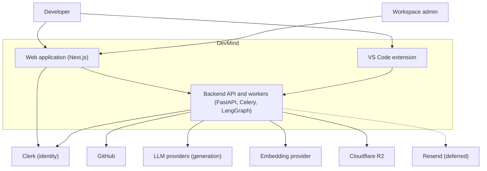
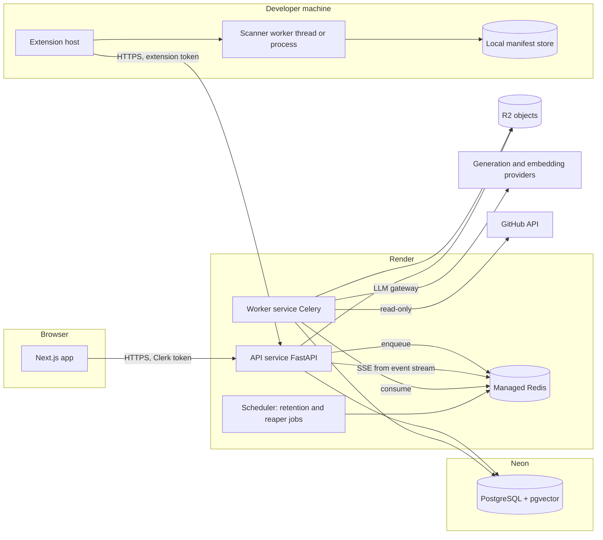
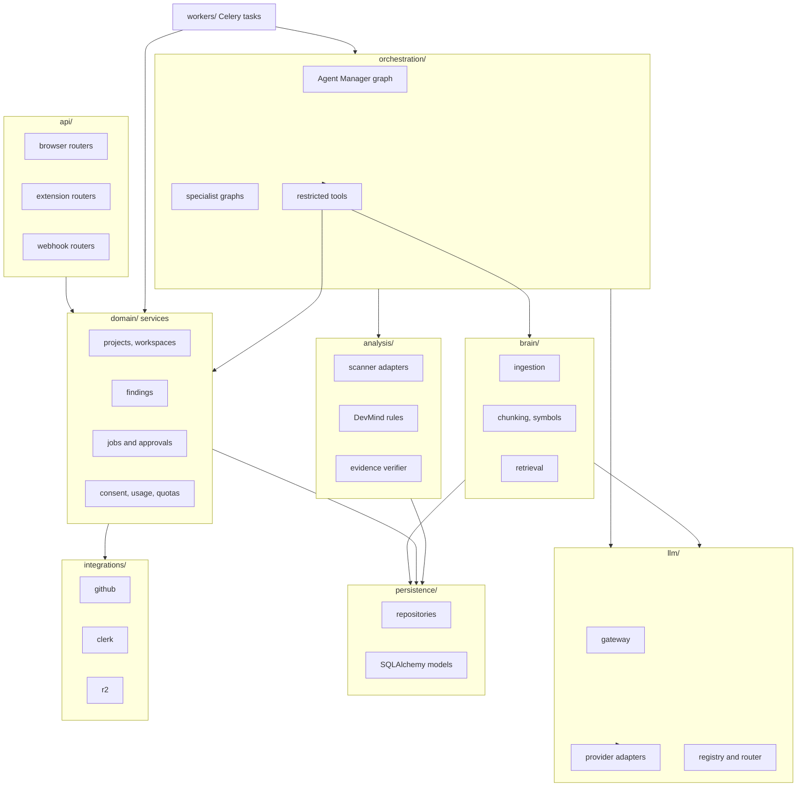
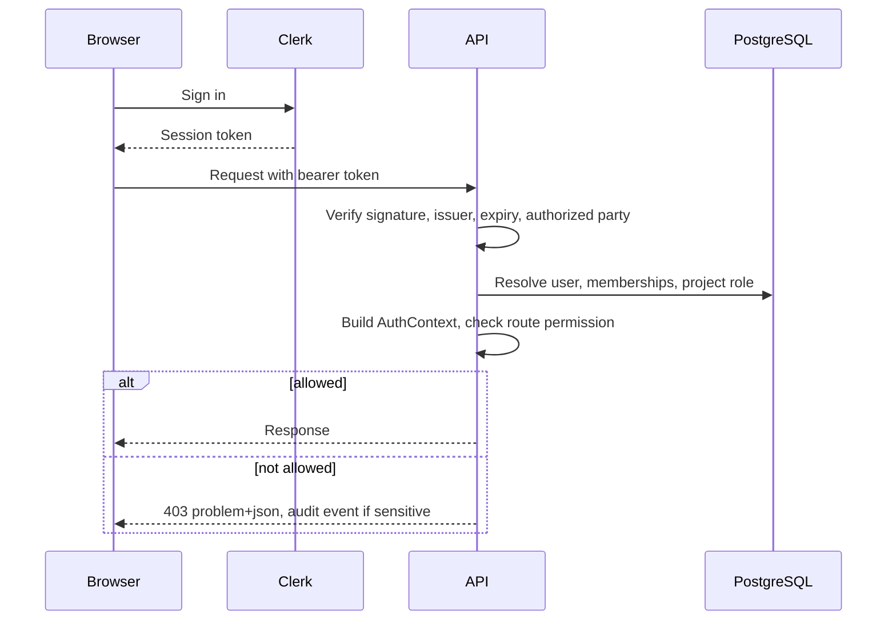
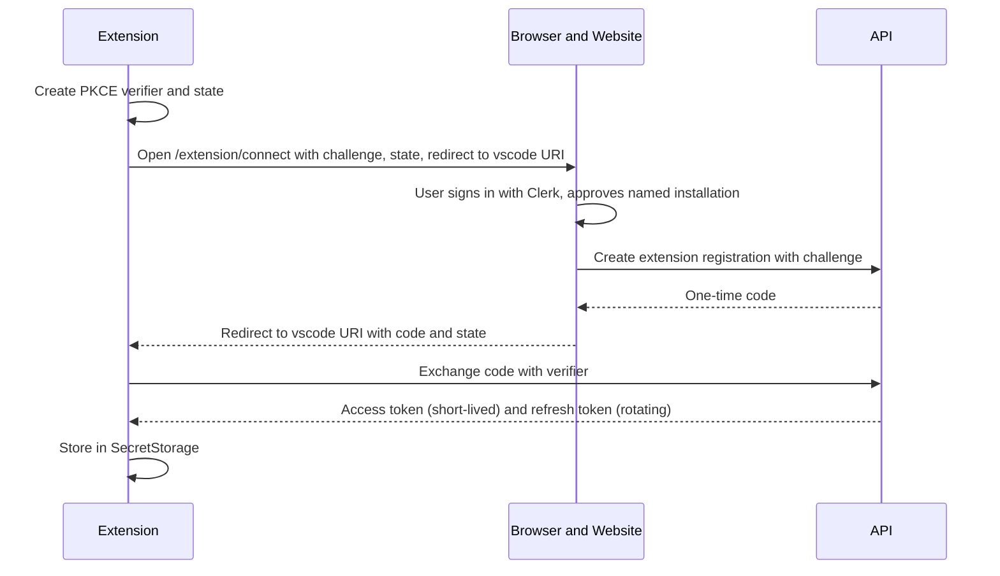
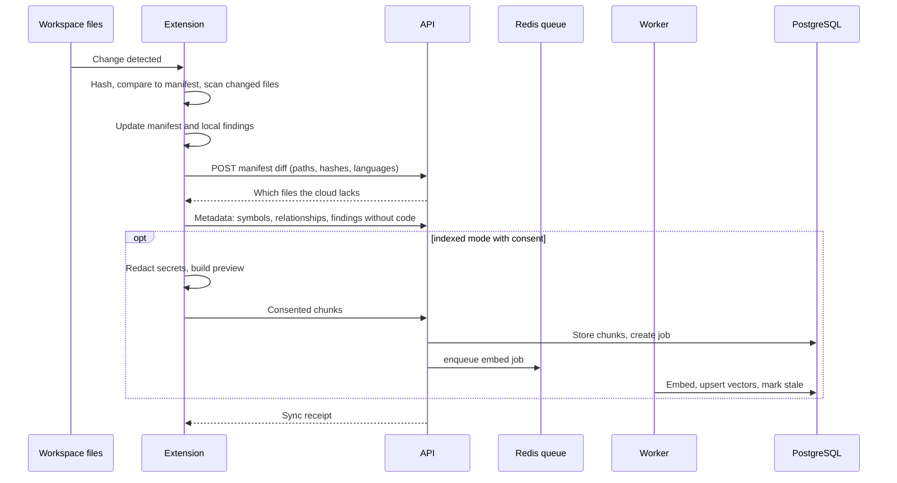
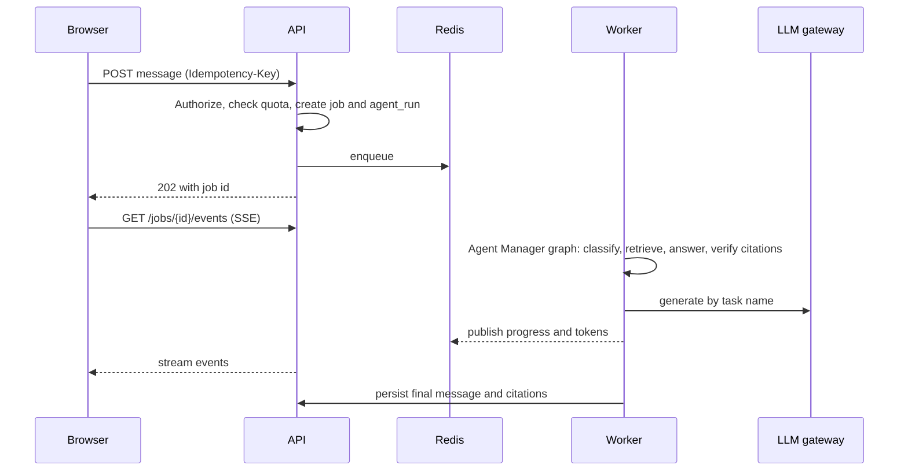
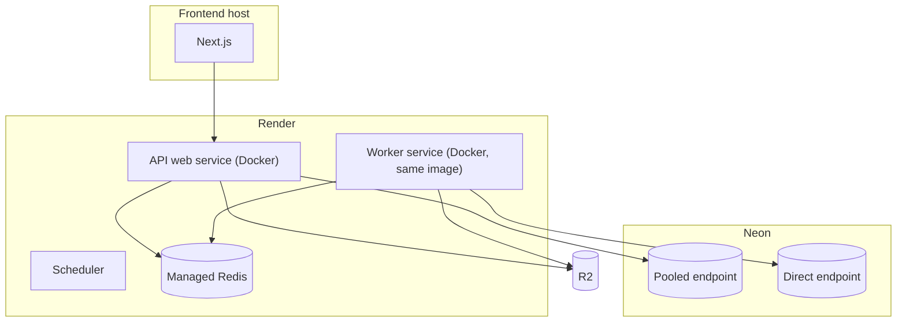
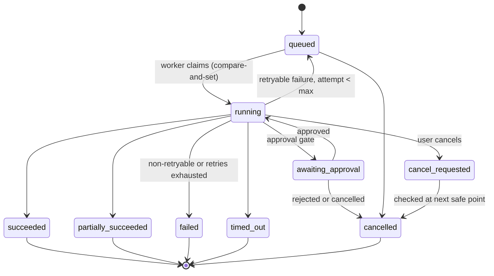

# 02 · System Architecture

**Purpose.** Explains how DevMind is built: components, boundaries, data flows, deployment topology, job lifecycle and failure handling. It implements the scope in [01](01-product-requirements.md). Data schemas and endpoints are in [03](03-data-model-and-api.md); the Project Brain in [04](04-project-brain-and-rag.md); agents and LLM routing in [05](05-agents-and-llm-workflows.md).

**Status.** Specification only. Decision IDs refer to [12](12-architecture-decisions-and-open-questions.md).

---

## 1. Architectural principles

1. **Modular monolith first.** One backend codebase with strict internal boundaries; two deployables (API, worker) from one image (ADR-004, ADR-005). No microservice per agent.
2. **PostgreSQL is the source of truth.** Job intent, state, findings and the Brain live in PostgreSQL. Redis is transport and cache; losing it must not lose work (ADR-008).
3. **Deterministic first, model second.** Parsing, scanning, scoring, verification and CRUD are ordinary code. LangGraph is used only where multi-step reasoning, branching, checkpointing or approval is needed (ADR-006).
4. **Authorization is separate and mandatory.** Authentication identifies a user; every operation is authorized against workspace and project membership (ADR-010).
5. **Local first, send less.** The extension scans locally; the cloud receives only what the sync mode and consent allow (ADR-021, ADR-022).
6. **Everything external is replaceable.** LLM providers, embedding providers, GitHub credentials and the Redis provider sit behind interfaces and configuration (ADR-016).
7. **Untrusted input everywhere.** Repository content, logs and LLM output are data, never instructions ([07](07-security-privacy-and-threat-model.md)).
8. **Observable and bounded.** Every job is traceable, measurable and quota-limited.

## 2. System context



## 3. Containers



| Container | Technology | Responsibility |
|---|---|---|
| Web application | Next.js, TypeScript | Public site, authenticated UI, streaming views |
| VS Code extension | TypeScript | Local scanning, diagnostics, sync control |
| API service | FastAPI | Auth verification, authorization, validation, CRUD, job creation, status and event streaming |
| Worker service | Celery + the same Python package | Ingestion, embedding, scans of cloud-sourced repos, agent workflows |
| Scheduler | Celery beat or equivalent | Retention sweeps, stale-job reaper, token cleanup |
| PostgreSQL | Neon | Structured data, vectors, job state, LangGraph checkpoints |
| Redis | Managed (ADR-031) | Queue transport, rate-limit counters, job event stream, short caches |
| Object storage | R2 | Reports, uploaded documents and logs |

## 4. Component responsibilities (backend)



### 4.1 Import rules (enforced in CI with an import-boundary checker)

| Layer | May import | Must not import |
|---|---|---|
| `api/` | `domain/`, `core/`, schemas | `persistence/` models directly, `orchestration/`, providers |
| `domain/` | `persistence/`, `integrations/`, `core/` | `api/`, `workers/` |
| `brain/` | `persistence/`, `llm/` (embedding interface only), `analysis/` (parsers) | `api/`, `orchestration/` |
| `analysis/` | `persistence/`, `core/` | `llm/` (analysis is deterministic) |
| `orchestration/` | `domain/`, `brain/`, `analysis/`, `llm/` (gateway only) | `api/`, provider SDKs |
| `llm/` | `core/` | everything else |
| `workers/` | `domain/`, `orchestration/`, `brain/` | `api/` |

Every repository function requires an `AuthContext` or an explicit `SystemContext` for background jobs that act on behalf of a recorded actor.

## 5. Repository layout (planned)

```text
DevMind/
├── README.md  AGENTS.md  PLAN.md  BRAIN.md  render.yaml  .env.example  .gitignore
├── package.json  pnpm-workspace.yaml
├── docs/                      # documentation package (00 to 13), runbooks, showcase kit
├── brand/                     # logo, icons, social images, design tokens
├── client/                    # Next.js website            (was: frontend/)
├── extension/                 # VS Code extension          (was: vscode-extension/)
├── common/                    # shared TypeScript: generated API client, shared data, tokens (was: packages/)
├── server/                    # FastAPI + Celery (Python)  (was: backend/)
│   ├── Dockerfile  pyproject.toml  README.md
│   ├── alembic/               # migrations
│   ├── configs/llm/           # providers.yaml, models.yaml, tasks.yaml (no secrets)
│   ├── app/
│   │   ├── api/  core/  domain/  persistence/
│   │   ├── brain/  analysis/  llm/  orchestration/
│   │   ├── integrations/  workers/
│   │   └── llm/prompts/       # versioned prompt files
│   └── tests/
├── evals/                     # scanner, retrieval, answer-quality fixtures and results
├── infra/                     # docker-compose.yml for local development
├── scripts/                   # test-all, brand sync, docs link check
└── .github/workflows/         # CI
```

Folder names `client/`, `extension/`, `common/`, `server/` are owner-approved (ADR-039) and replace the earlier names `frontend/`, `vscode-extension/`, `packages/`, `backend/`. Additions over the initial concept (`common/`, `evals/`, `infra/`, `scripts/`, `.github/`) are design recommendations: they keep shared code, evaluation data and infrastructure definitions out of application code. `render.yaml` stays at the repository root because Render looks for it there.

## 6. Technology choices

| Concern | Choice | Why | Trade-off |
|---|---|---|---|
| API framework | FastAPI, Pydantic v2 | Typed validation, OpenAPI generation | Async discipline required |
| ORM and migrations | SQLAlchemy 2.x, Alembic | Mature, explicit migrations | Verbose |
| Queue | Celery on Redis (ADR-009) | Retries, time limits, routing | Visibility-timeout configuration |
| Agent orchestration | LangGraph (ADR-006) | State, branching, checkpoint, interrupts | API evolves; pin versions |
| Parsing | Tree-sitter | Language-aware, fast, incremental | Grammar packaging (OQ-17) |
| Frontend data | Server Components plus TanStack Query | Right pattern per surface | Two mental models |
| Streaming | Server-Sent Events | One-way, simple, proxy-friendly | Needs keep-alives (OQ-13) |
| Types across boundary | OpenAPI → generated TS client | No drift | Generation step in CI |
| Logging | structlog JSON | Structured, redactable | — |
| Tracing | OpenTelemetry | Vendor-neutral | Avoid payload capture |

## 7. Authentication and authorization

### 7.1 Browser request



Authentication succeeding grants nothing by itself. `GET /me` returns identity; permissions are computed per project.

### 7.2 Extension sign-in (ADR-012)



Tokens are scoped to extension-facing endpoints only, stored hashed server-side, bound to a registration the user can revoke on the website.

## 8. Data flows

### 8.1 Local scan to cloud Brain



### 8.2 Website question (CAP-01)



### 8.3 PR analysis (Release 1.1)

GitHub sends a webhook or the user requests analysis → API validates signature or permission → job → worker fetches PR diff through the GitHub adapter (read-only) → PRAgent graph invokes AuthCheck, ReviewBuddy and DocsAlive as subgraphs → results stored as findings and a `pr_analyses` record → optional comment posting requires human approval.

## 9. Deployment topology

> **Active profile:** the owner deploys the **free profile** first (ADR-046, [10](10-deployment-and-operations.md) §22): API, an embedded worker and the scheduler run in one Render free web service (`DEVMIND_RUN_MODE=all`). The diagram below shows the target topology, which the code still supports (`api`, `worker`, `scheduler` modes).



Details, environment differences and configuration are in [10](10-deployment-and-operations.md). The API uses the pooled Neon endpoint; migrations and workers needing session features (the LangGraph checkpointer if incompatible, OQ-12) use the direct endpoint.

## 10. Asynchronous job lifecycle

### 10.1 States



### 10.2 Rules

| Concern | Design |
|---|---|
| **Source of truth** | `analysis_jobs` row; Redis message carries only the job ID. |
| **Creation** | One transaction creates the row and then enqueues. If enqueue fails after commit, a periodic *enqueuer sweep* re-enqueues `queued` jobs older than a threshold. |
| **Claiming** | Worker runs `UPDATE … SET status='running', attempt=attempt+1, heartbeat_at=now() WHERE id=? AND status='queued'`; zero rows means another worker has it. |
| **Heartbeat and reaper** | Running jobs update `heartbeat_at`. The scheduler requeues or fails jobs whose heartbeat is stale beyond the lease, up to `max_attempts`. |
| **Idempotency** | Client: `Idempotency-Key` on job-creating requests. Steps: natural keys with upserts (for example one embedding per chunk per embedding space). A re-run of a step must produce the same stored result. |
| **Retries** | Per job type policy: exponential backoff with jitter for transient provider errors and rate limits; no retry for validation or authorization errors; never retry beyond the quota. |
| **Timeouts** | Celery soft limit lets the job write partial results and mark `partially_succeeded` or `timed_out`; a hard limit protects the worker. Limits are per queue and set in configuration. |
| **Cancellation** | `cancel_requested` is polled between graph nodes and between batches. Process termination is a last resort. |
| **Worker loss** | `acks_late` and rejection on worker loss return the message to the queue; the claim step prevents double execution; LangGraph checkpoints let a workflow resume from its last node. |
| **Result access** | Results are rows (findings, messages, reports), referenced by `result_ref` on the job. |
| **Events** | Progress is appended to a Redis stream per job with a short expiry and mirrored by milestones to `job_events` in PostgreSQL so history survives expiry. |

## 11. Failure and recovery paths

| Failure | Behavior |
|---|---|
| Redis unavailable at enqueue | Job stays `queued`; API returns 202 with a degraded-queue warning; sweep re-enqueues when Redis returns. |
| Redis data loss | Sweep re-enqueues queued and stale-running jobs from PostgreSQL. |
| Worker crash mid-job | Message redelivered; claim logic and idempotent steps prevent duplicate effects; checkpoint resume. |
| LLM rate limit or timeout | Retry per task policy; then fallback model if capability-compatible; then fail with a user-facing reason. |
| LLM invalid output | One structured repair attempt; then `failed` with validation error recorded (no fallback). |
| Embedding provider down | Embedding job retried; retrieval degrades to keyword and symbol search with a flag in the response. |
| Neon unavailable | API readiness fails; requests return 503; workers back off. |
| GitHub rate limit | Respect reset time; job marked retry-scheduled. |
| Extension offline | Local scanning continues; sync queue persisted locally ([06](06-vscode-extension-and-local-scanning.md) §13). |
| Cross-version schema deploy | Migrations are backward compatible for one release (expand, migrate, contract). |

## 12. Logging and observability

- Structured JSON logs with `request_id`, `job_id`, `agent_run_id`, `workspace_id`, `project_id`, `actor_id`. Source code, prompts, completions, tokens and secrets are never logged; a redaction filter is the last line of defense.
- OpenTelemetry traces across API → queue → worker → LLM gateway, with provider, model, task, token counts and latency as attributes but no payloads.
- Metrics: queue depth and age, job duration per type, success/failure/retry rates, LLM latency and errors per provider, token usage, retrieval latency, DB pool saturation.
- Error reporting with payload scrubbing (vendor choice: OQ-15).
- Health: `/healthz` (process up) and `/readyz` (PostgreSQL and Redis reachable, migrations at expected head).

## 13. Scalability constraints and known limits

| Area | Constraint | Response |
|---|---|---|
| Neon connections | Limited concurrent connections | Pooled endpoint for API; bounded worker concurrency |
| Vector search with filters | Per-project filtering can reduce recall in approximate indexes | Measure; see [04](04-project-brain-and-rag.md) §9 |
| Large repositories | Embedding cost and time | Incremental sync, file-size and count limits, quotas |
| LLM throughput | Provider rate limits | Queueing, per-workspace concurrency caps |
| SSE connections | Many open streams on one API instance | Event stream in Redis; limit per user; polling fallback |
| LangGraph checkpoint size | State growth | Store references (IDs, citations) in state, not code bodies |

No capacity or latency figures are promised. They are established by measurement during [11](11-mvp-and-implementation-roadmap.md) milestone 10.

## 14. Key architecture decisions and alternatives

| Topic | Chosen | Alternatives considered | Reference |
|---|---|---|---|
| Service granularity | Modular monolith, 2 deployables | Microservices; single container | ADR-004/005 |
| Source of job truth | PostgreSQL rows | Redis only; Celery result backend | ADR-008 |
| Relationships | PostgreSQL tables | Graph database | ADR-020 |
| Search | PostgreSQL hybrid | Dedicated search/vector service | ADR-018 |
| Auth | Clerk plus own authorization | Clerk orgs; self-hosted auth | ADR-010/011 |
| Frontend→API | Direct with bearer token | BFF proxy | ADR-003 |
| Streaming | SSE | WebSocket | ADR-003 |
