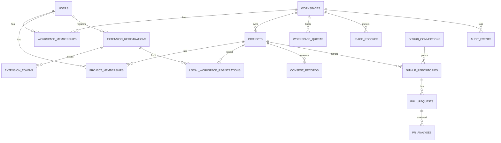
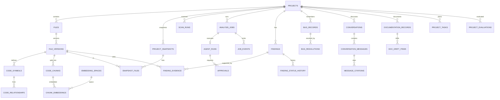
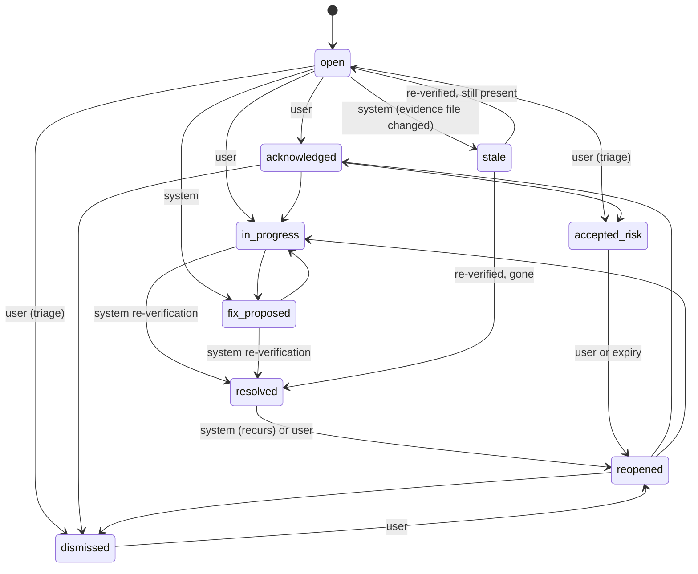

# 03 · Data Model and API

**Purpose.** Defines the logical PostgreSQL data model, state machines, tenant isolation, and the REST API contracts. It is authoritative for entity names, field names, enumerations, state transitions and endpoint paths. Other documents must use these names.

**Status.** Implemented for MVP schemas and endpoints (Alembic migrations 0001 through 0005, OpenAPI export, and client typed SDK). Post-MVP tables (pull requests, living docs, bug memory, project tasks, and evaluations) are implemented for Milestones 11–12. Related: [02](02-system-architecture.md) · [04](04-project-brain-and-rag.md) · [05](05-agents-and-llm-workflows.md) · [07](07-security-privacy-and-threat-model.md).

---

## 1. Conventions

| Topic | Convention |
|---|---|
| Primary keys | `uuid`. UUIDv7 recommended for index locality (library support to be checked), UUIDv4 acceptable. |
| Timestamps | `timestamptz`, UTC. `created_at`, `updated_at` on mutable tables. |
| Tenant columns | Every tenant-owned table has `workspace_id`; project-owned tables also have `project_id`. Both are denormalized deliberately so authorization and RLS never need joins. |
| Enumerations | PostgreSQL `text` with `CHECK` constraints (simpler migrations than native enums). Values listed in §5. |
| JSON | `jsonb` only for genuinely schemaless metadata. Anything queried or constrained gets a real column. |
| Names | `snake_case`, plural table names. |
| Deletion | See §8. |
| Migrations | See §9. |

## 2. Entity relationship overview

Two diagrams keep each readable. Column lists are in §3.





## 3. Tables

Unless stated, each table has `id`, `workspace_id` (where tenant-owned), `created_at`. "MVP" marks tables needed in the first release; others are created by the migration of the milestone that needs them.

### 3.1 Identity, tenancy, access

| Table | Purpose | Key columns | Constraints and indexes |
|---|---|---|---|
| `users` (MVP) | Identity mapping to Clerk | `clerk_user_id`, `email`, `display_name`, `last_seen_at`, `deleted_at` | unique `clerk_user_id` |
| `workspaces` (MVP) | Tenant | `name`, `slug`, `kind` (`personal`,`team`), `created_by`, `deleted_at` | unique `slug` |
| `workspace_memberships` (MVP) | User role in workspace | `workspace_id`, `user_id`, `role` | unique (`workspace_id`,`user_id`); index `user_id` |
| `workspace_invitations` (M11) | Pending invites | `email`, `role`, `token_hash`, `expires_at`, `accepted_at` | unique `token_hash` |
| `projects` (MVP) | A codebase | `workspace_id`, `name`, `slug`, `visibility` (`workspace`,`private`), `sync_mode` (`metadata_only`,`indexed`), `source_kind` (`local`,`github`), `primary_language`, `default_branch`, `archived_at`, `deleted_at` | unique (`workspace_id`,`slug`); index (`workspace_id`) |
| `project_memberships` (MVP) | Per-project role | `project_id`, `user_id`, `role` | unique (`project_id`,`user_id`) |
| `extension_registrations` (MVP) | One per installation per user | `user_id`, `name`, `platform`, `extension_version`, `last_seen_at`, `revoked_at` | index `user_id` |
| `extension_tokens` (MVP) | Access/refresh tokens | `registration_id`, `token_hash`, `kind`, `scope`, `expires_at`, `rotated_from`, `revoked_at` | unique `token_hash`; never store raw tokens |
| `local_workspace_registrations` (MVP) | A local folder linked to a project | `project_id`, `registration_id`, `workspace_label`, `root_fingerprint`, `last_scan_run_id`, `last_sync_at` | unique (`project_id`,`registration_id`,`root_fingerprint`); the fingerprint is a hash, never the absolute path |

### 3.2 Project Brain

| Table | Purpose | Key columns | Constraints and indexes |
|---|---|---|---|
| `files` (MVP) | A path in a project | `project_id`, `path` (repo-relative), `language`, `tier`, `current_version_id`, `removed_at` | unique (`project_id`,`path`); GIN trigram on `path` |
| `file_versions` (MVP) | Immutable content identity | `file_id`, `project_id`, `content_hash`, `size_bytes`, `line_count`, `scan_run_id`, `origin` (`extension`,`github`) | unique (`file_id`,`content_hash`) |
| `project_snapshots` (MVP) | Named state | `project_id`, `kind` (`scan`,`commit`,`manual`), `ref` (commit SHA or scan id), `label` | index (`project_id`,`created_at`) |
| `snapshot_files` (MVP) | Path → version in a snapshot | `snapshot_id`, `file_id`, `file_version_id` | PK (`snapshot_id`,`file_id`) |
| `code_symbols` (MVP) | Named program elements | `file_version_id`, `symbol_key`, `name`, `qualified_name`, `kind`, `signature`, `start_line`, `end_line`, `framework_tags text[]`, `is_current`, `metadata jsonb` | index (`project_id`,`symbol_key`); trigram on `name`; partial index where `is_current` |
| `code_relationships` (MVP) | Typed edges | `from_symbol_id`, `to_symbol_id` (nullable), `to_external` (text), `kind`, `resolution` (`resolved`,`inferred`,`unresolved`), `file_version_id`, `is_current` | index (`project_id`,`from_symbol_id`,`kind`), (`project_id`,`to_symbol_id`,`kind`) where `is_current` |
| `code_chunks` (MVP, `indexed` mode) | Searchable code pieces | `file_version_id`, `symbol_id`, `kind`, `start_line`, `end_line`, `content` (consented, redacted), `content_hash`, `search_text`, `token_estimate`, `redaction_count`, `is_current` | unique (`file_version_id`,`start_line`,`end_line`,`content_hash`); GIN on `to_tsvector(search_text)`; trigram on identifiers |
| `embedding_spaces` (MVP) | Provider/model/dimension | `provider_id`, `model_id`, `dimension`, `status` (`building`,`active`,`deprecated`), `config_hash` | unique (`provider_id`,`model_id`,`dimension`) |
| `chunk_embeddings` (MVP) | Vectors | `chunk_id`, `space_id`, `embedding vector(N)`, `embedded_at` | PK (`chunk_id`,`space_id`); HNSW index (cosine) per active space; filter columns `project_id` |

`is_current` is maintained transactionally by ingestion: when a file gets a new version, rows for the previous version flip to `false` in the same transaction. Retrieval defaults to `is_current = true`; snapshots query by version through `snapshot_files`.

### 3.3 Scans, jobs and agents

| Table | Purpose | Key columns | Constraints |
|---|---|---|---|
| `scan_runs` (MVP) | One scan pass | `project_id`, `origin` (`extension`,`cloud_fetch`,`github_pr`), `registration_id`, `status` (`running`,`completed`,`failed`,`cancelled`), `started_at`, `finished_at`, `rules_version`, `stats jsonb` (counts only), `idempotency_key` | unique (`project_id`,`idempotency_key`) |
| `analysis_jobs` (MVP) | Async work unit | `project_id`, `type`, `status`, `requested_by`, `params jsonb`, `idempotency_key`, `attempt`, `max_attempts`, `queue`, `heartbeat_at`, `started_at`, `finished_at`, `error_code`, `error_detail`, `cancel_requested_at`, `result_ref jsonb`, `consent_id`, `budget jsonb` | unique (`project_id`,`idempotency_key`); index (`status`,`heartbeat_at`) |
| `job_events` (MVP) | Milestone log | `job_id`, `seq`, `kind`, `message`, `data jsonb` | PK (`job_id`,`seq`) |
| `agent_runs` (MVP) | One LangGraph execution | `job_id`, `workflow`, `thread_id`, `prompt_versions jsonb`, `model_choices jsonb`, `config_hash`, `state_summary jsonb`, `usage_totals jsonb` | unique `thread_id` |
| `approvals` (R1.x, built with first gated step) | Human approval gates | `agent_run_id`, `action_kind`, `proposal jsonb`, `status` (`pending`,`approved`,`rejected`,`expired`), `decided_by`, `decided_at` | index (`status`) |

LangGraph checkpoint tables live in a separate `langgraph` schema managed by the library (ADR-037). They hold state references, not code bodies.

### 3.4 Findings and knowledge

| Table | Purpose | Key columns | Constraints |
|---|---|---|---|
| `findings` (MVP) | Reportable issues | `project_id`, `fingerprint`, `rule_id`, `source` (`scanner`,`devmind_rule`,`llm_verified`), `category`, `title`, `summary`, `explanation`, `severity`, `confidence`, `evidence_level`, `status`, `first_seen_scan_run_id`, `last_seen_scan_run_id`, `primary_file_id`, `primary_start_line`, `primary_end_line`, `suggested_fix jsonb`, `status_reason`, `resolved_at` | unique (`project_id`,`fingerprint`); index (`project_id`,`status`,`severity`) |
| `finding_evidence` (MVP) | Machine-checkable support | `finding_id`, `file_version_id`, `path`, `start_line`, `end_line`, `snippet_hash`, `snippet_text` (nullable, consented), `role` (`primary`,`supporting`,`missing_check`), `detail jsonb`, `is_current` | index `finding_id` |
| `finding_status_history` (MVP) | Transition log | `finding_id`, `from_status`, `to_status`, `actor_kind` (`user`,`system`), `actor_id`, `reason` | index `finding_id` |
| `review_rules` (M11) | Checklist review rules | `project_id`, `rule_id`, `name`, `description`, `category`, `severity`, `check_type`, `file_patterns text[]`, `rule_config jsonb`, `is_active` | unique (`project_id`,`rule_id`); index (`project_id`,`is_active`) |
| `conversations` (MVP) | Project chat threads | `project_id`, `created_by`, `title` | index (`project_id`,`created_at`) |
| `conversation_messages` (MVP) | Messages | `conversation_id`, `role`, `content`, `job_id`, `status` | index (`conversation_id`,`created_at`) |
| `message_citations` (MVP) | Resolvable references | `message_id`, `file_version_id`, `path`, `start_line`, `end_line`, `content_hash`, `symbol_key` | index `message_id` |
| `bug_records` (R1.2) | Bug memory entries | `project_id`, `fingerprint`, `error_signature`, `title`, `summary`, `module_hint`, `first_seen_at` | unique (`project_id`,`fingerprint`) |
| `bug_resolutions` (R1.2) | How it was fixed | `bug_record_id`, `cause`, `fix_summary`, `files jsonb`, `resolved_by`, `finding_id` (nullable) | index `bug_record_id` |
| `documentation_records` (R1.2) | Known docs | `project_id`, `file_id` or `object_key`, `kind` (`readme`,`api`,`architecture`,`other`), `current_version_hash` | |
| `doc_drift_items` (R1.2) | Mismatch items | `documentation_record_id`, `kind`, `target_symbol_key`, `explanation`, `status`, `proposal jsonb` | |
| `project_tasks` (R1.3) | Work items | `project_id`, `title`, `status`, `priority`, `source` (`user`,`agent`,`finding`), `finding_id` | |
| `task_dependencies` (R1.3) | Task ordering | `task_id`, `depends_on_task_id` | PK pair; no cycles (validated) |
| `project_evaluations` (R1.3) | Health and readiness | `project_id`, `snapshot_id`, `scores jsonb`, `verdict`, `reasons jsonb`, `rubric_version` | |
| `deployment_incidents` (R1.4) | Past failures | `project_id`, `fingerprint`, `summary`, `probable_cause`, `resolution`, `report_object_key` | |

### 3.5 Integrations, governance, accounting

| Table | Purpose | Key columns | Constraints |
|---|---|---|---|
| `github_credentials` (M11) | Encrypted OAuth tokens | `workspace_id`, `user_id`, `github_user_id`, `encrypted_token`, `scopes text[]` | credentials encrypted with AES-256-GCM envelope encryption (`DEVMIND_ENCRYPTION_KEYS`); never logged |
| `github_repository_bindings` (M11) | Project-repo link | `project_id`, `repo_id`, `repo_full_name`, `default_branch`, `installation_id` | unique (`project_id`); unique (`repo_id`) |
| `pull_requests` (M11) | PR mirror | `project_id`, `github_pr_id`, `number`, `title`, `state`, `head_sha`, `base_sha`, `author_login`, `html_url`, `synced_at` | unique (`project_id`,`number`); index (`project_id`,`state`) |
| `pr_analyses` (M11) | PR analysis result | `pull_request_id`, `head_sha`, `job_id`, `summary jsonb`, `risk_rating`, `change_impact jsonb`, `checklist_results jsonb` | index (`pull_request_id`,`head_sha`) |
| `consent_records` (MVP) | Source-transmission consent | `project_id`, `user_id`, `scope` (`snippet_transmission`,`cloud_index`,`llm_processing`), `provider_ids text[]`, `data_categories text[]`, `granted_for` (`single_request`,`project`), `policy_version`, `granted_at`, `expires_at`, `revoked_at` | index (`project_id`,`scope`) |
| `retention_policies` (MVP) | Retention settings | `workspace_id`, `project_id` (nullable), `kind`, `days` | unique (`workspace_id`,`project_id`,`kind`) |
| `audit_events` (MVP) | Sensitive-action log | `workspace_id`, `actor_id`, `actor_kind`, `action`, `target_kind`, `target_id`, `ip_hash`, `metadata jsonb` | append-only; index (`workspace_id`,`created_at`) |
| `usage_records` (MVP) | Inference accounting | `workspace_id`, `project_id`, `job_id`, `llm_task`, `provider_id`, `model_id`, `input_tokens`, `output_tokens`, `cost_units`, `latency_ms`, `outcome` | index (`workspace_id`,`created_at`) |
| `workspace_quotas` (MVP) | Limits | `workspace_id`, `kind` (`monthly_tokens`,`concurrent_jobs`,`job_token_budget`,`indexed_files`), `limit_value` | unique (`workspace_id`,`kind`) |
| `idempotency_keys` (MVP) | Request replay | `principal_id`, `key`, `route`, `request_hash`, `response_status`, `response_body`, `expires_at` | unique (`principal_id`,`key`,`route`) |
| `report_artifacts` (R1.3) | R2 object metadata | `project_id`, `kind`, `object_key`, `content_type`, `size_bytes`, `expires_at` | PostgreSQL holds metadata; R2 holds bytes |

## 4. Tenant and project isolation

- Authorization is enforced in the application: repository functions take an `AuthContext` and add `workspace_id` (and `project_id`) predicates; a function without one cannot be written without a `SystemContext`.
- Cross-tenant joins never rely on a client-supplied ID alone: a resource is loaded by `(id, workspace_id)`.
- Resources the caller cannot see return `404`; resources the caller can see but cannot modify return `403`.
- Defense in depth (ADR-025, OQ-09): enable PostgreSQL row-level security with `SET LOCAL app.workspace_id` per transaction once the application layer is stable.
- Embeddings and chunks are tenant data: vector queries always filter on `project_id`.

### 4.1 Effective project role

| Caller | Project `visibility = workspace` | Project `visibility = private` |
|---|---|---|
| Workspace `owner` / `admin` | maintainer | maintainer |
| Workspace `member` | contributor | none unless a `project_memberships` row exists |
| Workspace `viewer` | viewer | none unless membership row exists |
| Explicit project membership | the greater of workspace-derived and project role | project role |

### 4.2 Permissions

| Permission | viewer | contributor | maintainer |
|---|---|---|---|
| `project:read`, `brain:read`, `findings:read`, `conversation:read` | ✔ | ✔ | ✔ |
| `project:sync`, `analysis:create`, `conversation:create`, `finding:acknowledge`, `finding:progress` | | ✔ | ✔ |
| `finding:triage` (dismiss, accept risk), `consent:manage`, `project:update`, `members:manage`, `integrations:manage`, `project:delete` | | | ✔ |

Workspace-level `usage:read`, `audit:read`, `workspace:manage` require workspace `admin` or `owner`.

## 5. Enumerations

| Name | Values |
|---|---|
| Job `status` | `queued`, `running`, `awaiting_approval`, `succeeded`, `partially_succeeded`, `failed`, `cancel_requested`, `cancelled`, `timed_out` |
| Job `type` | `ingest_project`, `embed_chunks`, `ask_project`, `security_review`, `code_review`, `change_impact`, `pr_analysis`, `doc_drift`, `bug_match`, `deployment_diagnosis`, `next_task`, `project_evaluation`, `release_readiness`, `purge_project` |
| Finding `severity` | `critical`, `high`, `medium`, `low`, `info` |
| Finding `confidence` | `low`, `medium`, `high` |
| `evidence_level` | `E0`, `E1`, `E2`, `E3` (glossary) |
| Finding `category` | `authentication`, `authorization`, `secret_exposure`, `input_validation`, `error_handling`, `testing`, `documentation`, `configuration`, `dependency`, `quality`, `other` |
| Relationship `kind` | `imports`, `calls`, `defines_route`, `guarded_by`, `reads_model`, `writes_model`, `tests`, `documents` |
| Symbol `kind` | `function`, `method`, `class`, `route_handler`, `server_action`, `model`, `constant`, `module` |
| Language `tier` | `1` (semantic), `2` (text-level), `3` (unsupported) |
| Role names | see glossary |

### 5.1 Finding lifecycle



Rules: (1) `resolved` is set by the system after re-verification fails to reproduce the finding, or by a user with a reason; a later detection reopens it. (2) `dismissed` requires a reason code (`false_positive`, `not_applicable`, `duplicate`, `other`) and feeds scanner evaluation ([09](09-testing-and-quality-strategy.md) §8). (3) Any change to evidence files moves the finding to `stale` until verification re-runs. (4) Every transition writes `finding_status_history` and, for triage, `audit_events`.

## 6. Job status transitions

See the state diagram in [02](02-system-architecture.md) §10.1. The API exposes `status`, `attempt`, `max_attempts`, timestamps, `error_code`, `error_detail` (user-safe), and `result_ref`. A job in `partially_succeeded` carries a `result_ref` and a list of unfinished parts in `error_detail`.

## 7. Versioning model

- **File version:** identity by `(file, content_hash)`. A new hash creates a new version; the file's `current_version_id` moves; derived rows for the old version become non-current.
- **Project snapshot:** immutable list of versions. Created at scan completion (`kind=scan`), or from a commit for GitHub projects. Used for history, PR comparison and evaluation.
- **Scan versioning:** each scan records `rules_version`. A rules change makes earlier findings candidates for re-verification.
- Retention keeps the current version plus a configurable number of snapshots (ADR-026); older versions' chunks and embeddings are deleted while metadata and hashes remain.

## 8. Deletion

| Data | Strategy |
|---|---|
| Users | Soft delete (`deleted_at`) triggers a deletion workflow after Clerk deletion events; personal workspace data deleted per policy |
| Workspaces, projects | Soft delete with a grace period, then `purge_project` job hard-deletes |
| Files | Marked `removed_at` when absent from the current scan; history retained per retention |
| Chunks, embeddings, evidence snippet text | Hard delete on revocation, mode change to `metadata_only`, retention expiry or project deletion |
| Findings | Retained as metadata unless the project is deleted; snippet text removed with the source |
| Audit events | Retained for a configured period; contain no source |
| Redis, R2, LangGraph checkpoints | Purged by the same `purge_project` job; each store reports completion |
| Backups | Provider backup retention means deleted data can persist in backups until expiry; this must be stated in the privacy settings, not hidden |

## 9. Migrations

- Alembic, one linear history, one migration per logical change, reviewed as code. No manual production DDL.
- Expand → migrate → contract: columns are added nullable or with defaults, code deployed that handles both, data backfilled by a job, constraints tightened in a later release.
- Every migration is tested up and down on a database seeded with fixtures; a CI check detects model/migration drift ([09](09-testing-and-quality-strategy.md) §4).
- Vector dimension changes use a new embedding space and table, never an in-place `ALTER` ([04](04-project-brain-and-rag.md) §10).
- Migrations run through the direct Neon endpoint ([10](10-deployment-and-operations.md) §8).

## 10. API conventions

| Topic | Rule |
|---|---|
| Base path | `/api/v1`. Breaking changes create `/api/v2`; additive changes do not. Deprecations announced with a `Deprecation` header and documented. |
| Schemes | Browser-facing: `Authorization: Bearer <Clerk session token>`. Extension-facing (`/api/v1/ext/…`): `Authorization: Bearer <DevMind extension token>`. A route accepts exactly one scheme. |
| Content | JSON, UTF-8. Streaming endpoints use `text/event-stream`. |
| Errors | RFC 9457 `application/problem+json` with `type`, `title`, `status`, `detail`, `code`, `request_id`, optional `errors[]`. |
| Pagination | Cursor-based: `limit` (default 25, maximum 100), `cursor`; response has `items`, `next_cursor`. |
| Idempotency | `Idempotency-Key` header required on POST operations that create scans, jobs, uploads or consents. Stored 24 hours. Same key and body returns the original response; same key with different body returns `422 idempotency.mismatch`. |
| Rate limiting | Redis counters per principal and route class (`read`, `write`, `job_create`, `ext_sync`, `auth`). Responses include `RateLimit-*` and `Retry-After`. Limit values are configuration, tuned after measurement. |
| Timestamps | ISO 8601 UTC. |
| IDs | UUID strings. |
| Request size | Per-route maximums; `413` when exceeded. |

### 10.1 Error code catalog (initial)

| `code` | HTTP | Meaning |
|---|---|---|
| `auth.unauthenticated` | 401 | Missing or invalid token |
| `auth.forbidden` | 403 | Authenticated, not permitted |
| `resource.not_found` | 404 | Missing or not visible |
| `validation.failed` | 422 | Schema or business validation failed |
| `conflict.state` | 409 | Invalid state transition |
| `sync.stale_base` | 409 | Client manifest base is outdated |
| `idempotency.mismatch` | 422 | Key reused with different body |
| `consent.required` | 403 | Operation needs a consent record that is missing or revoked |
| `quota.exceeded` | 429 | Workspace quota reached |
| `rate_limit.exceeded` | 429 | Too many requests |
| `payload.too_large` | 413 | Over size limit |
| `llm.unavailable` | 503 | No configured provider could serve the task |
| `job.not_cancellable` | 409 | Job already terminal |
| `integration.github.permission_denied` | 403 | GitHub token lacks required permission scope (ADR-015) |
| `integration.github.token_revoked` | 401 | GitHub credential revoked, expired, or uninstalled (ADR-015) |
| `integration.github.signature_invalid` | 401 | Webhook HMAC-SHA256 signature missing or mismatch (ADR-015) |
| `integration.github.rate_limited` | 429 | GitHub API rate limit reached (ADR-015) |

## 11. Endpoint families

### 11.1 Browser-facing

| Family | Endpoints | Permission |
|---|---|---|
| Auth context | `GET /me` · `GET /me/permissions?project_id=` | authenticated |
| Workspaces | `GET /workspaces` · `POST /workspaces` · `GET/PATCH /workspaces/{id}` · `GET/POST /workspaces/{id}/members` · `PATCH/DELETE /workspaces/{id}/members/{user_id}` · `GET/POST /workspaces/{id}/invitations` · `DELETE /workspaces/{id}/invitations/{invitation_id}` | member read; admin manage |
| Invitations | `GET /invitations/verify` (preview) · `POST /invitations/accept` (join workspace) | public verify; authenticated accept |
| Projects | `GET/POST /workspaces/{wid}/projects` · `GET/PATCH/DELETE /projects/{pid}` · `GET/POST /projects/{pid}/members` | by permission |
| Extension management | `GET /me/extensions` · `DELETE /me/extensions/{registration_id}` · `POST /extension/authorize` (creates one-time code for the sign-in flow) | authenticated |
| Scans | `GET /projects/{pid}/scans` · `GET /scans/{id}` | `project:read` |
| Findings | `GET /projects/{pid}/findings` (filters: `status`, `severity`, `category`, `evidence_level`, `file`) · `GET /findings/{id}` · `POST /findings/{id}/transitions` | `findings:read`; transitions per §4.2 |
| Analysis | `POST /projects/{pid}/analyses` · `GET /projects/{pid}/jobs` | `analysis:create` |
| Jobs | `GET /jobs/{id}` · `GET /jobs/{id}/events` (SSE) · `POST /jobs/{id}/cancel` · `POST /jobs/{id}/approvals/{approval_id}` | job's project permission |
| Conversations | `GET/POST /projects/{pid}/conversations` · `GET /conversations/{id}` · `POST /conversations/{id}/messages` | `conversation:*` |
| Project Brain | `GET /projects/{pid}/brain/summary` · `/brain/files` · `/brain/files/{file_id}` · `/brain/symbols` · `POST /brain/search` · `GET /brain/graph?symbol_key=&depth=` · `/brain/snapshots` | `brain:read` |
| Reports & Evaluation | `GET /projects/{pid}/evaluations` · `POST /projects/{pid}/evaluations/run` · `GET /projects/{pid}/evaluations/latest` · `GET /projects/{pid}/evaluations/{id}` · `GET /projects/{pid}/release-readiness/latest` · `POST /projects/{pid}/reports` (export) | `project:read` / `analysis:create` |
| Project tasks | `GET/POST /projects/{pid}/tasks` · `GET /projects/{pid}/tasks/recommend` · `GET/PATCH/DELETE /projects/{pid}/tasks/{id}` · `POST /projects/{pid}/tasks/{id}/dependencies` · `DELETE /projects/{pid}/tasks/{id}/dependencies/{dep_id}` | `project:read` / `project:write` |
| Bug memory | `GET/POST /projects/{pid}/bugs` · `GET /bugs/{id}` | R1.2 |
| Review rules | `GET/POST /projects/{pid}/review-rules` · `GET/PATCH/DELETE /projects/{pid}/review-rules/{rule_id}` · `POST /projects/{pid}/review-rules/reset` | `project:read` / `project:write` |
| GitHub & PRs | `GET /github/oauth/authorize` · `GET /github/oauth/callback` · `GET/POST/DELETE /projects/{pid}/github-binding` · `GET /projects/{pid}/pull-requests` · `GET /projects/{pid}/pull-requests/{id}` · `POST /projects/{pid}/pull-requests/{id}/analyze` · `POST /projects/{pid}/pull-requests/{id}/checklist-triage` | `project:read` / `project:write` (comment posting gated by human approval) |
| Consent and privacy | `GET/POST /projects/{pid}/consents` · `DELETE /consents/{id}` · `PATCH /projects/{pid}/sync-mode` · `POST /projects/{pid}/data-deletion` | `consent:manage` |
| Usage and audit | `GET /workspaces/{wid}/usage` · `GET /workspaces/{wid}/quotas` · `GET /workspaces/{wid}/audit-events` | workspace admin |
| Webhooks | `POST /webhooks/github` · `POST /webhooks/clerk` | signature-verified, no user token |
| Operations | `GET /healthz` · `GET /readyz` | none (no sensitive data) |

### 11.2 Extension-facing (`/api/v1/ext`)

| Family | Endpoints | Notes |
|---|---|---|
| Session | `POST /ext/token` (exchange code) · `POST /ext/token/refresh` · `POST /ext/registrations/self/heartbeat` | refresh tokens rotate |
| Projects | `GET /ext/projects` · `POST /ext/projects/{pid}/workspaces` (register local workspace) | only projects the user can `project:sync` |
| Scans | `POST /ext/projects/{pid}/scans` · `PATCH /ext/scans/{id}` (complete/fail/cancel) | idempotent |
| Manifest | `POST /ext/projects/{pid}/manifest/diff` · `PUT /ext/projects/{pid}/manifest` | metadata only |
| Metadata | `PUT /ext/projects/{pid}/symbols` · `PUT /ext/projects/{pid}/relationships` · `POST /ext/projects/{pid}/findings:batch` | no source bodies |
| Snippets | `POST /ext/projects/{pid}/snippets` | requires `consent_id`; see §12.4 |
| Jobs | `POST /ext/projects/{pid}/analyses` (user-requested cloud analysis) · `GET /ext/jobs/{id}` | returns website deep link |
| Links | `GET /ext/projects/{pid}/links` | URLs to web screens |

Extension tokens never reach browser-facing routes; browser tokens never reach extension routes.

## 12. Representative schemas

### 12.1 Finding

```json
{
  "id": "0192b1c0-3d1e-7a3b-9c11-5f6a7a8b9c01",
  "project_id": "0192b1bf-0000-7000-8000-000000000001",
  "rule_id": "devmind.authz.missing_role_check",
  "category": "authorization",
  "title": "Administrative route has no role check",
  "summary": "Authentication is required but no authorization check was found on the call path.",
  "explanation": "…",
  "severity": "high",
  "confidence": "high",
  "evidence_level": "E2",
  "status": "open",
  "location": {"path": "backend/app/routes/admin.py", "start_line": 42, "end_line": 58},
  "evidence": [
    {"role": "primary", "path": "backend/app/routes/admin.py", "start_line": 42, "end_line": 58,
     "file_version_id": "0192…", "snippet_hash": "sha256:…", "is_current": true,
     "detail": {"route": "GET /admin/users", "authentication": "Depends(get_current_user)",
                "authorization": "none found",
                "analysis_scope": "handler and 2 resolved callees; unresolved: 1 dynamic dependency"}}
  ],
  "suggested_fix": {"kind": "proposal", "description": "Require an admin role dependency.", "diff": null},
  "first_seen_scan_run_id": "…",
  "last_seen_scan_run_id": "…"
}
```

`analysis_scope` is mandatory for E2 "missing check" findings: it states what was examined and what was unresolved, so absence of a check is never presented as more certain than it is.

### 12.2 Create analysis (browser)

`POST /api/v1/projects/{pid}/analyses` with `Idempotency-Key`

```json
{
  "type": "security_review",
  "params": {"scope": {"paths": ["backend/app/routes/"]}, "snapshot_id": null},
  "consent_id": "0192…"
}
```

Response `202`:
```json
{
  "job": {"id": "0192…", "type": "security_review", "status": "queued",
          "attempt": 0, "max_attempts": 3, "created_at": "2026-10-10T09:00:00Z"},
  "links": {"self": "/api/v1/jobs/0192…", "events": "/api/v1/jobs/0192…/events"}
}
```

Errors: `403 auth.forbidden`, `403 consent.required` (type needs code and no valid consent in `metadata_only`), `422 validation.failed`, `429 quota.exceeded`, `503 llm.unavailable`.

### 12.3 Manifest diff (extension)

`POST /api/v1/ext/projects/{pid}/manifest/diff`
```json
{
  "scan_run_id": "0192…",
  "base_snapshot_id": "0192…",
  "files": [
    {"path": "backend/app/routes/admin.py", "content_hash": "sha256:…", "size_bytes": 2431,
     "language": "python", "line_count": 88}
  ]
}
```
Response:
```json
{"unchanged": 412, "new": 3, "changed": 5, "removed": ["old/file.ts"], "stale_base": false}
```
The server never asks for content in this step; it only tells the client which files it lacks metadata for.

### 12.4 Snippet upload (extension, consented)

`POST /api/v1/ext/projects/{pid}/snippets` with `Idempotency-Key`
```json
{
  "consent_id": "0192…",
  "purpose": {"kind": "analysis", "job_type": "security_review"},
  "snippets": [
    {"path": "backend/app/routes/admin.py", "file_content_hash": "sha256:…",
     "start_line": 40, "end_line": 60, "content": "…redacted…",
     "redaction_count": 1, "client_redaction_version": "1"}
  ]
}
```
Validation: consent exists, is not revoked or expired, covers this project, provider set and purpose; `file_content_hash` matches a known version; total size ≤ route limit; server-side redaction re-runs and may increase `redaction_count`; excluded paths (credentials, keys) are rejected with `422` even if sent. Response `202` with `job` if `purpose` created one, otherwise `201` with a snippet receipt (counts only). Single-request snippets are attached to the job and removed per retention.

### 12.5 Findings batch (extension)

`POST /api/v1/ext/projects/{pid}/findings:batch`: each item matches §12.1 without server-assigned fields and carries `source: "extension_local"`. The server treats extension-reported findings as **client-reported**: they are stored with `evidence_level` capped at E1 until server-side verification re-evaluates them where source is available; the UI shows their origin.

### 12.6 Consent

```json
{
  "scope": "snippet_transmission",
  "granted_for": "single_request",
  "provider_ids": ["primary_provider"],
  "data_categories": ["source_code_snippets"],
  "preview_hash": "sha256:…"
}
```
`preview_hash` binds the consent to the exact preview the user saw; a different payload requires a new consent.

### 12.7 Project Brain search (browser)

`POST /api/v1/projects/{pid}/brain/search`
```json
{"query": "where is admin permission enforced", "modes": ["symbol", "keyword", "vector"], "limit": 10}
```
Response items carry `path`, line range, `symbol_key`, `score`, `matched_by`, and a `citation` object.

### 12.8 Problem response

```json
{"type": "https://devmind.example/problems/consent-required",
 "title": "Consent required", "status": 403, "code": "consent.required",
 "detail": "This analysis needs code snippets. Review and approve what will be sent.",
 "request_id": "req_01HV…"}
```

## 13. Sensitive operations

| Operation | Authorization | Validation | Failure responses | Idempotency / rate limit | Audit |
|---|---|---|---|---|---|
| Create project | workspace `member`+ | name, slug unique | 409, 422 | key; `write` | yes |
| Change `sync_mode` | `consent:manage` | mode in enum; switching to `metadata_only` schedules deletion of stored chunks and embeddings with an explicit confirmation field | 403, 409 | `write` | yes |
| Grant / revoke consent | `consent:manage` | provider list is a subset of providers enabled for the workspace; `preview_hash` present | 403, 422 | key | yes |
| Upload snippets | `project:sync` + valid consent | §12.4 | 403 `consent.required`, 413, 422 | key; `ext_sync` | yes (counts) |
| Create analysis | `analysis:create` | type allowed; quota; consent when type needs code | 403, 429, 503 | key; `job_create` | no (job is the record) |
| Cancel job | project permission of requester or maintainer | job not terminal | 409 `job.not_cancellable` | `write` | yes |
| Approve gated action | maintainer | approval pending, not expired, same project | 409, 403 | key | yes |
| Finding triage (dismiss/accept risk) | `finding:triage` | reason code required | 409, 422 | `write` | yes |
| Delete project / data | `project:delete` | explicit confirmation string | 409 | key | yes |
| Issue/revoke extension token | user (self) | registration belongs to user | 403 | `auth` | yes |
| Link GitHub repo | `integrations:manage` | repo accessible to the connection | 403, 422 | key | yes |
| Webhooks | HMAC/signature | signature, delivery ID dedupe | 401, 409 | `auth` class | yes |
