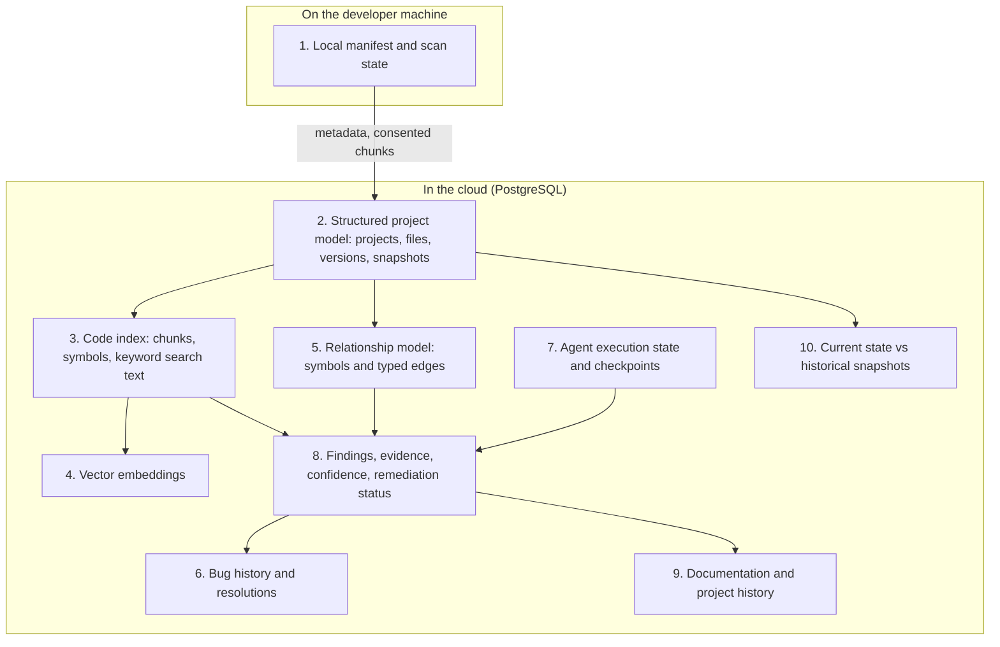
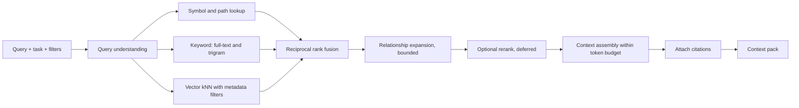
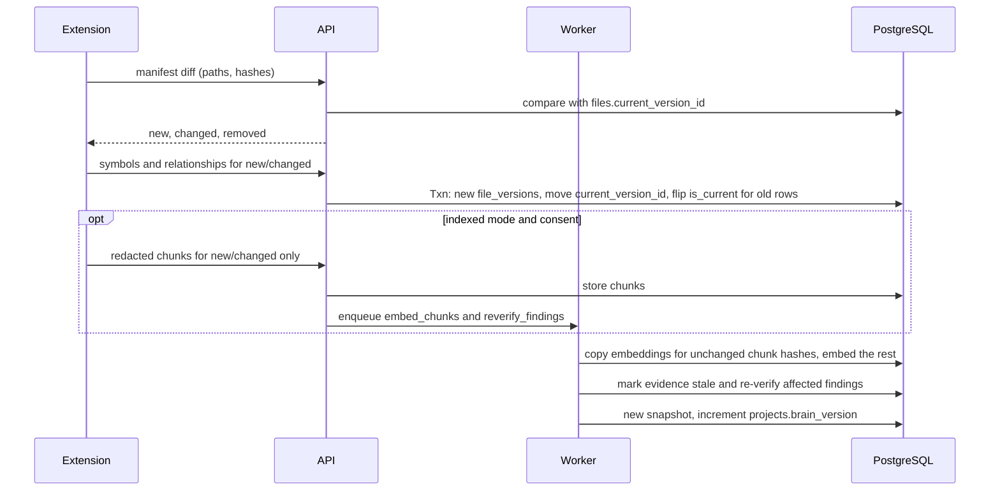
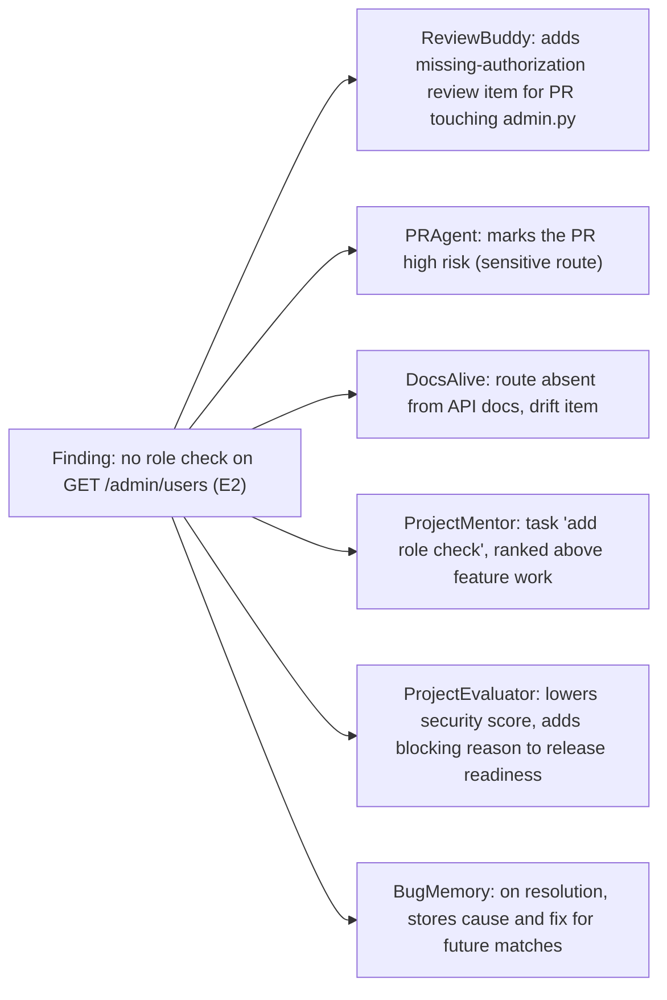

# 04 · Project Brain and Retrieval

**Purpose.** Defines the Project Brain: what it contains, how it is built from local scans and cloud ingestion, how it stays current, how information is retrieved and attributed, and how quality is measured. It is authoritative for ingestion, indexing, retrieval, embeddings and staleness rules.

**Status.** Specification only. Related: [02](02-system-architecture.md) · [03](03-data-model-and-api.md) (schemas) · [05](05-agents-and-llm-workflows.md) (consumers) · [06](06-vscode-extension-and-local-scanning.md) (producer) · [07](07-security-privacy-and-threat-model.md). Decisions: ADR-018 to ADR-022.

---

## 1. Purpose and scope

The Project Brain is a **structured, version-aware understanding of a project**. It is what lets one finding be reused by several agents and lets an answer cite the current code. It is not a single large prompt, not a bag of raw files, and not "the vector database".

In scope: knowledge categories, local vs cloud stores, parsing and chunking, symbols and relationships, keyword and vector retrieval, fusion and ranking, embeddings and their versioning, staleness, incremental synchronization, caching, deletion, evaluation.

Out of scope: agent behavior ([05](05-agents-and-llm-workflows.md)), extension internals ([06](06-vscode-extension-and-local-scanning.md)).

## 2. Ten related but different concepts



| # | Concept | What it is | What it is *not* | Where |
|---|---|---|---|---|
| 1 | Local manifest and scan state | Per-file hashes, sizes, languages, last-scan info, local findings, sync queue | The cloud's view of the project | Extension storage outside the repo |
| 2 | Structured cloud project model | Projects, files, file versions, snapshots, scan runs | Source content | PostgreSQL |
| 3 | Searchable code index | Chunks (when consented), symbol records, search text | Embeddings | PostgreSQL (`code_chunks`, `code_symbols`) |
| 4 | Vector embeddings | Numeric vectors per chunk per embedding space | An index of structure; they are source-derived data | `chunk_embeddings` (pgvector) |
| 5 | Relationship model | Typed edges between symbols and files (imports, calls, route→handler, guarded_by, tests, documents) | Semantic similarity | `code_relationships` |
| 6 | Bug history | Error signatures, causes, fixes, files | A finding list | `bug_records`, `bug_resolutions` |
| 7 | Agent execution state | Workflow state and checkpoints per run | Project knowledge (it is scratch state with references) | `agent_runs`, `langgraph` schema |
| 8 | Findings and evidence | Issues, evidence citations, confidence, status | LLM prose | `findings`, `finding_evidence` |
| 9 | Documentation and history | Known docs, drift items, scan/snapshot history, status history | Current code | `documentation_records`, `doc_drift_items`, history tables |
| 10 | Current vs historical | `current_version_id` and `is_current` for now; snapshots for then | — | `files`, `snapshot_files` |

The Brain never contains "everything the LLM was shown". An LLM prompt is assembled per task from these stores as a **context pack** and then discarded.

## 3. Knowledge categories and schemas

| Category | Source | Stored as | Needed in `metadata_only`? | Needed in `indexed`? |
|---|---|---|---|---|
| Files and versions | Extension / GitHub | `files`, `file_versions` (hash, size, language) | ✔ | ✔ |
| Symbols (name, kind, signature, lines) | Local parsing / cloud parsing | `code_symbols` | ✔ (names and signatures are code-derived metadata; the user sees this in the sync preview) | ✔ |
| Relationships | Local parsing / cloud parsing | `code_relationships` | ✔ | ✔ |
| Route and framework facts | Framework detectors | symbol `framework_tags`, `defines_route`/`guarded_by` edges | ✔ | ✔ |
| Code chunks with content | Consented upload / GitHub fetch | `code_chunks.content` | ✘ | ✔ |
| Embeddings | Cloud embedding job | `chunk_embeddings` | ✘ | ✔ |
| Findings and evidence | Scanners, verifier | `findings`, `finding_evidence` (snippet text only when consented) | ✔ (without code text) | ✔ |
| Database facts from project files | Local parsing | symbols of kind `model` plus relationships `reads_model`/`writes_model` | ✔ | ✔ |
| Bug history | Users, resolved findings | `bug_records` | ✔ | ✔ |
| Documentation | Repo docs, uploads | `documentation_records` (+ chunks in `indexed`) | partial | ✔ |
| Conversations | Website | `conversations` | ✔ | ✔ |

## 4. Local index versus cloud index

| | Local (extension) | Cloud (Project Brain) |
|---|---|---|
| Holds | Manifest, hashes, local symbols and relationships, local findings, sync queue | Everything in §3 that the sync mode allows |
| Purpose | Fast, offline scanning; know what changed | Cross-device website experience, retrieval, agents, history |
| Source text | Reads files from disk on demand; does not duplicate them | Only consented chunks (`indexed`) or per-request snippets |
| Authority | Authoritative for "what is on this machine now" | Authoritative for history, findings status, conversations |
| Failure mode | Stale if extension never runs | Stale if sync is paused; the website shows last-synced time and never claims freshness it lacks |

Ownership rules: the extension owns local manifest rows; the server owns findings *status*, history, conversations and agent state. When the extension re-scans and rediscovers a finding, it reports it; the server decides status transitions ([03](03-data-model-and-api.md) §5.1).

## 5. Code-aware parsing and chunking

### 5.1 Parsing

Tree-sitter parses Tier 1 languages (TypeScript/JavaScript, Python). Parsing runs locally in the extension and again in the server for cloud-sourced content (GitHub). The same grammar versions are pinned on both sides so symbol keys match (OQ-17).

Extracted: imports/exports, functions, classes, methods, constants, decorators, route definitions (Next.js route handlers and server actions, Express routers, FastAPI routes), model definitions (Prisma schema, SQLAlchemy declarative models, SQL migrations), call expressions resolved within the project where possible.

### 5.2 Chunking

| Rule | Detail |
|---|---|
| Unit | One chunk per top-level symbol (function, class, method group) including leading comments and decorators |
| Large symbols | Split on statement boundaries with a small overlap; never mid-statement |
| Module chunk | Imports and top-level statements |
| Config and schema files | By top-level key, model or statement |
| Markdown docs | By heading section |
| Tier 2 files (text-level) | Fixed windows of lines with overlap (starting values to tune against the retrieval evaluation set) |
| Size | A token ceiling per chunk set by the embedding model's limits in configuration |
| Metadata | `path`, `language`, `kind`, `symbol_key`, `start_line`, `end_line`, `content_hash`, framework tags, `is_test`, `is_migration` |
| Embedded text | A short header (path, qualified symbol name, kind) prepended to the code, so the vector carries location context; the stored `content` stays unmodified |

### 5.3 Redaction and exclusion

Secrets and excluded files are removed **before** chunking leaves the machine and again on the server before storage or embedding ([07](07-security-privacy-and-threat-model.md) §6). A chunk records `redaction_count`; embedded text never contains the original secret.

## 6. Symbol indexing and relationships

A symbol has a stable `symbol_key` (hash of project, path, qualified name, kind). The key survives file edits so that findings, conversations and history can follow a symbol across versions; a rename or move produces a new key and the old one's derived data goes stale.

**Relationship model in PostgreSQL versus a graph database (ADR-020):**

| Criterion | PostgreSQL tables | Graph database |
|---|---|---|
| Queries needed | Callers/callees, importers, route→handler→guard chain, tests-for-symbol, docs-for-symbol: 1–3 hops | Same, plus deep path analytics DevMind does not need |
| Operational cost | None extra | New service, backups, tenant isolation, sync |
| Consistency with versions | Same transaction as ingestion (`is_current`) | Separate write path to keep consistent |
| Tenant isolation | Same predicates as everything else | New isolation surface |
| Performance risk | Recursive CTEs degrade at large depth | Better for deep traversal |
| **Recommendation** | **Use PostgreSQL; cap depth at 3 by default** | Revisit if depth > 4 queries are routine or latency targets fail |

Traversal example (callers of a symbol up to depth 2):
```sql
WITH RECURSIVE callers(symbol_id, depth) AS (
  SELECT r.from_symbol_id, 1
  FROM code_relationships r
  WHERE r.project_id = :pid AND r.to_symbol_id = :target AND r.kind = 'calls' AND r.is_current
  UNION
  SELECT r.from_symbol_id, c.depth + 1
  FROM code_relationships r JOIN callers c ON r.to_symbol_id = c.symbol_id
  WHERE r.project_id = :pid AND r.kind = 'calls' AND r.is_current AND c.depth < :max_depth
)
SELECT DISTINCT symbol_id FROM callers;
```
Unresolved edges (`resolution = 'unresolved'`) are kept and flagged; analyses report their existence rather than ignoring dynamic or external calls.

## 7. Four ways of "understanding" code

| Method | Answers | Strength | Weakness | Used for |
|---|---|---|---|---|
| **Syntactic** (parse trees) | What is defined here? What does this call? | Exact, deterministic | No notion of meaning; needs a grammar per language | Symbols, routes, guards, chunk boundaries |
| **Keyword** (full-text, trigram) | Where does this identifier or error string occur? | Exact tokens, handles rare names | Misses paraphrase | Identifiers, paths, error messages |
| **Semantic** (embeddings) | What code is *about* this idea? | Handles natural-language questions | Approximate; can retrieve plausible but wrong code; embeds source-derived data | Concept questions ("where do we check admin permission") |
| **Relational** (explicit edges) | What is connected to this, and how? | Precise, explainable paths | Only as complete as the parser | Change impact, guard chains, test and doc links |

No single method is sufficient. Findings use syntactic and relational evidence; conversations use all four.

## 8. Hybrid retrieval



1. **Query understanding.** Deterministic first: detect identifiers, paths, error text, and filters (`path:`, `kind:`). An optional LLM `query_rewrite` task expands natural-language questions; it never replaces the original query.
2. **Parallel retrievers.** (a) symbol and path exact/prefix matches; (b) full-text over `search_text` (identifier-split text: `getUserById` → `get user by id`) plus trigram on names; (c) vector kNN in the active embedding space filtered by `project_id`, `is_current`, language, kind, path prefix.
3. **Fusion.** Reciprocal rank fusion: `score(d) = Σ 1 / (k + rank_i(d))`, starting `k = 60`, equal retriever weights. Constants live in `server/configs/retrieval.yaml` and are tuned on the evaluation set, not by feel.
4. **Relationship expansion.** For top results that are symbols, add direct callers/callees/guards/tests/docs, capped by hops and count. Expansion adds *context*, never changes ranking of direct hits.
5. **Rerank.** A cross-encoder or LLM rerank is deferred until evaluation shows a gap fusion cannot close.
6. **Context assembly.** Respect the task's token budget from LLM task configuration; merge overlapping ranges; include whole symbols preferentially; order by file and line for readability; include relevant findings and bug history summaries as separate, labelled blocks.
7. **Attribution.** Every item carries a citation: `file_version_id`, `path`, `start_line`, `end_line`, `content_hash`, `symbol_key`. The answer generator must cite from this set only; a post-check verifies every citation in the output exists in the pack and resolves to current or explicitly historical content.
8. **Insufficient context.** If fused results fall below a configured relevance floor or the mode lacks content, the response states what is missing instead of generating from weak context.

Mode differences: in `metadata_only`, retrievers (a) and relationship expansion work; (b) and (c) have no content to search, so answers are structural, and the UI offers to attach snippets for the request.

## 9. pgvector usage

- One `chunk_embeddings` table per embedding space with `vector(N)` where `N` is the space's dimension. HNSW index with cosine distance (index parameters tuned by measurement).
- **Filtered search caveat.** Approximate indexes can return too few rows when a restrictive filter (`project_id`) is applied after the index scan. Mitigations to evaluate in order: use the extension's iterative-scan options if available on the Neon-provided version (to verify); query with a larger candidate limit then filter; partition `chunk_embeddings` by workspace hash; as a last resort, exact scan for small projects (cheap when a project has few thousand chunks). The choice is made by measuring recall against exact search on the evaluation set.
- Queries always filter on `project_id` and `is_current`; this is a tenant-isolation requirement, tested ([09](09-testing-and-quality-strategy.md) §6).
- Vectors are stored with the `embedding_space_id`; comparisons across spaces are impossible by construction.
- Vectors are source-derived data: they are deleted with the source (§15).

## 10. Hosted embeddings and versioning

- **Interface.** `EmbeddingProvider.embed(texts, input_type)` is separate from the generation interface so providers can differ ([05](05-agents-and-llm-workflows.md) §5). Query and document embeddings can use different `input_type` where a provider distinguishes them.
- **Embedding space record.** `embedding_spaces(provider_id, model_id, dimension, status, config_hash)`. Exactly one space is `active` for retrieval at a time per environment.
- **Startup validation.** The configured active space's dimension must match the table's column; mismatch fails startup.
- **Changing the model (re-embedding runbook).**
  1. Add the new model to configuration; create a new `embedding_spaces` row with `status = building` and its table via migration.
  2. Run `embed_chunks` jobs for all current chunks into the new space (idempotent; resumable; quota-aware).
  3. Run the retrieval evaluation set against old and new spaces; compare.
  4. If acceptable, switch `active` to the new space in configuration and restart; old space becomes `deprecated`.
  5. Drop the old table after a grace period.
- **Cost control.** Embedding jobs obey workspace quotas and per-job budgets; unchanged chunks are never re-embedded (§11).

## 11. Versioning, staleness and incremental synchronization

### 11.1 Ingestion pipeline



### 11.2 Staleness rules

| Event | Effect |
|---|---|
| File content hash changes | New `file_versions` row; `current_version_id` moves; old symbols, relationships, chunks `is_current = false` (same transaction) |
| File removed | `files.removed_at` set; its current rows non-current |
| Evidence's file version no longer current | `finding_evidence.is_current = false`; open findings move to `stale` and a re-verification job is enqueued |
| Symbol key disappears (rename/move) | Findings and citations referencing it go stale; conversations show a "code changed since this answer" badge |
| Doc drift item's symbol changes | Drift item re-evaluated |
| Embedding for non-current chunk | Kept for the snapshot retention window, then deleted |
| Parser or rules version changes | Findings and symbols for affected files re-derived by a background job |

**Current vs outdated analysis.** Anything derived carries the `file_version_id` it was derived from. Retrieval and agents default to `is_current`; history views use snapshots. A UI element that shows derived data always shows whether its source is current.

### 11.3 Incremental sync guarantees

- Unchanged files (same hash) are not re-uploaded, re-chunked or re-embedded.
- Chunk-level reuse: when a changed file contains an unchanged symbol (same `content_hash`), its embedding is copied from the earlier chunk instead of recomputed.
- Sync is resumable: the client persists a queue; the server accepts the same batch twice with the same idempotency key.
- `projects.brain_version` increments per completed ingestion and keys caches.

## 12. Caching

| Cache | Key | Invalidation | Notes |
|---|---|---|---|
| Query embedding | hash(workspace, space, query text) | TTL | Avoids repeat embedding cost |
| Retrieval result | (project, `brain_version`, query hash, filters) | `brain_version` increment | Never cross-tenant; value holds IDs, not code |
| Parsed file cache (extension) | content hash + grammar version | Hash or grammar change | Local only |
| LLM output | Not cached by default | — | Only deterministic, side-effect-free tasks may opt in, keyed with workspace and prompt version |

Keys always include the workspace; caches never contain code bodies in Redis (IDs and scores only).

## 13. Representative examples

### 13.1 Retrieval: "Where is admin permission enforced?"

1. Query understanding extracts concepts `admin`, `permission`.
2. Symbol lookup finds `require_admin` and `AdminGuard`; keyword search finds `role == "admin"` in two handlers; vector search surfaces `authorization.py::check_role` that uses different words.
3. Fusion ranks `require_admin` first (found by three retrievers).
4. Expansion adds routes with `guarded_by` edges to `require_admin` and routes **without** it among admin-prefixed routes.
5. Context pack cites four symbols with line ranges; the answer lists enforced routes and flags the unguarded one as a *possible* gap with a pointer to the finding.

### 13.2 One finding, many consumers



Only the agents relevant to a trigger run. A change to `README.md` triggers DocsAlive only; the finding above is read, not recomputed, by the others. No agent receives the whole project.

### 13.3 Staleness: the fix

The developer adds a role dependency to the handler. The extension re-hashes `admin.py` → new file version → old evidence non-current → finding becomes `stale` → re-verification finds the guard → finding `resolved`, history records the transition, ProjectMentor's task completes, evaluation recomputes on next run.

## 14. Retrieval quality evaluation

| Element | Specification |
|---|---|
| **Fixture projects** | Small, realistic TypeScript and Python projects stored in `evals/fixtures/` with known structure |
| **Labeled queries** | Natural-language, identifier, error-string and "needs relationship" queries, each with the set of correct chunks/symbols; includes **no-answer** queries |
| **Metrics** | recall@k, mean reciprocal rank, nDCG@k, citation validity rate, correct no-answer rate, p50/p95 latency |
| **Ablations** | keyword only, vector only, symbol only, hybrid, hybrid + expansion |
| **Embedding comparison** | Same set across candidate embedding spaces before any switch |
| **Filtered ANN check** | Recall of the approximate query vs exact scan under tenant filters |
| **Regression gate** | No metric may fall below the recorded baseline; baselines recorded in `evals/results/` and summarized in [09](09-testing-and-quality-strategy.md) §9 |

Baselines are produced in the milestone that builds retrieval ([11](11-mvp-and-implementation-roadmap.md) M5), not assumed here.

## 15. Data deletion and index cleanup

| Trigger | Action |
|---|---|
| Consent revoked or mode set to `metadata_only` | Delete `code_chunks.content`, `chunk_embeddings`, evidence snippet text for the project; symbols and metadata remain |
| Retention expiry | Delete non-current chunks and embeddings beyond the snapshot window |
| File removed | Non-current immediately; deleted per retention |
| Project deletion | `purge_project`: chunks, embeddings, symbols, relationships, findings, conversations, checkpoints, R2 objects, caches |
| Embedding space retirement | Drop table after grace |
| Verification | The purge job records per-store row counts deleted; a test asserts no rows remain for a deleted project |

## 16. Failure states

| Failure | Behavior |
|---|---|
| Embedding provider unavailable | Retrieval degrades to keyword + symbol; response flagged `degraded: true`; embedding jobs retry |
| Active space dimension mismatch | Startup fails with explicit error |
| Parser error on a file | File recorded as `parse_failed`; falls back to text-level chunking; no symbols; findings say "not analyzed" for that file |
| Unsupported language | Tier 2 text-level indexing only; security analysis reports "not analyzed" |
| Stale base on sync | `409 sync.stale_base`; client re-diffs |
| Redaction removes most of a chunk | Chunk dropped and counted; reported in sync receipt |
| Retrieval below relevance floor | Answer states insufficient context |
| Partial ingestion | Job `partially_succeeded`; unfinished files listed; the Brain is consistent per file version, never half-written |
