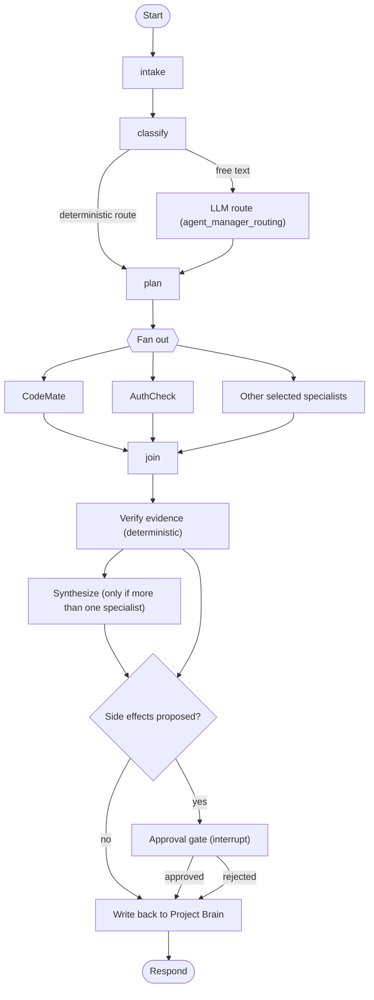
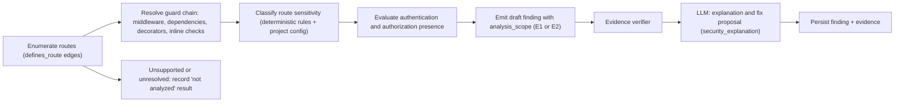

# 05 · Agents and LLM Workflows

**Purpose.** Specifies the Agent Manager, the specialist agents, the LangGraph workflow design, the LLM gateway and provider abstraction, configuration, routing, accounting and evaluation. It is authoritative for agent behavior and LLM configuration.

**Status.** Specification only. LangGraph and provider API names must be checked against the installed versions when implementing (see the verification register in [12](12-architecture-decisions-and-open-questions.md) §5). Related: [02](02-system-architecture.md) · [03](03-data-model-and-api.md) · [04](04-project-brain-and-rag.md) · [07](07-security-privacy-and-threat-model.md) · [09](09-testing-and-quality-strategy.md). Decisions: ADR-006, ADR-016, ADR-017, ADR-024, ADR-027, ADR-028, ADR-037.

---

## 1. Principles

1. **Agents reason over evidence; they do not generate evidence.** Evidence comes from deterministic analysis and the Project Brain ([04](04-project-brain-and-rag.md)).
2. **Agents ask for work by task name.** No agent names a provider or model.
3. **Least privilege.** Agents get read-only retrieval tools plus `propose_*` tools that write proposals, never side effects.
4. **A finding without verifiable evidence is not a finding** (ADR-024).
5. **Humans approve consequences.** External side effects pause at an approval gate.
6. **Use a graph only when it earns its keep** (ADR-006).

## 2. Agent Manager

The Agent Manager is the single entry point for agent workflows. It does not analyze code itself.

| Responsibility | Detail |
|---|---|
| Intake | Validate the job, load `AuthContext`, snapshot configuration hash, load budgets |
| Classify intent | Deterministic rules first (job type, explicit command, PR event); LLM `agent_manager_routing` only for free-form chat |
| Plan | Map intent to a set of specialists from a table (below); never "let the model decide everything" |
| Dispatch | Run specialists in parallel where independent |
| Verify | Pass all draft findings through the deterministic evidence verifier |
| Synthesize | Merge results; call the LLM (`final_synthesis`) only when multiple specialists contributed |
| Gate | Pause for approval when proposals carry side effects |
| Write back | Persist findings, messages, citations, bug records through domain services |
| Account | Record usage and per-node outcomes |

### 2.1 Intent to specialist plan

| Intent (examples from the vision) | Specialists run | Release |
|---|---|---|
| Ask about code ("How does authentication work?") | CodeMate | MVP |
| Security check ("Is this endpoint protected?") | AuthCheck (retrieval from CodeMate tools) | MVP |
| Review a change | ReviewBuddy, AuthCheck | 1.1 |
| Analyze a pull request | PRAgent → {AuthCheck, ReviewBuddy, DocsAlive} in parallel | 1.1 |
| Similar bug ("Find bugs similar to this error") | BugMemory | 1.2 |
| Documentation check | DocsAlive | 1.2 |
| What next? | ProjectMentor | 1.3 |
| "Is it ready to deploy?" / health | AuthCheck, ReviewBuddy, BugMemory, DocsAlive, DeployDoctor in parallel → ProjectEvaluator | 1.3 |
| Deployment failure | DeployDoctor, BugMemory | 1.4 |

Capabilities not yet released are absent from the plan table at runtime; asking for them returns a clear "not available yet" result, not a guess.

## 3. What is deterministic, what uses an LLM, what combines

| Job | Approach | Reason |
|---|---|---|
| File discovery, hashing, manifest diff | Deterministic | Exact |
| Parsing, symbols, relationships, route detection | Deterministic | Syntactic facts must be reproducible |
| Secret detection, dependency audit | Deterministic scanners | Established tools; LLM adds noise |
| Authentication/authorization structure on routes | **Deterministic detection → verifier → LLM explanation** | Existence of a guard is a code fact; explaining impact is language work |
| Retrieval, fusion, ranking | Deterministic | Measurable |
| Answer to a code question | **Retrieval (deterministic) → LLM generation → citation check (deterministic)** | Needs language; must stay grounded |
| Error signature extraction, bug matching candidates | Deterministic (normalization, fingerprints, FTS/vector) → LLM only to compare and explain top candidates | |
| Documentation drift detection | Deterministic diff of routes/symbols vs doc references → LLM drafts patch proposals | |
| Task ranking | Deterministic (dependencies, severity, blocking) → LLM explains | Ranking must be consistent |
| Health scores and readiness verdict | Deterministic rubric → LLM narrates | A number must not depend on prose |
| Deployment diagnosis | Deterministic signature and config checks → LLM ranks hypotheses with citations | Logs are messy; evidence still required |
| Intent classification for free text | LLM with deterministic rules first | |
| CRUD, permissions, quotas, status transitions | Ordinary services (no graph) | ADR-006 |

**LangGraph workflows:** the Agent Manager graph and each specialist subgraph. **Not graphs:** ingestion, embedding, scanning, scoring, retention, reaping, webhooks.

## 4. LangGraph design

### 4.1 Manager graph



### 4.2 State

State holds **references and small structured values**, never code bodies, so checkpoints stay small and free of source.

```python
class RunState(TypedDict):
    run_id: str; job_id: str; project_id: str; workspace_id: str
    actor_id: str; consent_id: str | None
    request: Request                    # job type, params, user message
    intent: Intent | None
    plan: list[SpecialistTask]          # which specialists, scoped inputs
    context_refs: list[CitationRef]     # IDs/citations, not text
    drafts: list[DraftFinding]          # reducer: append
    verified: list[VerifiedFinding]
    hypotheses: list[Hypothesis]        # unverified; shown in chat only
    proposals: list[Proposal]           # fixes, doc patches, comments
    approvals: list[ApprovalState]
    errors: list[NodeError]             # reducer: append
    usage: UsageTotals                  # reducer: sum
    budget: Budget
```
Context text is rebuilt from references inside a node when needed and discarded after.

### 4.3 Conditional routing and parallelism

- Plan comes from the intent table (§2.1) restricted by released capabilities and project mode.
- Independent specialists run in parallel using LangGraph's fan-out mechanism; join waits for all, with a per-specialist timeout.
- Within a specialist, retrieval calls that do not depend on each other run concurrently.
- The gateway enforces per-workspace concurrency, so a parallel plan cannot exceed limits.

### 4.4 Retry, timeout and failure policy

| Level | Policy |
|---|---|
| LLM call | Gateway retries transient errors per task config ([§11](#11-llm-configuration-design)); does not retry validation errors |
| Tool call (retrieval, DB) | Up to 2 retries for transient errors with backoff; permission and validation errors are final |
| Node | A node that raises a classified retryable error is retried by the graph (max 2); others propagate |
| Specialist | Timeout per specialist from configuration; on timeout, its result is `errors += timeout` |
| Run | Wall-clock and token budgets; on exhaustion the run ends `partially_succeeded` with what completed |
| Failure propagation | A failed specialist does not fail the run if others succeed; synthesis states which specialist failed. For release readiness, a failed *required* check makes the verdict `not_ready` with reason "check unavailable" — never `ready` |
| Cancellation | `cancel_requested` checked before each node |

### 4.5 Checkpointing

LangGraph's PostgreSQL checkpointer, `thread_id = agent_run.thread_id`, in the `langgraph` schema (ADR-037). A worker restart resumes from the last completed node. Checkpoints contain references only. Neon pooling compatibility is open (OQ-12). Checkpoints are deleted with the project and by retention.

### 4.6 Human approval

An approval gate uses LangGraph's interrupt mechanism. On reaching it: create an `approvals` row (`pending`) with a *proposal* (exact text of the PR comment, issue, patch), set the job `awaiting_approval`, and publish an event. A maintainer approves or rejects through `POST /jobs/{id}/approvals/{approval_id}`; the worker resumes the thread. Approvals expire (configurable); expiry equals rejection.

| Action kind | Gated? | Notes |
|---|---|---|
| Show a finding, answer, report in DevMind | No | Presented as a recommendation |
| Post a PR comment or create an issue on GitHub | **Yes** | Exact text shown |
| Commit or apply any code or documentation change | **Yes** | v1 produces diff proposals only |
| Publish a release-readiness verdict outside DevMind (status check) | **Yes** | |
| Delete data | **Yes** (user action with confirmation) | |
| Any deployment or merge | Never performed in v1 | |

## 5. LLM gateway and provider abstraction

### 5.1 Interfaces

```python
class LLMGateway:
    async def generate(self, task: str, messages, *, schema: type[BaseModel] | None = None,
                       tools: list[ToolSpec] | None = None, ctx: CallContext) -> LLMResult: ...
    async def stream(self, task: str, messages, *, ctx: CallContext) -> AsyncIterator[LLMChunk]: ...
    async def embed(self, task: str, texts: list[str], *, ctx: CallContext) -> EmbeddingResult: ...

class GenerationProvider(Protocol):      # one adapter per provider API
    async def generate(self, req: NormalizedRequest) -> NormalizedResponse: ...
    async def stream(self, req: NormalizedRequest) -> AsyncIterator[NormalizedChunk]: ...

class EmbeddingProvider(Protocol):       # separate; may use a different provider
    async def embed(self, req: EmbedRequest) -> EmbedResponse: ...
```

`CallContext` carries workspace, project, job, consent, budget. Embedding and generation providers are independent (ADR-019).

### 5.2 Gateway responsibilities

Resolve task → model chain; validate capabilities; check quota and consent coverage for the provider; render and size the request; normalize to the adapter's format; call with timeout; classify errors; retry per policy; fall back per policy; parse and validate structured output (one repair attempt); normalize response; record usage; emit a trace span without payloads.

### 5.3 Adapters

One adapter per provider API family, each translating: message roles, system prompts, tool schemas and tool-call results, structured-output mechanism, streaming chunks, token usage, error taxonomy. Candidate adapters: Anthropic, OpenAI, Google, and an OpenAI-compatible adapter for other services. These are candidates, not commitments (ADR-017). A `fake` adapter supports deterministic tests.

**Library question (open design detail).** A third-party multi-provider library could replace custom adapters. Evaluate it against: capability transparency, structured-output and tool-call fidelity per provider, streaming, error classification, dependency size and upgrade cadence, and security posture. Default: thin custom adapters wrapping official SDKs; agents depend only on the gateway, so this can change without touching agents.

### 5.4 Capability honesty

Providers are **not** assumed equivalent. A model's `capabilities` in `models.yaml` declare only what has been verified for that model: tool calling, structured output mechanism (`native`, `json_mode`, `prompt_only`, `none`), streaming, maximum input and output tokens. Tasks declare `required_capabilities`. Startup validation refuses configurations where a task's primary model or any fallback lacks a required capability.

## 6. Specialist agents

Codenames from the vision: AuthCheck, ReviewBuddy, PRAgent, DocsAlive, DeployDoctor, ProjectMentor. CodeMate, BugMemory and ProjectEvaluator are proposed names.

### 6.1 Summary

| Agent | Capability | Release | Tools | Output | Side effects |
|---|---|---|---|---|---|
| CodeMate | CAP-01 | MVP | search_brain, get_symbol, get_file_range, get_relationships | Answer with citations, symbol explanations | none |
| AuthCheck | CAP-02 | MVP | route enumeration, guard resolution, scanner results, get_relationships | Draft findings, fix proposals | none (proposals) |
| ReviewBuddy | CAP-05 | 1.1 | diff access, project rules, findings | Checklist findings | none |
| PRAgent | CAP-06 | 1.1 | GitHub read adapter, relationships | PR summary, impact set, subgraph results | PR comment (gated) |
| BugMemory | CAP-03 | 1.2 | error normalizer, search over bug records | Matches with prior resolution | none |
| DocsAlive | CAP-04 | 1.2 | doc records, symbol/route list | Drift items, patch proposals | doc patch (gated) |
| ProjectMentor | CAP-08 | 1.3 | tasks, findings | Ranked next task + explanation | none |
| ProjectEvaluator | CAP-09 | 1.3 | all scores inputs | Scores, verdict, reasons | external status (gated) |
| DeployDoctor | CAP-07 | 1.4 | log redactor/parser, env-name check, incidents | Ranked causes with citations | none |

### 6.2 CodeMate

1. Retrieve a context pack ([04](04-project-brain-and-rag.md) §8) for the question.
2. Generate an answer constrained to the pack (`code_answer` task), requiring citations by pack ID.
3. Deterministic post-check: every citation resolves; claims without a citation about code behavior are flagged and trimmed or the answer regenerated once.
4. If the pack is insufficient, respond with what is missing.

### 6.3 AuthCheck (security intelligence, MVP scope)



- **Framework detectors (MVP):** Next.js route handlers and server actions, Express, FastAPI. Anything else yields "not analyzed" results, listed in the report; absence of a finding is **not** reported as "safe".
- **Authorization signals:** role/permission dependencies, middleware guards, calls to known authorization helpers (configurable per project), explicit role comparisons in the handler. Ownership checks (object-level authorization) are a documented limitation in the MVP: reported as "not analyzed" rather than assumed.
- **Evidence levels:** E1 when a rule matches but call-path resolution is incomplete; E2 when the guard chain is fully resolved within `analysis_scope` and no authorization check is present. `analysis_scope` lists what was examined and what was unresolved.
- **LLM role:** explain impact, suggest a fix as a diff proposal, point out likely false-positive causes (which may *lower* confidence but never raise severity or evidence level). The LLM may also emit **hypotheses** about logic flaws; these are shown in chat as hypotheses and are never persisted as findings unless deterministic evidence supports them.
- **Other MVP checks:** hard-coded secrets (scanner), handlers that read request bodies without a validation step (structural), unsafe configuration patterns defined in the rule pack.
- **Never claims** exploitability. Language: "possible authorization gap", "no authorization check found on the analyzed call path".

### 6.4 ReviewBuddy (1.1)

Applies the project's checklist (input validation, error handling, authorization, tests, documentation, plus user-defined rules) to a diff. Detection is structural and rule-based; the LLM writes reasons and fixes. Custom rules are declared in a project rules file with an ID, scope selector, check type and message, validated against a schema.

### 6.5 PRAgent (1.1)

Fetch PR metadata and diff (read-only), map changed files to symbols and affected modules, compute **change impact** through relationships (callers, importers, route/guard chains, tests, docs), invoke AuthCheck, ReviewBuddy and DocsAlive on the changed scope in parallel, assemble the summary (purpose, files, affected areas, risks, security findings, testing concerns, documentation impact). Posting to GitHub requires approval.

### 6.6 BugMemory (1.2)

Normalize an error (strip paths, IDs, timestamps; extract exception type and top frames), compute a fingerprint, find candidates through exact fingerprint, full-text and vector search over `bug_records`, then the LLM compares top candidates and explains similarity, stating differences. A low-similarity result is labelled as such. On resolution of a finding or user-logged bug, the agent proposes a record (cause, fix, files) for the user to confirm.

### 6.7 DocsAlive (1.2)

Compare current routes, exported symbols and configuration keys with documentation references; classify drift (undocumented, removed-but-documented, changed signature, stale section); generate patch proposals. Applying a patch is gated.

### 6.8 ProjectMentor (1.3)

Rank open tasks and findings by deterministic score: blocking relationships, severity, dependency order, then recency; the LLM explains the top recommendation ("complete the order-state flow; the payment module depends on it"). Tasks come from users, findings, or agent suggestions the user accepted.

### 6.9 ProjectEvaluator (1.3)

Computes dimension scores (functionality, code quality, security, testing, documentation, deployment) from documented rubric rules, then a release-readiness verdict from policy rules (for example any open E2 critical finding → `not_ready`). The rubric and thresholds are versioned (`rubric_version`) and configurable. Functionality is limited and labelled (OQ-18). The LLM writes the narrative; it cannot change a number or verdict. Scores are described as rubric results, not benchmarks.

### 6.10 DeployDoctor (1.4)

Input: pasted or uploaded log, optional recent change set, environment variable **names**. Steps: redact and cap size; extract error signatures; check referenced environment names against names used in code and `.env.example`; match past incidents and bug records; the LLM ranks hypotheses with confidence, each citing log lines and code locations. Never stores or requests secret values.

## 7. Evidence requirements and the verifier

Every draft finding must supply: category, rule or detector ID, at least one `evidence` item (file version, path, line range, snippet hash), evidence level, and (for E2 "missing check") `analysis_scope`.

The verifier is deterministic code:

| Check | Fails when |
|---|---|
| File and version | Path is not in the current snapshot or version differs from the cited one |
| Line range | Outside the file or empty |
| Snippet hash | Hash of the cited lines differs from `snippet_hash` |
| Rule | Rule ID unknown |
| Structural claim | For authorization findings, re-resolves the guard chain and confirms the stated result |
| Level | Claims E2 but analysis scope shows unresolved nodes on the path → downgraded to E1 |
| Secrets | Evidence snippet contains an unredacted secret |

Failed drafts are dropped or downgraded; the reason is recorded in the run (not shown as a finding). Hypotheses without evidence appear in chat labelled as such.

## 8. Prompt management (ADR-028)

- Prompts are files in `server/app/llm/prompts/<task>/vN.md` with front matter (task, version, input variables, output schema, required capabilities).
- Rendering is deterministic; variables are escaped; **untrusted content is placed in clearly delimited data blocks** and the system prompt states that content inside is data, not instructions ([07](07-security-privacy-and-threat-model.md) §8).
- The prompt version used is recorded in `agent_runs.prompt_versions`.
- Prompt changes require passing the regression suite (§15) and an evaluation delta where behavior changes.
- No secrets, customer names or real code in committed prompts or examples.

## 9. Tool execution boundaries

| Rule | Detail |
|---|---|
| Closed set | Agents receive an explicit list of tools; no generic shell, file-system or network tool exists |
| Read-only by default | Retrieval and listing tools are scoped by `AuthContext` and project |
| Writes are proposals | `propose_finding`, `propose_fix`, `propose_doc_patch`, `propose_bug_record`, `propose_pr_comment` write to proposal records. Persisting findings goes through the verifier; external effects go through approval |
| No repository code execution | Neither server nor agents run project code or tests in v1 |
| Bounded results | Tools cap result counts and sizes |
| Argument validation | Tool arguments are validated against schemas; IDs are re-authorized, never trusted from model output |
| No credentials in tool context | GitHub tokens, API keys and DB credentials are never visible to a model |
| Audit | Tool calls are logged with names, sizes and outcomes, not payloads |

## 10. Structured outputs

Each task that needs structure names a Pydantic `output_schema`. The gateway uses the model's declared mechanism (native schema mode, JSON mode, or prompt-based) and validates the result. On failure: one repair attempt with the validation error; then the call fails with `llm.invalid_output` (no fallback model, because the fault is not provider availability). Tool-calling tasks require `tool_calling` capability and validate tool arguments before execution.

## 11. LLM configuration design

Layout (non-secret, committed):

```text
server/configs/llm/
  providers.yaml     # who we can call, environments, data policy flags, timeouts
  models.yaml        # model registry: id, provider, verified capabilities, limits, price units
  tasks.yaml         # task → model, fallbacks, params, required capabilities, budgets
.env.example         # names of secrets only, placeholder values
```

All values below are **illustrative placeholders**. `.invalid` hostnames and `REPLACE_…` strings are intentional: startup validation rejects them outside development.

### 11.1 `providers.yaml`

```yaml
version: 1
providers:
  primary_provider:
    adapter: openai_compatible          # anthropic | openai | google | openai_compatible | fake
    base_url: "https://api.provider-a.invalid/v1"
    api_key_env: DEVMIND_LLM_PRIMARY_API_KEY
    enabled: true
    environments: [development, staging, production]
    terms_reviewed: false               # must be true before production use (OQ-03)
    data_policy:
      source_code_allowed: false        # set true only after terms review is recorded
      note: "REPLACE with the reviewed retention/training terms reference and date"
    timeouts: { connect_s: 5, read_s: 60 }
    concurrency: { max_in_flight: 8 }
  alternative_provider:
    adapter: anthropic
    api_key_env: DEVMIND_LLM_ALT_API_KEY
    enabled: false
    environments: [staging, production]
    terms_reviewed: false
    data_policy: { source_code_allowed: false, note: "REPLACE" }
    timeouts: { connect_s: 5, read_s: 60 }
  embedding_provider:
    adapter: openai_compatible
    base_url: "https://api.provider-b.invalid/v1"
    api_key_env: DEVMIND_EMBED_API_KEY
    enabled: true
    environments: [development, staging, production]
    terms_reviewed: false
    data_policy: { source_code_allowed: false, note: "REPLACE" }
    timeouts: { connect_s: 5, read_s: 30 }
  fake_provider:
    adapter: fake
    enabled: true
    environments: [development, test]
```

### 11.2 `models.yaml`

```yaml
version: 1
models:
  primary_reasoning:
    provider: primary_provider
    model_id: "REPLACE_WITH_EVALUATED_MODEL_ID"
    kind: generation
    status: unvalidated                 # unvalidated | evaluated | deprecated
    capabilities:                       # declare only what has been verified for this model
      tool_calling: true
      structured_output: native         # native | json_mode | prompt_only | none
      streaming: true
    limits: { max_input_tokens: null, max_output_tokens: null }   # REQUIRED before use
    price_units: { input_per_1k: null, output_per_1k: null }      # from official pricing; for cost accounting only
  fast_light:
    provider: primary_provider
    model_id: "REPLACE_WITH_EVALUATED_MODEL_ID"
    kind: generation
    status: unvalidated
    capabilities: { tool_calling: false, structured_output: json_mode, streaming: true }
    limits: { max_input_tokens: null, max_output_tokens: null }
    price_units: { input_per_1k: null, output_per_1k: null }
  fallback_reasoning:
    provider: alternative_provider
    model_id: "REPLACE_WITH_EVALUATED_MODEL_ID"
    kind: generation
    status: unvalidated
    capabilities: { tool_calling: true, structured_output: prompt_only, streaming: true }
    limits: { max_input_tokens: null, max_output_tokens: null }
    price_units: { input_per_1k: null, output_per_1k: null }
  embed_code:
    provider: embedding_provider
    model_id: "REPLACE_WITH_EVALUATED_EMBEDDING_MODEL_ID"
    kind: embedding
    status: unvalidated
    dimension: null                     # REQUIRED; must match the active embedding space
    limits: { max_input_tokens: null }
    normalize: true
  test_model:
    provider: fake_provider
    model_id: "fake-deterministic"
    kind: generation
    status: evaluated
    capabilities: { tool_calling: true, structured_output: native, streaming: true }
    limits: { max_input_tokens: 100000, max_output_tokens: 4000 }
    price_units: { input_per_1k: 0, output_per_1k: 0 }
```

### 11.3 `tasks.yaml`

```yaml
version: 1
defaults:
  timeout_s: 60
  retry: { max_attempts: 3, backoff: exponential, initial_delay_s: 1, max_delay_s: 30,
           jitter: true, retry_on: [timeout, rate_limit, provider_5xx, connection] }
tasks:
  agent_manager_routing:
    model: fast_light
    fallbacks: [fallback_reasoning]
    required_capabilities: [structured_output]
    output_schema: AgentPlan
    params: { temperature: 0.0, max_output_tokens: 500 }       # illustrative
    budget: { max_input_tokens: 6000 }
  code_answer:
    model: primary_reasoning
    fallbacks: [fallback_reasoning]
    required_capabilities: [streaming]
    params: { temperature: 0.2, max_output_tokens: 1500 }
    budget: { max_input_tokens: null }                         # set after measuring context packs
    data: { may_contain_source: true }
  security_explanation:
    model: primary_reasoning
    fallbacks: []                                              # no fallback until a second provider passes review
    required_capabilities: [structured_output]
    output_schema: FindingExplanation
    params: { temperature: 0.0, max_output_tokens: 1200 }
    data: { may_contain_source: true }
  final_synthesis:
    model: primary_reasoning
    fallbacks: [fallback_reasoning]
    required_capabilities: [structured_output]
    output_schema: SynthesizedAnswer
    params: { temperature: 0.2, max_output_tokens: 1500 }
  query_rewrite:
    model: fast_light
    fallbacks: []
    required_capabilities: [structured_output]
    output_schema: RewrittenQuery
    params: { temperature: 0.0, max_output_tokens: 200 }
  embedding_code:
    kind: embedding
    model: embed_code
    batch: { max_items: null }                                 # from provider limits
  embedding_query:
    kind: embedding
    model: embed_code
```

Further tasks follow the same shape as agents are built: `code_review_reasoning`, `pr_summary`, `doc_patch_proposal`, `bug_match_explanation`, `deployment_diagnosis`, `task_explanation`, `evaluation_narrative`, `file_summary`.

### 11.4 Validation, unknown models, startup

| Rule | Behavior |
|---|---|
| Schema | Pydantic models with `extra = forbid`; wrong types fail |
| Referential integrity | Every `task.model`, `fallback`, `model.provider` must exist |
| Unknown model for an enabled task | **Startup fails** with the task and key |
| Placeholders | `REPLACE_*`, `.invalid`, null required limits fail startup in staging and production; allowed only in development and test with the `fake` provider |
| Capability check | Primary and every fallback must satisfy `required_capabilities`; otherwise startup fails naming both |
| Embedding | Task model dimension must equal the active `embedding_spaces.dimension` |
| Secrets | Each enabled provider's `api_key_env` variable must be set (value never logged); missing → fail |
| Data policy | A task with `may_contain_source: true` cannot route to a provider whose `source_code_allowed` is false; production requires `terms_reviewed: true` |
| Disabled tasks | Skipped with a warning |
| Config hash | A hash of the three files is computed at startup, recorded on each run |

### 11.5 Reload behavior

Production and staging: **restart required** for any change; the config hash makes behavior reproducible. Development: optional hot reload of `tasks.yaml` only. A running job keeps the configuration snapshot it started with, so a deploy cannot change a half-finished workflow's models.

### 11.6 Fallback compatibility

A fallback is valid only if it (1) satisfies the task's required capabilities, (2) is permitted by data policy for the task's data class, (3) is covered by the project's consent record when the call contains source, (4) has `status != deprecated`, and (5) fits the context size (the gateway trims or fails; it never silently truncates). Prompt compatibility is the task author's responsibility and is tested per fallback in the regression suite.

## 12. Model routing and fallback policy (ADR-027)

| Situation | Behavior |
|---|---|
| Normal | Task's primary model |
| Timeout, connection error, 5xx, rate limit after retries | Next fallback that satisfies §11.6 |
| Invalid structured output after one repair | Fail the call (`llm.invalid_output`); do not fall back |
| Content refusal | Return as a refusal result; do not retry on other providers to bypass |
| No eligible fallback | Fail with `llm.unavailable`; job retried later per job policy |
| Quota or budget exhausted | Stop before the call; `quota.exceeded`; partial results kept |

Routing can differ by task (complex reasoning, security explanation, summarization, routing) and by environment, entirely in `tasks.yaml`.

## 13. Token and cost accounting; rate limits

- Every gateway call writes a `usage_records` row: workspace, project, job, task, provider, model, input/output tokens (provider-reported where available, estimated otherwise), `cost_units` (from `price_units`; no real prices appear in this repo's docs), latency, outcome.
- **Pre-call checks:** workspace monthly token quota, concurrent job quota, per-job token budget, estimated input size vs model limit.
- **Rate limits:** per-provider concurrency semaphores and token buckets in Redis; `Retry-After` honored; per-workspace concurrency caps prevent one tenant starving others.
- **Visibility:** usage and quotas are shown in workspace settings; thresholds produce warnings before hard stops.
- Logs and traces exclude payloads.

## 14. Prompt-injection posture (summary)

Repository content, logs, documents and retrieved text are untrusted. Controls: delimited data blocks; system instructions state that data cannot change instructions or tool use; tools are least-privilege so a hijacked model cannot cause side effects without approval; outputs are schema-validated; citation and evidence checks reject fabricated references; suspicious instruction-like content in data is flagged in the run record. Full model: [07](07-security-privacy-and-threat-model.md) §8. Tests: [09](09-testing-and-quality-strategy.md) §12.

## 15. Regression tests for agents

| Layer | Test |
|---|---|
| Config | Valid and invalid fixture configs; capability mismatch; placeholder rejection |
| Gateway | Fake provider with fault injection: timeouts, rate limits, 5xx, malformed output, partial streams; fallback eligibility; quota stop |
| Adapters | Recorded-shape tests per provider adapter for request/response/error normalization (no live calls in CI) |
| Prompts | Rendering snapshot tests; untrusted-block delimiters present; variables escaped |
| Nodes | Each node with fixed state in and out |
| Graphs | Full runs with the fake provider; checkpoint resume after forced interruption; approval pause and resume; parallel failure propagation |
| Evidence | Verifier accepts valid, rejects tampered, downgrades unresolved scope |
| Live-model eval | Separate, budgeted, non-blocking workflow comparing against recorded baselines (§16) |

## 16. Model evaluation and benchmark procedure

Model names are never chosen from popularity or memory (ADR-017). Procedure:

1. **Candidates.** List provider/model pairs from official documentation; record the research date and links in [12](12-architecture-decisions-and-open-questions.md) §5.
2. **Hard gates.** Provider terms reviewed for the data classes DevMind sends; required capabilities declared and verified by tests; limits sufficient.
3. **Datasets.** Maintained in `evals/llm/`: code Q&A grounded in fixture projects; security explanation faithful to given evidence; tool-calling accuracy; structured-output validity; routing classification; prompt-injection resistance; long-context pack handling.
4. **Metrics.** Schema validity rate; citation validity; faithfulness to evidence (rubric with human-labeled gold set; LLM-as-judge only as a secondary signal and checked against humans); tool-call correctness; injection resistance; latency p50/p95; error and rate-limit frequency over several days; cost per task from official pricing (price and date recorded).
5. **Decision.** Weighted comparison with explicit weights recorded; choose primary and fallback per task; record the decision, data, and date in ADR-017; set `status: evaluated` in `models.yaml`.
6. **Re-evaluation.** On any model or prompt change that affects a task, rerun the relevant dataset; keep the baseline history in `evals/results/`.
