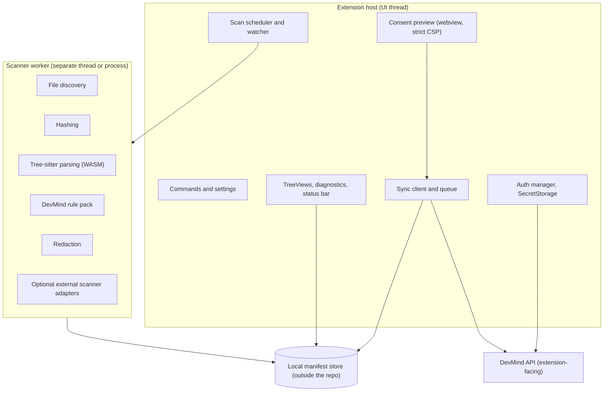
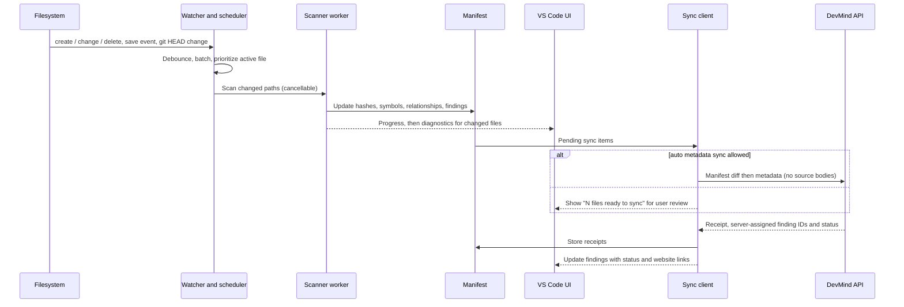

# 06 · VS Code Extension and Local Scanning

**Purpose.** Specifies the DevMind VS Code extension: what it does, what it never does, how it scans, how it keeps a local manifest, how it synchronizes with the cloud Project Brain, and how consent governs any source transmission. It is authoritative for extension behavior and the local-to-cloud data boundary.

**Status.** Specification only. Related: [01](01-product-requirements.md) (FR-EXT) · [02](02-system-architecture.md) · [03](03-data-model-and-api.md) (extension API) · [04](04-project-brain-and-rag.md) · [07](07-security-privacy-and-threat-model.md). Decisions: ADR-001, ADR-012, ADR-021, ADR-022, ADR-023, ADR-033, ADR-034.

---

## 1. Responsibilities and non-goals

| Responsibilities | Non-goals (v1) |
|---|---|
| Detect and understand the opened workspace | A second web application; project management UI |
| Scan supported local source files; keep a local manifest and index | AI chat or conversations (they live on the website) |
| Detect relevant changes and rescan incrementally | Silent upload of any repository |
| Run local, language-aware analysis | Executing project code, scripts or tests |
| Show diagnostics, scan status, file references and findings | Auto-applying fixes (it may show proposals from the cloud) |
| Show structure and database information discoverable from project files | Connecting to a live or production database |
| Let the user review and control synchronization | Bypassing consent for any reason |
| Link to the matching project, finding and report on the website | Storing credentials outside VS Code `SecretStorage` |

## 2. Extension architecture

All heavy work (hashing, parsing, rules) runs off the extension host's main thread so the editor stays responsive.

## 3. Workspace initialization and linking

1. On activation, detect workspace folders. Multi-root workspaces are handled per folder.
2. Compute a **root fingerprint** (hash of repository identity: git remote URL hash plus root folder name, or a generated ID persisted in extension storage when no git remote). The absolute path is never sent.
3. If the folder is unlinked, show a non-modal prompt: *Link this folder to a DevMind project* (choose an existing project from `GET /ext/projects` or open the website to create one).
4. Linking calls `POST /ext/projects/{pid}/workspaces` with the fingerprint and a user-chosen label.
5. Until linked, the extension may still scan locally and show local findings (no cloud interaction).
6. First-run copy states, in plain words, that nothing leaves the machine until the user approves a sync.

## 4. File discovery, ignores and limits

**Order of exclusion:** hard exclusions → `.gitignore` → `.devmindignore` → settings globs → size and count limits.

| Category | Rule |
|---|---|
| Hard-excluded directories | `.git`, `node_modules`, `vendor`, `dist`, `build`, `out`, `.next`, `.turbo`, `coverage`, `.venv`, `venv`, `__pycache__`, `.mypy_cache`, `.pytest_cache`, `target`, `.idea` |
| Generated and minified | `*.min.js`, `*.map`, `*.bundle.js`, files with a generated-file header marker |
| Binary and media | Detected by extension and by sniffing the first bytes; hashed for the manifest at most, never parsed |
| Archives and data blobs | Skipped |
| Credential files | `.env`, `.env.*`, `*.pem`, `*.key`, `id_rsa*`, `*.p12`, `*.pfx`, `credentials*.json`, `*.kdbx`: **path-only handling**. Content is never read for transmission or chunking. The presence of such a file that is not ignored by git can produce a finding about the path, not the content. |
| Lockfiles | Read for dependency audit locally; never chunked or embedded |
| `.devmindignore` | gitignore syntax, committed with the repo for team-wide ignores |

**Limits (initial proposals; tune after measurement):** per-file analysis ceiling of about 1 MB (larger files are recorded as `skipped_too_large`); a workspace file-count ceiling (about 50,000 included files) beyond which the user is asked to narrow scope; a per-scan time budget with resumable progress; a total-size ceiling per snippet request. Skipped files are visible in the UI with the reason, never silently dropped.

## 5. Local manifest, hashing and incremental scanning

**Manifest record per file:** relative path, size, modification time, SHA-256 content hash (over raw bytes), language and tier, parse status (`ok`, `partial`, `failed`, `skipped_*`), symbol and relationship counts, rules version last applied, local finding IDs, last-synced content hash.

**Store:** outside the repository, in VS Code's per-workspace storage location (`ExtensionContext.storageUri`). Technology is open (ADR-033, OQ-05): the interim default is SQLite compiled to WebAssembly; a JSON-lines fallback is acceptable for small workspaces. The store never lives in the repo, so there is nothing to commit by accident.

**Incremental scan algorithm:**
1. Enumerate included files (respecting §4).
2. Fast path: unchanged `(size, mtime)` → keep the stored hash.
3. Otherwise hash content; unchanged hash → no work.
4. Changed hash → parse, extract symbols and relationships, run rules, replace this file's rows.
5. Removed path → mark removed, drop its local findings and symbols.
6. A rules-version or grammar-version change marks affected files for rescan.
7. Complete: write a scan summary and enqueue a manifest diff for sync (§11).

Chunk-level hashes use line-ending-normalized text so CRLF/LF checkouts do not create phantom changes; the file hash is over raw bytes and is the identity used for file versions.

## 6. From change to display

Triggers: file watcher events, `onDidSaveTextDocument`, branch switches and large batch changes (coalesced into one scan), manual commands. The active editor's file is scanned first.

## 7. Supported language strategy (ADR-023)

| Tier | Languages | What the extension does | What it does **not** do |
|---|---|---|---|
| **1: semantic** | TypeScript, JavaScript (incl. JSX/TSX), Python | Parsing, symbols, relationships, route and model detection (Next.js, Express, FastAPI; Prisma schema and SQLAlchemy models), DevMind rule pack, secret scan, dependency audit | Type-aware resolution across all dynamic features; unsupported frameworks are reported as **not analyzed** |
| **2: text-level** | Common source/config/markup files (for example Java, Go, SQL, YAML, Markdown) | Listed in the manifest; text-level chunking when synced in `indexed` mode; secret scan | No symbols, no security rules; findings say "not analyzed" |
| **3: unsupported** | Everything else | Hash only | — |

Support is never described as equivalent across languages. The website's project overview shows a coverage table (files per tier, files `not analyzed`) so users can see the limits of a clean result.

## 8. Parsing, symbol extraction and scanners

- **Parsing:** Tree-sitter (WASM build) in the worker; grammar versions pinned and shared with the backend (OQ-17). Parse errors produce `partial` status; extraction proceeds on valid subtrees.
- **Extraction:** symbols (name, qualified name, kind, signature, lines, framework tags), relationships (`imports`, `calls`, `defines_route`, `guarded_by`, `reads_model`, `writes_model`, `tests`), per [04](04-project-brain-and-rag.md) §6. Facts are declarative where possible (tree-sitter queries stored as data in a shared rule pack) so that the extension and backend extract the same facts.
- **Authorization evaluation split:** the extension evaluates the rule pack on extracted facts to show *immediate local findings* (capped at E1). The backend re-evaluates the same facts server-side ([05](05-agents-and-llm-workflows.md) §6.3), which can produce E2 results because it holds the synced relationship model. This works in `metadata_only` mode: guard-chain evaluation needs facts, not source bodies.
- **External scanners (optional):** adapters for a secret scanner, a pattern engine and dependency audit tools, **only if** installed on the user's machine, enabled in machine-scope settings, and the workspace is trusted. Results are normalized to the DevMind finding format, with SARIF as the import format. Rule licensing questions are tracked in OQ-07.
- **Never:** run project scripts, install packages, or invoke build tools.

## 9. Findings, diagnostics and UI

**Finding format.** The canonical schema is in [03](03-data-model-and-api.md) §12.1. Locally reported findings use `source: "extension_local"` and evidence level capped at E1.

**Diagnostics mapping**

| Severity | VS Code severity | Notes |
|---|---|---|
| critical, high | Error | Message prefix `Possible:` when evidence is E1 |
| medium | Warning | |
| low | Information | |
| info | Hint | |

Diagnostics set `source = "DevMind"`, `code` = rule ID (linked to the website finding when synced), `relatedInformation` for supporting evidence locations. Resolved, dismissed and accepted-risk findings emit no diagnostics. Status is never conveyed by color alone: the message text contains severity and evidence wording.

**Views (DevMind activity-bar container):**

| View | Content |
|---|---|
| Findings | Grouped by severity then file; shows evidence level and status; actions: open location, open in DevMind, dismiss locally (syncs as a triage request) |
| Project structure | Routes, models, modules and key symbols derived from the manifest |
| Database (from files) | Models/tables/relations from supported schema files (§10) |
| Sync | Last sync, pending items, mode, **Review what will be sent** |
| Scan | Current scan progress, skipped files with reasons, rules version |

Status bar item shows `idle`, `scanning`, `offline`, `sync paused`, or `sign-in required`.

**Commands:** `devmind.signIn`, `devmind.signOut`, `devmind.linkProject`, `devmind.scanWorkspace`, `devmind.scanFile`, `devmind.cancelScan`, `devmind.reviewSync`, `devmind.requestAnalysis`, `devmind.openInWeb`, `devmind.showWhatLeaves`, `devmind.manageConsent`.

**Settings:** all settings that change where data goes (`devmind.apiBaseUrl`, auto-sync, external scanners) are **machine-scoped**, so a repository's `.vscode/settings.json` cannot redirect traffic or enable tools. Workspace-scoped settings cover only ignore globs and scan limits.

## 10. Database-related information from project files

Discovered **only** from files the user already has:

| Source | Extracted |
|---|---|
| Prisma `schema.prisma` | Models, fields, relations, enums |
| SQLAlchemy declarative models | Tables, columns, relationships |
| SQL migration files and Alembic revisions | Tables and columns created or altered |
| Mongoose schemas (Tier 1, later) | Collections and fields |

Displayed as the Database view and synchronized as `model` symbols and `reads_model`/`writes_model` edges.

**Rules on live connectivity (ADR-034, Deferred):**
- v1 never opens a connection to any database.
- It never reads connection strings from environment files to connect.
- A future live-introspection capability must be a separate specification: explicit user enablement, read-only schema introspection, credentials only in `SecretStorage`, never transmitted to DevMind, no row data, its own threat model and consent text.

## 11. Local-to-cloud synchronization

### 11.1 What goes where

| Data | Stays local | Stored remotely | Embedded | May reach an LLM provider |
|---|---|---|---|---|
| File contents on disk | ✔ always | Only consented chunks in `indexed` mode | Only those chunks | Only consented snippets or chunks, redacted |
| Absolute paths, machine names, usernames | ✔ | ✘ never | ✘ | ✘ |
| Repo-relative paths, content hashes, sizes, languages | Copy | ✔ (metadata) | ✘ | Paths may appear in prompts as part of snippets or facts |
| Symbols (names, signatures, lines) | Copy | ✔ (metadata) | Only as part of an embedded chunk header | Possibly, as structured facts in a prompt |
| Relationships | Copy | ✔ | ✘ | Possibly, as facts |
| Findings (without code) | Copy | ✔ | ✘ | Possibly, as facts, for explanation |
| Evidence snippet text | Local | Only if consented | ✘ | Only if consented |
| Credential files, `.env*`, keys | ✔ | ✘ **never** (path-only finding at most) | ✘ | ✘ **never** |
| Secrets found inside source | Local | Replaced with `[REDACTED:type:hash8]` before leaving | ✘ | ✘ (redacted) |
| Database facts from files | Copy | ✔ (as `model` symbols) | ✘ | Possibly, as facts |
| Auth tokens | `SecretStorage` | Hashes only | ✘ | ✘ |

### 11.2 Modes (ADR-022)

| | `metadata_only` (default) | `indexed` |
|---|---|---|
| Uploads | Manifest, symbols, relationships, findings without code | Plus consented, redacted chunks |
| Website code questions | Structural answers; user can attach snippets per request | Full retrieval over indexed code |
| Cloud embedding | None | Chunks embedded |
| Consent | Only per request when snippets are sent | Project-level consent record covering provider and categories |

Switching `indexed` → `metadata_only` deletes stored chunks, embeddings and evidence snippet text, with confirmation ([04](04-project-brain-and-rag.md) §15).

### 11.3 Sync protocol

Manifest diff → server returns which files are new, changed or removed → client sends metadata for those → (indexed + consent) client sends chunks for those → receipt. Every call is idempotent and resumable; the client persists a sync queue in the manifest store. Unchanged files are never re-sent.

## 12. Source transmission and consent

### 12.1 When source can leave

Only when the user (a) asks for a cloud analysis that needs code (`devmind.requestAnalysis`, or "attach code" from the website flow), or (b) opts the project into `indexed` mode.

### 12.2 The preview

Before any transmission the extension builds the **exact payload** and shows it in a preview panel:
- list of files with line ranges and chunk counts;
- the number of secrets redacted, with their types (never values);
- the provider(s) and the purpose;
- what is excluded and why;
- a link to the project's recorded provider-terms status.

Actions: **Send for this request**, **Allow for this project** (`indexed` consent), **Cancel**. The consent request includes `preview_hash`; the server rejects a payload that does not match ([03](03-data-model-and-api.md) §12.6).

### 12.3 Supplying snippets for one request

1. The user selects files or a scope (or accepts a suggestion computed locally from the manifest and symbols).
2. The extension reads only those line ranges, redacts, builds the preview.
3. On approval it `POST`s snippets bound to `consent_id` and a stated purpose.
4. The server re-redacts, rechecks excluded paths, attaches the snippets to the job (not the Brain unless the project is `indexed`), and returns a job with a website deep link.
5. Single-request snippets are deleted per retention after the job.

### 12.4 Facts first

Where possible, DevMind sends **structured facts** (route, guard names, signatures, line ranges) instead of code. For example, a security explanation for a missing guard can be written from facts without source. Snippets are an optional enhancement shown in the preview.

## 13. Authentication, network failures, offline behavior

> **Free hosting note (ADR-046):** the server may be asleep. A first request that times out or returns 502/503 within about 90 seconds of inactivity is shown as **"Server waking up…"** with a progress indicator and automatic retries (backoff with jitter), not as a failure. Local scanning is unaffected.

- **Sign-in:** browser flow with PKCE, custom URI handler, state validation; tokens in `SecretStorage` ([02](02-system-architecture.md) §7.2). Access token short-lived; refresh token rotating; revocation by the user on the website invalidates the registration.
- **Requests:** HTTPS only; certificate validation not disableable; `X-DevMind-Client: extension/<version>`; server may reply with a minimum supported version prompting an upgrade.
- **Retries:** exponential backoff with jitter on network errors, 429 (respecting `Retry-After`) and 5xx; no retry on 4xx other than 409 `sync.stale_base` (re-diff) and 401 (refresh once).
- **Offline:** scanning, diagnostics and views work fully offline. Sync queue persists and drains when connectivity returns; the Sync view shows pending counts and last success.
- **Clock and replay:** idempotency keys per sync batch; duplicates are harmless.
- **Sign-out:** deletes tokens; local manifest remains unless the user chooses to clear it.

## 14. Handoff to the website

| User need | Extension action |
|---|---|
| Ask a question about the project | Open the project conversation on the website (`devmind.openInWeb`) |
| See a finding's full evidence and explanation | Link on the finding opens it on the website |
| Comprehensive reports, health, PRs, bug history, tasks | Website only |
| Request cloud analysis of selected code | `devmind.requestAnalysis` → consent preview → job → deep link to the job on the website |
| Manage members, integrations, consent, retention | Website only; extension shows read-only mode and a link |

The extension never renders a chat panel in v1 (ADR-001).

## 15. Performance

- Scanning runs in a worker; the host thread only receives progress and results in batches.
- Debounce and coalesce events; cancel and restart on superseding changes.
- Parsing cache keyed by content hash and grammar version.
- Memory ceiling and file-size limits guard against pathological files; a parse that exceeds a time limit marks the file `partial`.
- Budgets (activation time, scan throughput per 1,000 files, memory) are set after measuring on synthetic workspaces of 1k, 10k and 50k files; they are not promised here.
- Lazy activation: activate on workspace containing supported files or on explicit command, not on every VS Code start.

## 16. Security boundaries

| Concern | Control |
|---|---|
| Untrusted workspace | Declare limited support: built-in local scan allowed; no external tools, no sync, no rule or config files executed from the repo until trusted |
| Hostile files | Worker isolation; parse timeouts; size limits; no dynamic code evaluation from repo content; path normalization to prevent traversal outside the workspace |
| Tokens | `SecretStorage` only; never in settings, logs or manifest |
| Redirected API | `apiBaseUrl` machine-scoped; allowlist check for production builds |
| Webview | Strict CSP, no remote scripts, no network; data passed by message |
| External scanners | Fixed argument arrays (no shell interpolation), working directory limited to the workspace, output size caps, timeouts |
| Supply chain | Pinned dependencies, lockfile, audit in CI, minimal dependency set, reproducible bundle |
| Telemetry | Honors VS Code's telemetry setting; contains no paths or code; opt-in event set is documented |

## 17. Testing

| Layer | Approach |
|---|---|
| Unit | Ignore matching, hashing, manifest diff, redaction, SARIF mapping, diagnostics mapping, sync queue (Vitest) |
| Parser and rules | Fixture files per language with expected symbols, edges and findings; vulnerable, safe, ambiguous and misconfigured cases ([09](09-testing-and-quality-strategy.md) §8) |
| Integration | `@vscode/test-electron` against fixture workspaces: link, scan, diagnostics, views, cancel |
| API contract | Stub server generated from the OpenAPI schema; contract tests for retries, idempotency, 401 refresh, 409 re-diff |
| Consent | Tests assert no network call carrying source occurs without a matching preview and consent; negative tests for excluded paths |
| Cross-platform | Linux, macOS, Windows in CI (path separators, CRLF, case sensitivity, symlinks) |
| Performance | Synthetic large workspaces with recorded throughput and memory |
| Security | Untrusted-workspace behavior; webview CSP; malicious filenames and huge/binary files |

## 18. Packaging and release

- Bundle with a single-file bundler; include WASM assets; package with the standard VS Code packaging tool.
- Semantic versioning; pre-release channel for testing, stable for general use; changelog.
- Publish to the Visual Studio Marketplace and to Open VSX for VS Code-compatible editors; verify which registry each target editor uses at release time.
- Server compatibility: the API advertises a minimum client version; the extension shows an upgrade prompt rather than failing silently.
- CI builds the `.vsix`, runs tests, audits dependencies, and attaches the artifact; publishing requires manual approval.
- Release notes list known limitations (unsupported frameworks, language tiers).
