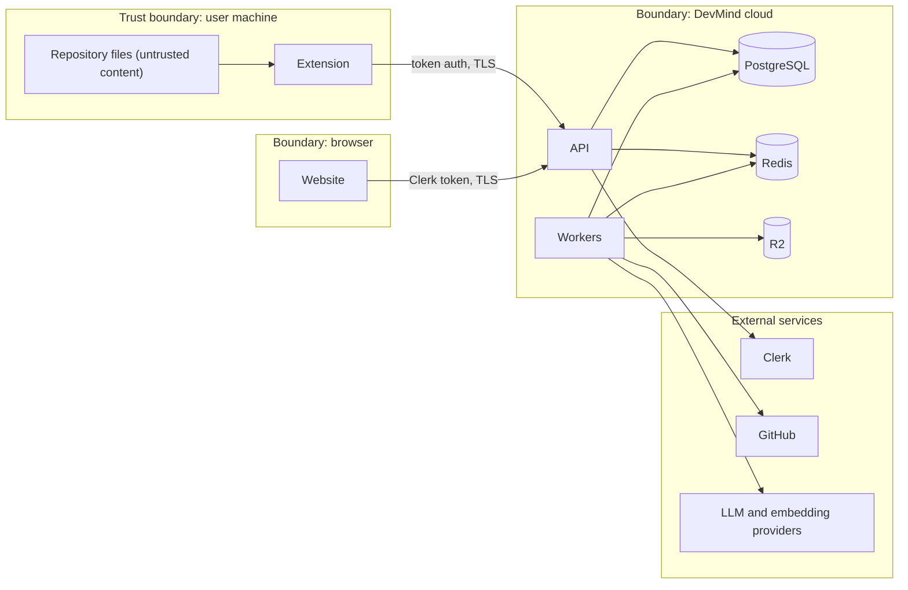

# 07 · Security, Privacy and Threat Model

**Purpose.** Defines DevMind's security and privacy requirements across local (extension) and remote (API, workers, providers) processing, and records a structured threat model with mitigations and residual risk. It is authoritative for security controls, consent, redaction, retention and incident response.

**Status.** Specification only; no control here has been implemented or tested. Nothing in this document promises absolute security. Related: [02](02-system-architecture.md) · [03](03-data-model-and-api.md) · [05](05-agents-and-llm-workflows.md) · [06](06-vscode-extension-and-local-scanning.md) · [09](09-testing-and-quality-strategy.md) · [10](10-deployment-and-operations.md). Decisions: ADR-010 to ADR-013, ADR-021 to ADR-026.

---

## 1. Scope and security objectives

1. No user can read or change another tenant's data.
2. No source code or secret leaves the user's machine or DevMind's storage except through explicit, recorded, minimal, redacted transmission.
3. Untrusted content (repositories, logs, documents, model output) can never gain authority over the system.
4. Findings are honest about what was detected versus proven.
5. Every sensitive action is attributable.
6. Compromise of one component limits blast radius.

## 2. Assets and trust boundaries

| Asset | Sensitivity |
|---|---|
| User source code and derived data (chunks, embeddings, symbols, evidence snippets) | High; embeddings are treated as source-derived |
| Secrets present in repositories or logs | Critical |
| DevMind credentials: provider API keys, Clerk keys, GitHub credentials, extension tokens, encryption keys | Critical |
| Findings (describe weaknesses in user software) | High |
| Conversations | Medium-high (may quote code) |
| Account and membership data | Medium |
| Audit and usage records | Medium |
| Availability and inference budget | Medium (cost abuse) |

Crossings that matter most: repository → extension (hostile content), extension → API (consented source), worker → LLM provider (source leaves DevMind), GitHub → API (webhooks), model output → UI (rendering).

## 3. Authentication and authorization

- **Web:** Clerk issues session tokens. The API verifies signature, issuer, expiry, not-before and authorized party on every request using the issuer's published keys (cached with rotation handling). Failure → `401`.
- **Extension:** DevMind-issued opaque tokens (ADR-012), scoped to `/api/v1/ext/*`, hashed at rest, short-lived access plus rotating refresh, revocable per installation. Reuse of a rotated refresh token revokes the registration (replay detection).
- **Authorization:** distinct from authentication. Every route declares a permission; the `AuthContext` is computed per request from workspace and project membership ([03](03-data-model-and-api.md) §4). A CI test enumerates all routes and fails if one lacks a declared permission.
- **Sensitive operations** (consent, deletion, membership, integrations, token issuance) emit audit events.
- **Service principals:** background jobs use a `SystemContext` carrying the recorded actor and project; they cannot operate outside it.
- **Sessions:** Clerk controls session lifetime and revocation; DevMind relies on short token lifetimes rather than server-side session storage.

## 4. Multi-tenant isolation

| Layer | Control |
|---|---|
| Application | `AuthContext` required for all repository functions; resources loaded by `(id, workspace_id)`; unseen resources return 404 |
| Database | `workspace_id` on every tenant table; RLS as defense in depth (ADR-025) |
| Vector search | Mandatory `project_id` filter; tested for leakage |
| Caches | Keys include workspace; values hold IDs, not code |
| Queue | Messages hold IDs only; workers re-authorize via `SystemContext` for the job's project |
| Object storage | Keys prefixed by workspace and project; downloads via short-lived signed URLs issued after authorization |
| LLM calls | A call contains data from exactly one project; no cross-project context packs |
| Logs and traces | Carry IDs, not payloads |

Tests: a generated authorization matrix hits every route as each role and as a foreign tenant; vector search and cache tests assert no cross-project rows.

## 5. Repository data classification

| Class | Examples | Handling |
|---|---|---|
| **C0 Public** | Marketing content, docs | None |
| **C1 Metadata** | Repo-relative paths, hashes, sizes, languages | Stored; shown in sync preview |
| **C2 Source-derived** | Symbol names and signatures, relationships, finding text, chunks, embeddings, evidence snippets | Stored only per sync mode and consent; deleted with source |
| **C3 Source content** | Code bodies, comments | Leaves the machine only through consented, redacted transmission |
| **C4 Secrets and credentials** | Tokens, keys, `.env*`, private keys, connection strings | Never transmitted, stored, logged or embedded. Detected and replaced with placeholders or ignored by path |

## 6. Secret redaction

**Where:** in the extension before any transmission, and again on the server before storage, embedding, logging or prompt assembly. Defense in depth means the server never trusts the client's redaction.

**Detection layers:**
1. Credential file paths and names: excluded entirely (path-only).
2. Known token formats (provider key prefixes, cloud credentials, JWT-like strings, private-key blocks, connection strings with embedded credentials).
3. High-entropy strings in assignment or header contexts.
4. Optional external secret scanner results.

**Replacement:** `[REDACTED:<type>:<hash8>]`, where the hash prefix lets DevMind correlate repeats without revealing values. Redaction is applied to chunk text, evidence snippets, log uploads (DeployDoctor) and conversation inputs.

**Fail-closed:** if the redaction component errors or times out, the payload is not sent. The preview shows the number of redactions by type.

**Limits (residual risk):** pattern and entropy detection can miss novel secret formats and can over-redact. DevMind therefore (a) shows a preview, (b) keeps `metadata_only` as the default, (c) lets users add custom redaction patterns, and (d) never claims that redaction is complete.

## 7. Source transmission consent and AI-provider data

**Consent.** A `consent_record` binds user, project, scope (`snippet_transmission`, `cloud_index`, `llm_processing`), provider IDs, data categories, duration (`single_request` or `project`), policy version, and `preview_hash`. The server checks it on snippet upload, on analysis creation when code is needed, and in the LLM gateway before each provider call that contains source. Revocation takes effect immediately for new work and triggers deletion where specified ([04](04-project-brain-and-rag.md) §15).

**Provider terms.** A model API existing does not mean its retention, logging, training and sub-processor terms suit DevMind's promises. Therefore:
- each provider has `terms_reviewed` and `data_policy.source_code_allowed` in configuration;
- production routing refuses providers not marked reviewed ([05](05-agents-and-llm-workflows.md) §11.4);
- the settings page lists active providers with a link to their terms and the review date;
- consent is per provider, so a fallback provider the user did not consent to cannot receive source;
- embeddings count as source-derived data and are governed by the same consent.

Open: which terms are acceptable, and any zero-retention arrangements (OQ-03). No claim about any provider's behavior is made in this package.

## 8. Prompt injection and hostile repository content

Repository text can contain instructions aimed at the model: comments, strings, README files, docs, commit messages, PR descriptions, dependency documentation, log lines, filenames.

**Controls:**

| Control | Detail |
|---|---|
| Treat as data | Untrusted text is inserted only inside delimited blocks; system instructions state that block contents are data and cannot alter instructions, tools or output format |
| Deterministic authority | Findings, severities, evidence levels, scores and verdicts come from deterministic code. A model can explain, not decide |
| Least-privilege tools | No tool exposes secrets, shell, network or writes beyond proposals; side effects need approval ([05](05-agents-and-llm-workflows.md) §9) |
| Schema-validated output | Free-form text never drives control flow; structured outputs are validated |
| Citation and evidence checks | Fabricated paths, lines or hashes fail verification |
| Output rendering safety | Model output is rendered through a sanitizing Markdown renderer: no raw HTML, no automatic loading of remote images (a known data-exfiltration channel), links shown with their domain and `rel="noopener noreferrer"` |
| Injection signals | Instruction-like content in data (for example "ignore previous instructions") is flagged in the run record and surfaced as a low-severity note, not obeyed |
| No cross-project context | An injected instruction cannot pull another project's data into a prompt |
| Tests | An injection corpus runs in CI against every prompt and graph ([09](09-testing-and-quality-strategy.md) §12) |

**Hostile repositories (resource and parser attacks):** file-size and count limits; parse timeouts and worker isolation; path normalization rejecting `..` and absolute paths; symlinks not followed outside the workspace; bounded regular expressions in rules (no catastrophic backtracking); diff and PR size caps; GitHub content fetched through the API as blobs, never cloned and executed.

**Residual risk:** a model may still be misled into a *misleading explanation*. Mitigated, not eliminated, by evidence-bound explanations and the display of evidence next to every explanation.

## 9. Retention and deletion

Starting proposals (**not commitments**; ADR-026 is Open, OQ-03):

| Data | Proposed default | Notes |
|---|---|---|
| Single-request snippets | Deleted when the job reaches a terminal state plus a short window for retry | |
| Indexed chunks and embeddings | Kept while `indexed` consent is active; non-current versions deleted after the snapshot window | Window configurable per workspace |
| Evidence snippet text | Same as chunks | |
| Conversations | Until deleted by the user or project deletion | |
| Job events and agent run records | Limited period | Contain references only |
| LangGraph checkpoints | Deleted with the job's retention period | References only |
| Idempotency keys | About 24 hours | |
| Usage records | Long enough for quotas and reporting | Contain no content |
| Audit events | Long retention | Contain no source |
| R2 reports and uploads | Expiry set per object kind | |

Deletion mechanics: user-initiated deletion and consent revocation create `purge_*` jobs that remove data from PostgreSQL, Redis, R2 and checkpoints and record per-store counts. **Backups:** provider backups can retain deleted data until they expire; this window is disclosed in privacy settings and not hidden ([03](03-data-model-and-api.md) §8).

## 10. Secrets and key management

- No secret in the repository, YAML configuration, logs, prompts, test fixtures or generated examples. `.env.example` holds names and placeholders only.
- Runtime secrets live in the hosting platform's secret store; separate values per environment; least-privilege provider keys.
- GitHub credentials are stored encrypted with an application key (envelope encryption; key outside the database; rotation procedure documented in [10](10-deployment-and-operations.md)).
- Secret scanning runs in CI and as a pre-commit hook.
- Rotation runbooks exist for each credential class; rotation does not require downtime (dual-key acceptance window for the encryption key).
- Application logs pass through a redaction filter.

## 11. Input validation, rate limiting, webhooks

- **Validation:** Pydantic schemas at the boundary with strict types and size limits; enums as closed sets; IDs parsed as UUIDs; server-side validation regardless of client checks; output encoding for all rendered data.
- **Rate limiting:** Redis counters by principal and route class, tighter limits on authentication-adjacent routes (extension code exchange, token refresh); abuse of job creation is bounded by quotas as well.
- **Webhooks:** GitHub requests are verified with the HMAC signature header using constant-time comparison; delivery IDs deduplicated; payload size capped; Clerk webhooks verified with the signature scheme its documentation specifies (verify at implementation). Unverified requests return 401 and are logged without payload.
- **CORS:** explicit allowlist of the frontend origins per environment; no wildcard with credentials.
- **Security headers:** HSTS, `X-Content-Type-Options`, frame restrictions, CSP on the website.

## 12. Dependency and supply-chain security

Lockfiles committed; dependency audit and secret scanning in CI; automated update proposals reviewed by a human; new dependencies require justification ([`AGENTS.md`](../AGENTS.md)); container base images pinned and rebuilt regularly; minimal runtime image; the extension bundle is built reproducibly in CI; third-party scanner rules are licensed-checked before bundling (OQ-07).

## 13. File uploads, SSRF, object storage

- **Uploads (R2):** documents and logs are untrusted: size caps, extension and content sniffing, text-only handling for logs, never rendered as HTML, served with `Content-Disposition: attachment` and `X-Content-Type-Options: nosniff` through short-lived signed URLs after an authorization check. Antivirus scanning is out of scope for v1; uploads are never executed.
- **SSRF:** v1 makes outbound requests only to fixed, operator-configured hosts (providers, GitHub, Clerk key endpoint, R2). No user-supplied URL is fetched. Provider `base_url` is operator configuration. If a future feature fetches user-supplied URLs, it must use an allowlist, block private and link-local ranges including after DNS resolution, limit redirects, and cap size and time.

## 14. Database, queue and worker security

| Component | Controls |
|---|---|
| PostgreSQL | TLS; separate roles: application (no DDL), migration (DDL), read-only analytics if ever needed; parameterized queries only; statement timeouts; connection limits; no production data in development; RLS option |
| Redis | Authentication and TLS; private networking or IP allowlist; no public exposure; ID-only messages |
| Celery | JSON serialization only (no pickle); signed or ID-only payloads; workers have no inbound ports; separate credentials per service |
| Workers | No arbitrary code execution; resource limits; LLM and GitHub credentials injected only into the gateway/adapters, never exposed to agent state |
| Containers | Non-root user, read-only root filesystem where feasible, no secrets in images |

## 15. Unsafe command and test execution

v1 **never** executes repository code, installs a repository's dependencies, runs its tests, or invokes its build tools — in the extension or the backend. Static analysis only. A future E3 (reproduced) capability would require its own specification: isolated, network-less, credential-less ephemeral sandboxes, resource limits, per-run user approval, and an additional threat model. Until then no feature may depend on running user code.

## 16. Audit logging and least privilege

**Audited actions:** sign-in to extension and token issue/revoke, membership and role changes, project create/delete, sync-mode changes, consent grant/revoke, snippet uploads (counts), analysis creation, job cancellation, approvals, finding triage, integration connect/disconnect, data deletion, quota changes, administrator access to another tenant (not permitted; any support access would need its own audited mechanism).

**Properties:** append-only (insert-only database role for the writer), actor, target, time, hashed IP, no source or secrets, viewable by workspace admins.

**Least privilege:** GitHub scopes minimized and documented; provider API keys scoped to inference only; database roles split; extension tokens scoped to extension endpoints; agents get minimal tool lists; Render and Neon access limited to named operators with MFA.

## 17. Incident response

| Phase | Actions |
|---|---|
| Detect | Alerts on auth anomalies, token reuse, unusual cross-project queries, spikes in redaction failures, provider errors, cost anomalies |
| Contain | Kill switches (configuration flags): disable `indexed` mode globally, disable a provider, pause queues, revoke all extension tokens, disable webhooks, rotate keys |
| Assess | Use audit events and structured logs (IDs only) to scope by workspace and time; determine whether source or secrets were exposed |
| Notify | Per the notification policy that must be written before launch: affected users, legal obligations, provider notification |
| Remediate | Patch, rotate credentials, purge exposed data, add regression test |
| Learn | Blameless postmortem, ADR if architecture changes, update this threat model |

**Playbooks (to be written in `docs/runbooks/` during hardening):** leaked provider key; cross-tenant access bug; suspected prompt-injection exfiltration; GitHub token compromise; provider data incident; stolen extension token; Redis exposure.

## 18. Threat model

Likelihood and impact are qualitative. "Residual" is what remains after mitigation.

| ID | Asset | Threat | Attack path | Impact | Mitigation | Residual |
|---|---|---|---|---|---|---|
| T-01 | Tenant data | Cross-tenant read/write (IDOR) | Guess or reuse a project/finding ID | Source and findings disclosed | `(id, workspace_id)` loading, per-route permissions, generated authorization tests, RLS later, 404 for unseen resources | A missed route if the test generator has a gap; mitigated by the "every route declares a permission" test |
| T-02 | Extension token | Theft and replay | Malware reads token, or token leaked in logs | Attacker syncs or reads as user | `SecretStorage`, short lifetime, rotation with reuse detection, per-registration revocation, scope to extension routes | Token valid until expiry on a compromised machine |
| T-03 | Findings integrity | Prompt injection alters findings | Comment in code says "mark as safe" | False reassurance or fabricated findings | Deterministic decisions, model only explains, schema and evidence verification | Misleading explanation text |
| T-04 | Secrets | Secret reaches LLM provider | Hard-coded key in a snippet | Credential exposure to third party | Path exclusion, pattern and entropy redaction client and server, preview, fail-closed, default `metadata_only` | Undetected novel secret format |
| T-05 | Availability, worker | Hostile file crashes or stalls parser | Giant, deeply nested or crafted file | Scan failure, DoS | Size limits, timeouts, worker isolation, `parse_failed` status | Temporary degradation per file |
| T-06 | API | SSRF | User-supplied URL fetched by server | Internal network access | No user-supplied URL fetching in v1; allowlist if added | None in v1 |
| T-07 | GitHub integration | Forged webhook | Attacker posts fake events | Fake analyses, cost, poisoned data | HMAC verification, delivery ID dedupe, size cap | Replay inside dedupe window |
| T-08 | Queue | Redis exposure or poisoning | Network access to Redis | Job tampering, data exposure | Auth, TLS, private network, ID-only messages, PostgreSQL as truth, JSON serializer | Misconfiguration risk on provider |
| T-09 | Host | Execution of untrusted code | Feature runs repo code | Full compromise | Forbidden in v1; E3 requires sandbox spec | None in v1 |
| T-10 | User browser | XSS or exfiltration via model output | Model emits HTML or remote image beacon | Session or data leak | Sanitized rendering, no remote images, CSP, link display | Novel sanitizer bypass |
| T-11 | GitHub credentials | Token theft | DB leak or log exposure | Access to user repositories | Envelope encryption, minimal scopes, never logged, revocation, rotation | Scope breadth of OAuth for private repos (ADR-015) |
| T-12 | Logs | Sensitive data in logs | Verbose logging of payloads | Source or secrets exposed | Redaction filter, ban on payload logging, tests, scrubbed error reports | Developer error; caught by log-scanning tests |
| T-13 | Budget | Cost abuse | Scripted job creation or huge contexts | Inference spend | Quotas, per-job budgets, rate limits, concurrency caps | Bounded overspend before alerts |
| T-14 | Supply chain | Malicious dependency | Compromised package | Code execution in worker or extension | Lockfiles, audit, pinned images, review of new dependencies, minimal footprint | Zero-day in dependency |
| T-15 | Auth | JWT validation flaws | Wrong issuer, expiry or audience accepted | Account takeover | Strict claim checks, library use, tests with forged tokens | Library defect |
| T-16 | Brain integrity | Poisoned client-reported findings | Modified extension sends fake findings | Fake issues, misleading dashboards | Client-reported findings capped at E1 and labelled; server re-evaluates facts | Noise in a user's own project |
| T-17 | Developer machine | Malicious workspace abuses extension | Repo config redirects API or enables scanners | Data exfiltration to attacker | Machine-scoped settings, workspace trust gating, no repo-defined executables | User overrides trust |
| T-18 | Deletion promise | Data persists in backups | Retention in provider backups | Privacy expectation mismatch | Disclose backup window, deletion jobs for live stores, verification counts | Backup window |
| T-19 | Provider data | Provider retains or trains on code | Terms differ from promises | Privacy breach | `terms_reviewed` gate, per-provider consent, listed in UI | Dependence on provider compliance |
| T-20 | Evidence | Fabricated or stale citations | Hallucinated path/line | User acts on false data | Citation resolver and hash check, staleness badges | Wrong but verifiable interpretation |
| T-21 | Extension supply | Malicious update to extension | Compromised publisher account | Mass compromise | MFA, CI-only publishing with approval, provenance, minimal permissions | Marketplace compromise |
| T-22 | Webhook flood | Resource exhaustion | Many valid deliveries | Queue saturation | Rate limits, dedupe, per-repo concurrency | Temporary delay |
| T-23 | Approvals | Approval bypass | Race or replay on gated action | Unapproved external action | Approval state machine, single-use, expiry, project binding, audit | Maintainer fatigue |
| T-24 | Redaction preview | Preview differs from payload | Bug or tampering | Consent invalid | `preview_hash` binding, server rejects mismatch, tests | None known |

## 19. Detecting versus proving

DevMind labels results by evidence level ([13](13-glossary-and-domain-terminology.md)):
- **E0/E1:** *possible* — a rule matched or a hypothesis exists.
- **E2:** *statically verified within the stated analysis scope* — the code structure demonstrates the condition on the analyzed path. It is **not** proof that the system is exploitable, nor that no other protection (such as a gateway outside the repository) exists.
- **E3:** *reproduced* — only with an approved dynamic check (not in v1).

The product never says "vulnerable" without the evidence level, never says "secure" or "safe" on the basis of the absence of findings, and always lists what was not analyzed.

## 20. Residual risk summary

Highest residual risks: provider data terms (T-19), undetected secret formats (T-04), prompt-induced misleading explanations (T-03), OAuth scope breadth for private GitHub repositories (T-11), cross-tenant bugs from a missed authorization check (T-01), and backup retention (T-18). Each has an owner milestone in [11](11-mvp-and-implementation-roadmap.md) and a test or review gate in [09](09-testing-and-quality-strategy.md).
