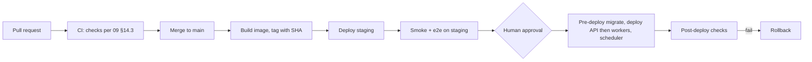

# 10 · Deployment and Operations

**Purpose.** The deployment and operational runbook for DevMind: environments, containers, Render services, Redis, Neon, R2, the client website, configuration and secrets, migrations, health checks, observability, backup and recovery, CI/CD, rollbacks, incident diagnosis, resource limits, and cost control.

**Status.** Implemented (Free Tier profile §22 per ADR-046, Milestones M1 through M11 and M13). Docker single-image build, Vercel frontend, Render web service, Neon PostgreSQL, Upstash Redis, GitHub integration & webhooks, Resend transactional emails, and operational runbooks are validated and passing. Sections 1 to 21 describe the target (funded) topology; §22 is the free profile that is actually deployed first (ADR-046). No plan prices, latency targets or capacity figures appear here; items needing measurement are listed in §21. Every vendor-specific behavior is verified against current documentation (register in [12](12-architecture-decisions-and-open-questions.md) §5). Section numbers are cited elsewhere (§8 migrations, §9 queue configuration, §11 secrets and rotation); keep them stable.

---

## 1. Principles

1. The API and the workers are **separate deployable services** built from **one image** (ADR-005). No process supervisor running both in one container.
2. Configuration comes from the environment; non-secret behavior from versioned YAML ([05](05-agents-and-llm-workflows.md) §11).
3. The database is the source of truth for job state; Redis carries only job IDs ([02](02-system-architecture.md) §10).
4. Every deploy is reversible; migrations follow expand, migrate, contract.
5. Nothing is logged that could contain source, prompts, secrets or tokens.

## 2. Environments

| Environment | Purpose | Data | LLM providers | Notes |
|---|---|---|---|---|
| `local` | Developer machine | Synthetic fixtures only | `fake_provider` by default; real keys optional | Docker Compose: Postgres (pgvector), Redis, API, worker, scheduler |
| `test` | CI | Ephemeral | `fake_provider` only | Service containers; no network egress to providers |
| `staging` | Pre-production verification (optional until M10) | Synthetic or consented test projects | Real providers with low quotas | Mirrors production topology; separate Neon branch/project, Redis, R2 bucket, Clerk instance, GitHub app |
| `production` | Users | User data | Reviewed providers only (`terms_reviewed: true`) | Separate credentials for everything |

No production data in non-production environments. Each environment has its own Clerk instance, database, Redis, bucket and keys. `DEVMIND_ENV` selects behavior (validation strictness for placeholders, allowed providers).

## 3. Docker and build strategy

| Aspect | Decision |
|---|---|
| Image | One server image for API, worker and scheduler; the command selects the role |
| Base | Slim official Python image, pinned by digest, rebuilt on a schedule for security patches `[VERIFY base tag at setup]` |
| Build | Multi-stage: build dependencies and virtualenv in a builder stage; copy the environment into a minimal runtime stage |
| User | Non-root; read-only root filesystem where feasible; writable `/tmp` only |
| Dependencies | Installed from the lockfile only; hashes verified where supported; no dev dependencies in the runtime image |
| Secrets | None in the image or build args |
| Metadata | Labels with commit SHA and build time; the SHA is exposed at `/healthz` and in logs |
| Tree-sitter and native libs | Installed in the builder and verified by a smoke test at image build |
| Scanners (server side) | Not bundled unless a backend scan stage is built ([06](06-vscode-extension-and-local-scanning.md) §8, ADR-023); never execute repository code |

Role commands (illustrative):

```text
api:       uvicorn app.main:app --host 0.0.0.0 --port $PORT --proxy-headers  (workers set by config)
worker:    celery -A app.workers.celery_app worker -Q ingest,embed,analysis,default --concurrency=<config> --without-gossip
scheduler: celery -A app.workers.celery_app beat   (single instance)
```

Queue names and concurrency are configuration; exact flags are confirmed at implementation. Only **one** scheduler instance may run.

## 4. Render services (`[VERIFY]` all Render specifics)

| Service | Type | Image/command | Health check | Scaling |
|---|---|---|---|---|
| `devmind-api` | Web service (Docker) | API command | `GET /healthz` for liveness; `/readyz` for deploy readiness | Instances by configuration; stateless |
| `devmind-worker` | Background worker (Docker, same image) | Worker command, separate queue sets possible (`ingest`/`embed` vs `analysis`) | Process-level; heartbeats recorded in the database | Replicas by queue depth; bounded concurrency to protect Neon connections |
| `devmind-scheduler` | Background worker | Beat command | Process-level | Exactly 1 |
| Redis | Managed Redis-compatible store (Upstash Redis with standard TLS connection string, ADR-046) | n/a | n/a | Persistence and eviction policy set per §5 |


Defined as infrastructure-as-code in `render.yaml` at the repository root (planned; the **free profile** in §22 is the one deployed now). Pre-deploy command runs migrations (§8). Auto-deploy from the main branch only to staging; production deploys are manual promotions after checks (§17). Environment groups hold shared non-secret variables; secrets are set per service in the platform's secret store.

## 5. Redis considerations

| Requirement | Reason |
|---|---|
| Managed and persistent (not an undocumented in-container Redis) | Job messages and rate-limit counters must survive restarts as far as the plan allows; PostgreSQL remains the source of truth so loss is recoverable ([02](02-system-architecture.md) §11) |
| Eviction policy that never evicts queue keys (`noeviction` on the queue instance) `[VERIFY plan support]` | Evicting broker keys silently loses jobs |
| TLS and authentication; private networking or allowlist | [07](07-security-privacy-and-threat-model.md) §14 |
| Separate logical use: broker, rate limits, job event streams, caches | Prefer separate databases or instances so cache eviction cannot affect the broker; if one instance is used, `noeviction` applies to all and caches use explicit TTLs and size limits |
| Cost model under Celery polling | Some serverless Redis offerings bill per command; Celery's polling can be expensive. Validate before choosing (OQ-04) |
| Capacity | Memory sized from measured queue depth and event stream retention (§21) |

## 6. Neon PostgreSQL (`[VERIFY]`)

| Topic | Decision |
|---|---|
| Endpoints | **Pooled** endpoint for the API; **direct** endpoint for migrations and for workers if the LangGraph checkpointer or session features need it (OQ-12) |
| Extensions | `vector`, `pg_trgm`; enabled by migration; verify the supported pgvector version and index options |
| Roles | Separate roles: `devmind_app` (no DDL), `devmind_migrate` (DDL), `devmind_audit_writer` (insert-only on `audit_events`), optional read-only role |
| Connection limits | API pool size × instances + worker concurrency × replicas must stay below the plan's limits; configured explicitly (§15) |
| Timeouts | Statement timeout and idle-in-transaction timeout set per role |
| Branching | Neon branches may serve staging/preview databases; do not seed branches from production data |
| Region | Same region as Render services to limit latency `[VERIFY availability]` |
| Backups | §16 |

## 7. Cloudflare R2

| Topic | Decision |
|---|---|
| Use | Suitable artifacts only (exported reports, uploaded logs/documents); structured metadata stays in PostgreSQL (ADR-013) |
| Access | S3-compatible API with least-privilege tokens scoped to one bucket per environment; no public buckets; short-lived presigned URLs for downloads `[VERIFY semantics]` |
| Object keys | `workspaces/{workspace_id}/projects/{project_id}/{kind}/{object_id}`; metadata row in PostgreSQL |
| Content handling | Treated as untrusted; served as attachments with `nosniff` ([07](07-security-privacy-and-threat-model.md) §13) |
| Lifecycle | Expiry per object kind; deletion jobs remove objects on project purge |
| Encryption | At rest per provider; additionally no secrets stored |

## 8. Migrations

- Tool: Alembic; run by the **pre-deploy** step through the **direct** Neon endpoint using the `devmind_migrate` role ([03](03-data-model-and-api.md) §9).
- Order: take a recovery point (§16) for production, run migrations, then roll out the new API and workers.
- **Expand, migrate, contract:** a release only ships schema changes compatible with the previous application version; destructive changes (drop column/table, type narrowing) ship at least one release later.
- A migration that locks large tables, rewrites data, changes an embedding dimension, or deletes data requires human approval ([AGENTS.md](../AGENTS.md) §7) and a rehearsal against a restored copy.
- Embedding-space changes: add a new space and index, backfill via `embed_chunks` jobs, switch reads, then retire the old space ([04](04-project-brain-and-rag.md) §10).
- `/readyz` fails if the database is not at the expected migration head.
- Rollback: forward-fix preferred; a downgrade is used only for migrations tested as reversible (§17).

## 9. Queue configuration (Celery on Redis)

| Setting area | Policy |
|---|---|
| Serialization | JSON only; messages contain IDs, never source or secrets ([07](07-security-privacy-and-threat-model.md) §14) |
| Acknowledgement | `acks_late` with reject on worker loss, so a killed worker's message returns to the queue; the DB claim step prevents double execution |
| **Visibility timeout** | Must be set **greater than the longest task time limit plus retry delays**; otherwise Celery on Redis redelivers a still-running task to another worker. Verify current semantics (`[VERIFY]`, 12 §5). Long ingestion is split into short tasks to keep this bound small |
| Time limits | Soft limit lets a task write partial results; hard limit protects the worker; values per queue in configuration |
| Prefetch | Low (1) for long tasks to avoid head-of-line blocking |
| Queues | Separate queues by workload (`ingest`, `embed`, `analysis`, `default`) so embedding bulk work cannot starve interactive analyses; per-workspace concurrency caps enforced in application code |
| Retries | Application-level policy per job type ([02](02-system-architecture.md) §10.2), not blind Celery auto-retry |
| Idempotency | Natural-key upserts; a re-run produces the same stored result |
| Scheduler jobs | Enqueuer sweep, stale-job reaper, retention purge, idempotency-key cleanup, usage rollups; each safe to run twice |
| Poison messages | Job marked `failed` after `max_attempts`; message dropped; alert on repeated failures |
| Shutdown | §19 |

## 10. Client deployment and server connectivity

| Topic | Decision |
|---|---|
| Host | Vercel is the recommended default (ADR-032, OQ-14); confirm streaming and proxy behavior with a probe |
| Build | `pnpm` build in CI; environment-specific public variables only |
| API access | Browser calls the API directly with the Clerk bearer token (ADR-003); the API URL is a public variable |
| CORS | The API allows only the exact client origins per environment; no wildcard with credentials ([07](07-security-privacy-and-threat-model.md) §11) |
| SSE | Keep-alive comments at a short interval; client falls back to polling if the connection is interrupted (OQ-13) |
| Security headers | CSP, HSTS, `X-Content-Type-Options`, frame restrictions set by the client host configuration |
| Preview deployments | Point to `staging` API only; origin added to the staging allowlist dynamically only through a reviewed mechanism |

## 11. Environment variables and secrets

All variables are listed in `.env.example` with placeholders. Prefix `DEVMIND_` for application variables. **Never commit real values.**

| Variable | Used by | Secret | Purpose |
|---|---|---|---|
| `DEVMIND_ENV` | api, worker, scheduler | no | `local` / `test` / `staging` / `production` |
| `DEVMIND_LOG_LEVEL` | all | no | Logging level |
| `DEVMIND_DATABASE_URL` | api | **yes** | Pooled Neon connection string (app role) |
| `DEVMIND_DATABASE_URL_DIRECT` | worker, migrations | **yes** | Direct connection string |
| `DEVMIND_REDIS_URL` | api, worker, scheduler | **yes** | Broker/rate-limit store |
| `DEVMIND_CLERK_ISSUER` | api | no | Expected token issuer |
| `DEVMIND_CLERK_JWKS_URL` | api | no | Signing keys endpoint |
| `DEVMIND_CLERK_AUTHORIZED_PARTIES` | api | no | Allowed client origins for token checks |
| `DEVMIND_CLERK_WEBHOOK_SECRET` | api | **yes** | Verify Clerk webhooks |
| `DEVMIND_GITHUB_OAUTH_CLIENT_ID` / `_SECRET` | api | secret only for `_SECRET` | GitHub OAuth (R1.1) |
| `DEVMIND_GITHUB_WEBHOOK_SECRET` | api | **yes** | Verify GitHub webhooks (R1.1) |
| `DEVMIND_ENCRYPTION_KEYS` | api, worker | **yes** | Envelope-encryption key set with key IDs for stored integration credentials |
| `DEVMIND_EXT_TOKEN_PEPPER` | api | **yes** | Pepper for hashing extension tokens |
| `DEVMIND_R2_ACCOUNT_ID`, `_ACCESS_KEY_ID`, `_SECRET_ACCESS_KEY`, `_BUCKET` | api, worker | key and secret are secret | Object storage |
| `DEVMIND_LLM_PRIMARY_API_KEY` | worker (gateway) | **yes** | Named by `providers.yaml` `api_key_env` |
| `DEVMIND_LLM_ALT_API_KEY` | worker | **yes** | Alternative provider |
| `DEVMIND_EMBED_API_KEY` | worker | **yes** | Embedding provider |
| `DEVMIND_RESEND_API_KEY` | api | **yes** | Resend transactional email API key (ADR-014) |
| `DEVMIND_EMAIL_FROM` | api | no | Sender address for transactional emails (e.g. `DevMind <invitations@warishlabs.in>`) |
| `DEVMIND_APP_BASE_URL` | api | no | Base URL for invite links and web deep links (`https://devmind.warishlabs.in`) |
| `DEVMIND_SENTRY_DSN` or equivalent | all | treat as sensitive | Error reporting (vendor open, OQ-15) |
| `DEVMIND_TURNSTILE_SECRET_KEY` | api | **yes** | Cloudflare Turnstile secret key for public form verification (Render) |
| `NEXT_PUBLIC_TURNSTILE_SITE_KEY` | client | no | Cloudflare Turnstile site key for browser widget (Vercel) |
| `DEVMIND_CORS_ORIGINS` | api | no | Comma-separated exact origins |
| `DEVMIND_MIN_EXTENSION_VERSION` | api | no | Compatibility floor ([06](06-vscode-extension-and-local-scanning.md) §18) |
| `DEVMIND_KILL_SWITCHES` | api, worker | no | Flags: disable `indexed` mode, disable a provider, pause queues, disable webhooks |

Only the gateway/adapters read LLM keys; they are never placed in agent state or logs.

### 11.1 Secret handling and rotation

- Secrets live in the platform secret store; separate values per environment; least-privilege tokens.
- CI and a pre-commit hook run secret scanning; a detected secret is treated as compromised and rotated.
- **Rotation runbooks (to be written in `docs/runbooks/`)** for: Neon role passwords, Redis credentials, Clerk keys, GitHub OAuth secret, R2 tokens, provider API keys, extension token pepper, webhook secrets.
- **Application encryption key rotation (zero downtime):** (1) add the new key to `DEVMIND_ENCRYPTION_KEYS` with a new key ID while keeping the old one; (2) deploy so the new key encrypts and both decrypt; (3) run a re-encryption job over stored credentials; (4) verify no record references the old key ID; (5) remove the old key; (6) record the rotation in the audit log. The extension token pepper uses the same dual-acceptance pattern, with forced token refresh if retired.
- Compromise response: [07](07-security-privacy-and-threat-model.md) §17 kill switches first, then rotate.

## 12. Health checks

| Endpoint/mechanism | Meaning | Checks |
|---|---|---|
| `GET /healthz` | Process is alive | Returns build SHA; no dependency calls |
| `GET /readyz` | Can serve traffic | PostgreSQL reachable (pooled), Redis reachable, migrations at expected head, configuration validated |
| Worker heartbeat | Worker alive | Periodic row/record with worker ID and queue set |
| Scheduler heartbeat | Beat alive | Last tick recorded; alert if stale |
| Provider probes | Optional, low-rate synthetic call on a schedule | Never include user data; failures reduce routing preference, they do not page |

Neither endpoint returns sensitive data.

## 13. Logging, tracing, error reporting

- Structured JSON logs with `request_id`, `job_id`, `agent_run_id`, `workspace_id`, `project_id`, `actor_id` ([02](02-system-architecture.md) §12); redaction filter as the last line of defense; source, prompts, completions, tokens and secrets never logged.
- OpenTelemetry traces across API, queue, worker and gateway; attributes: provider, model, task, token counts, latency; no payloads.
- Error reporting with payload scrubbing and request-body capture disabled; vendor open (OQ-15).
- Log retention and access are limited and documented; logs are not a data store.
- Dashboards (initial): request rate/errors/latency per route class; job duration and failures per type; queue depth and age; LLM latency/errors per provider; token usage; DB pool saturation; extension sync volume.

## 14. Queue monitoring

Metrics: queue length and oldest-message age per queue; active/reserved tasks; task runtime per job type; retry and failure rates; stale-heartbeat count; enqueuer-sweep activity; Redis memory and eviction counters (must be zero evictions on the broker). Alerts: oldest-message age above threshold, rising failure ratio, no worker heartbeat, scheduler tick missing, Redis memory near limit. Thresholds are set after measurement (§21). A job-center admin view exposes the same information per workspace without content.

## 15. Database connection management

| Aspect | Policy |
|---|---|
| API pool | Small pool per instance via the pooled endpoint; `pool_pre_ping`; recycle connections periodically |
| Workers | Bounded concurrency; direct endpoint when session features are needed; sum of connections across replicas stays under the plan's limit |
| Long operations | No transaction held open across an LLM call or network call |
| Transaction pooling caveats | Avoid session-level features (advisory locks, `SET` outside a transaction, prepared statements) on the pooled endpoint; RLS settings use `SET LOCAL` inside a transaction (OQ-09) |
| Timeouts | Statement and lock timeouts by role |
| Saturation alert | Pool wait time and connection-count alerts |

## 16. Backup and recovery

| Item | Plan |
|---|---|
| PostgreSQL | Use the provider's point-in-time recovery window and branch/restore facilities `[VERIFY window by plan]`; test a restore into a scratch environment at least once before launch and then on a schedule |
| Recovery objectives | RPO/RTO are **not promised**; define targets only after measuring restore time (§21) |
| Redis | Treated as reconstructible: PostgreSQL state plus the enqueuer sweep rebuilds queues ([02](02-system-architecture.md) §11); persistence reduces churn but is not relied on for correctness |
| R2 | Objects are artifacts; deletion is intentional; versioning/lifecycle per kind `[VERIFY]` |
| Secrets | Recoverable from the platform secret store and a separate secure record of ownership; no secrets in backups of code |
| Deleted data | Provider backups can retain deleted data for their window; this is disclosed in the privacy notice ([07](07-security-privacy-and-threat-model.md) §9) |
| Disaster scenarios | Region outage, accidental destructive migration, credential compromise, corrupted embedding space; each has an operational runbook in [`docs/runbooks/disaster-recovery.md`](runbooks/disaster-recovery.md) and [`docs/runbooks/database-restore.md`](runbooks/database-restore.md) |

## 17. CI/CD and rollbacks



| Topic | Policy |
|---|---|
| Promotion | The same image digest is promoted from staging to production |
| Deploy order | Migrate (compatible schema), deploy API, then workers, then scheduler; running jobs keep their configuration snapshot ([05](05-agents-and-llm-workflows.md) §11.5) |
| Post-deploy checks | `/readyz`, synthetic project scan with the fake provider path on staging, queue draining, error-rate watch window |
| Rollback | Redeploy the previous image digest; schema is backward compatible for one release so rollback needs no downgrade; for a bad migration, forward-fix or restore per §16 |
| Feature flags / kill switches | Configuration flags to disable `indexed` mode, a provider, queues or webhooks without a deploy |
| Extension releases | Separate pipeline ([06](06-vscode-extension-and-local-scanning.md) §18); the API's minimum client version prevents silent incompatibility |
| Approvals | Production deploys, migrations on production and key rotations are human-approved ([AGENTS.md](../AGENTS.md) §13) |

The step-by-step staging promotion, smoke check, and rollback rehearsal runbook is documented in [`docs/runbooks/staging-promotion.md`](runbooks/staging-promotion.md) ([11](11-mvp-and-implementation-roadmap.md) M10-10).

## 18. Production incident diagnosis

| Symptom | First checks |
|---|---|
| Jobs stuck in `queued` | Redis reachable? Workers alive (heartbeats)? Enqueuer sweep running? Queue age; kill switch `pause queues` set? |
| Jobs failing with `llm.unavailable` | Provider status, rate limits, config hash, fallback eligibility, key validity (without logging the key) |
| Slow API | Pool saturation, slow queries (statement logs), Neon status, a hot route (traces) |
| Rising 429s | Rate-limit settings, one workspace abusing quotas, provider quota |
| Retrieval degraded | Embedding provider failures (flag in responses), index/vacuum state, filtered ANN recall check |
| SSE disconnects | Proxy idle timeout, keep-alive interval, polling fallback behavior |
| Cross-tenant suspicion | Treat as security incident ([07](07-security-privacy-and-threat-model.md) §17): disable affected feature, preserve audit events, scope by workspace/time |
| Duplicate effects | Claim logic, idempotency keys, visibility timeout versus task duration (§9) |

Use request/job IDs; never request user source to debug. Step-by-step diagnostic and remediation playbooks for each failure mode are defined in [`docs/runbooks/incident-response.md`](runbooks/incident-response.md) ([11](11-mvp-and-implementation-roadmap.md) M10-08). GitHub integration, PR intelligence, and webhook delivery issues are triaged in [`docs/runbooks/github-integration-and-pr-intelligence.md`](runbooks/github-integration-and-pr-intelligence.md) ([11](11-mvp-and-implementation-roadmap.md) M11-09). Bug Memory deduplication surges and DocsAlive documentation drift triage procedures are documented in [`docs/runbooks/bug-memory-and-living-docs.md`](runbooks/bug-memory-and-living-docs.md) ([11](11-mvp-and-implementation-roadmap.md) M12.1).

## 19. Resource limits and graceful shutdown

| Aspect | Policy |
|---|---|
| Container limits | CPU/memory limits per service set after measurement; the API has request size and timeout limits; workers have per-task memory-aware batch sizes |
| Request limits | Per-route body limits (`payload.too_large`), concurrency limits for SSE per user |
| Worker shutdown | On termination signal, stop taking new tasks, let current tasks finish up to the platform's grace period `[VERIFY]`, then checkpoint and requeue; the heartbeat reaper handles the rest |
| API shutdown | Stop accepting connections, finish in-flight requests, close pools; SSE clients reconnect |
| Scheduler | Single instance; restart safe because jobs are idempotent |
| Long tasks | Designed to be resumable and shorter than the shutdown grace and visibility timeout |

## 20. Cost-control mechanisms

| Mechanism | Detail |
|---|---|
| Quotas | Per-workspace monthly tokens, concurrent jobs, per-job token budgets, project size limits ([05](05-agents-and-llm-workflows.md) §13); visible and configurable; no billing in v1 (ADR-029) |
| Routing | Cheaper/faster models for routing, summarization and rewrite tasks; heavier models for reasoning; chosen after evaluation ([05](05-agents-and-llm-workflows.md) §16) |
| Incremental work | Hash-based incremental sync means unchanged files are never re-uploaded or re-embedded |
| Caching | Retrieval and embedding caches per [04](04-project-brain-and-rag.md) §12 |
| Pre-call checks | Estimated input size versus limits; stop before calling when over budget |
| Kill switches | Disable expensive features quickly |
| Visibility | Usage records per task; alerts on anomalies (spend spike per workspace) |
| Infrastructure | Right-size services after measurement; scale workers to zero only if the platform supports it without breaking the scheduler `[VERIFY]` |
| Staging | Low quotas; fake provider for most tests |

## 21. Estimates that require validation

Measured values validated by load, concurrency, and capacity testing:

| Item | Method | Owner | Validated Baseline & Threshold |
|---|---|---|---|
| API and worker instance sizing | Load test with generated projects (`test_capacity.py`) | M10 | Peak allocation < 25 MB per 175-file chunking batch; total projected combined RSS ~195 MB (well under 512 MB Render Free limit; target < 350 MB) |
| Neon connection budget and pool sizes | Concurrency test (`test_capacity.py`) | M10 | `pool_size=5`, `max_overflow=5` (10 total max concurrent connections); `pool_recycle=1800`; `pool_pre_ping=True` handles serverless compute wakeups |
| Redis memory and persistence behavior | Queue soak test; simulation (`test_capacity.py`) | M10 | Upstash Free Tier < 10,000 cmd/day cap; realistic active/sleep day uses ~5,580 cmd/day (44% headroom); 24h baseline uses 5,760 cmd/day |
| Queue alert thresholds | Observation during staging (`test_alerts.py`) | M10 | Queue depth > 50, message age > 300s, stale heartbeat > 120s, error rate > 5.0% |
| Restore time (RTO) and acceptable data loss (RPO) | Restore drills (`test_restore_drill.py`, runbook) | M10 | RTO target < 5 min (local schema replay < 3.0s); RPO defined by Neon PITR window; post-restore sweep reconciles in-flight jobs |
| LLM and embedding cost per analysis/project size | Usage records from evaluation runs | M5–M7 | Gemini Free Tier RPM/TPM quotas enforced by sliding window rate limiter |
| SSE capacity per API instance | Connection test (`test_capacity.py`) | M8/M10 | 20+ concurrent SSE clients per worker; frame size <= 30 bytes (< 10 KB/hr idle); clean pubsub unsubscribe on disconnect |
| Extension scan times on 1k/10k/50k files | Benchmarks | M3 | Incremental hashing and local manifest diff |
| Cold-start and deploy duration | Measured in staging | M1/M10 | Sleep tolerance retry window: 90 seconds backoff for Render/Neon wake |

## 22. Free deployment profile (active; ADR-046)

The owner uses free tiers only. This profile keeps the code and the target architecture unchanged and changes only how the processes are packaged and hosted. Operational procedures and quota limits are documented in [`docs/runbooks/free-tier-operations.md`](runbooks/free-tier-operations.md). Vendor facts and their verification dates are in [12](12-architecture-decisions-and-open-questions.md) §5.

| Aspect | Free profile | Target profile (§4) |
|---|---|---|
| Client | Vercel Hobby, public repo, root directory `client`, personal non-commercial use | Any host |
| API + worker + scheduler | **One** Render free web service, `DEVMIND_RUN_MODE=all` (launcher starts uvicorn and an embedded Celery worker with beat, `--pool=solo`, concurrency 1) | Three services: web, worker, scheduler |
| Queue and rate limits | Upstash Redis Free Tier (standard TLS connection string, 10k cmd/day) | Persistent managed Redis with `noeviction` |
| Database | Neon Free, pooled endpoint, small storage cap | Neon paid or equivalent |
| Migrations | Run at container start under an advisory lock (do not rely on the pre-deploy command on free instances) | Pre-deploy command via the direct endpoint (§8) |
| Health check | `/health` / `/healthz` (cheap; `/readyz` is used by monitoring) | `/readyz` |
| Object storage | Deferred / Not used by the MVP (zero accounts or subscriptions) | R2 |
| Email | Resend free tier on the verified `warishlabs.in` domain (M11) | Resend |
| Monitoring | Render logs, health endpoints, optional free error-reporting tier (OQ-15) | Full observability stack |
| CI | GitHub Actions on a public repository (unlimited standard-runner minutes) | Same |

**Sleep tolerance (mandatory behavior).** A free Render web service sleeps after about 15 minutes without inbound traffic and takes about a minute to wake; Neon compute suspends after about five minutes. Therefore:

1. The website and extension treat a slow first request as "server waking" (progress message, retry with backoff for at least 90 seconds), not as an error ([06](06-vscode-extension-and-local-scanning.md) §13).
2. The database layer retries the first connection after a Neon suspend with short backoff.
3. On every start the app runs the enqueuer sweep and stale-job reaper ([02](02-system-architecture.md) §10) so jobs stranded by a sleep are resumed or failed with a clear reason.
4. Long jobs are split into short resumable tasks; the website polls job status, which also generates traffic.
5. SSE streams reconnect and fall back to polling (OQ-13).
6. No keep-alive pinger by default: a best-effort non-blocking probe runs at most once per hour when visitors open the homepage without aggressive loops.

**Memory budget.** The free instance has 512 MB. Before M2 ends, measure resident memory of the combined container under a representative ingestion and record it in `BRAIN.md`. If it does not fit, the fallback is a Postgres-backed job runner in place of Celery, which needs its own ADR.

**Storage budget.** Neon Free caps storage per project (plan for 0.5 GB). Embedding dimension at most 768 or `halfvec`; per-project limits on files and chunks are derived from measured bytes per chunk (text, tsvector, vector, HNSW index) and stored in `server/configs/quotas.free.yaml`; the quota service stops ingestion with a clear message before the cap is reached.

**Shared limits to remember.** Upstash Redis provides 10,000 commands/day on its free tier. Celery visibility timeout is set to 3600 seconds to prevent unnecessary re-polling. Render 750 free instance hours per workspace are shared with every other free service in that workspace.

**Upgrade triggers (not now).** Always-on worker needed; memory exceeded; storage cap hit; commercial use (Vercel Hobby terms); free tier terms change. Each trigger gets an ADR.

