# 11 · MVP and Implementation Roadmap

**Purpose.** A phased, dependency-ordered plan from an empty repository to the MVP and then to the later releases. Each milestone is small enough to be built and verified incrementally by a developer working with an AI coding agent (Antigravity).

**Status.** Active / Release 1.3 Complete. Milestones M1 through M11, M13, M12.1 (Release 1.2: Bug Memory & Living Docs), and M12.2 (Release 1.3: Project Mentor & Project Evaluation) are completed, tested, and validated. Milestone M12.3 represents post-1.3 release. No dates or durations are estimated. Milestone IDs (`M1` to `M13`) are cited elsewhere ([04](04-project-brain-and-rag.md) §14 cites M5, [02](02-system-architecture.md) §13 and [10](10-deployment-and-operations.md) cite M10); keep them stable. Terms: [13](13-glossary-and-domain-terminology.md).

---

> **Owner decisions that change the order and shape of this plan (2026-10-13):** folder names `client/ server/ extension/ common/` (ADR-039); the home page and extension UI shell are built first with fixture data (ADR-040: phases S1 and S2, before M1); free-tier hosting only, with the free deployment profile (ADR-046, [10](10-deployment-and-operations.md) §22), so M1's `render.yaml` defines one free web service plus a free Key Value, not three paid services; the real repository is the public `Warish-Labs/DevMind` (ADR-047). The detailed execution plan is `PLAN.md` and `docs/ANTIGRAVITY_PROMPT.md`.

## 1. Principles

1. **Vertical slice first.** The earliest goal is a thin path that works end to end (scan, sync, ask, see a finding), then widen it.
2. **One milestone, one reviewable outcome.** Tasks inside a milestone are small, independently testable and ordered.
3. **Deterministic before generative.** Scanners, parsers, retrieval and evidence checks exist and are tested before LLM workflows depend on them.
4. **Measure before claiming.** Baselines are recorded in the milestone that builds the capability ([09](09-testing-and-quality-strategy.md) §9).
5. **Security from the first milestone.** Authorization, redaction and consent mechanisms are built with the features they protect, not after.
6. **Do not build ahead.** Items marked Deferred in [12](12-architecture-decisions-and-open-questions.md) stay deferred.

## 2. Common rules for every milestone

### 2.1 How a task is run with an AI coding agent

Each task is handed to the agent as: the governing documents (per [AGENTS.md](../AGENTS.md) §2), the task statement, files expected to be created or changed, tests to add, commands to run, and the acceptance criterion. The agent inspects existing code first, makes a small change, runs the checks and reports real output, and lists deviations. Tasks that require human approval ([AGENTS.md](../AGENTS.md) §12) pause for it.

### 2.2 Documentation task (every milestone)

Update the status of each affected section from "Specified" to "Implemented in M#"; record deviations; update [12](12-architecture-decisions-and-open-questions.md) if a decision changed; record verification dates for vendor facts used (12 §5).

### 2.3 Common definition of done

All milestone acceptance criteria met; required tests added and passing in CI with real output reviewed; quality gates G1 to G9 ([09](09-testing-and-quality-strategy.md) §15) pass for the milestone's scope; no secrets or source content in logs; migrations reviewed; `.env.example` and [10](10-deployment-and-operations.md) updated for new configuration; documentation task done; known limitations written down.

## 3. MVP scope and breadth (OQ-10, ADR-038)

The academic demonstration may expect all nine capabilities; engineering quality favors depth. Options:

| Option | Content | Trade-off |
|---|---|---|
| A. Depth (interim default) | Code Intelligence + focused Security Intelligence on the shared Brain, with extension and website | Strong, demonstrable and honest; seven capabilities appear as designed-and-scheduled |
| B. Breadth | Shallow versions of all nine | Impressive surface; each shallow capability risks being unreliable, and evidence-based claims become hard to keep |
| C. Depth + thin showcases | Option A plus deterministic, clearly labeled partial views for Bug Memory (manual records and similarity) and Project Evaluation (security score and analysis coverage) | Shows lifecycle idea without fabricating intelligence |

**Interim default: Option A, with the deterministic parts of C that need no new agents** (security and coverage panel on the overview; bug records are 1.2). This must be confirmed with the project supervisor; the decision is recorded in ADR-038. Milestones M1 to M10 and M13 deliver the MVP; M11 and M12 are the post-MVP releases.

## 4. Release plan

| Release | Milestones | Content |
|---|---|---|
| **MVP** | M1 to M10, M13 | CAP-01, CAP-02 (focused), extension, website, Brain, privacy controls, usage/quotas, hardening, public homepage |
| **1.1** | M11 | GitHub integration (FR-BRN-07), CAP-06 Pull Request Intelligence, CAP-05 Code Review Intelligence, invitations (FR-PLT-05) |
| **1.2** | M12.1 | CAP-03 Bug Memory, CAP-04 Living Documentation |
| **1.3** | M12.2 | CAP-08 Project Mentor, CAP-09 Project Evaluation (full health and release readiness) |
| **1.4** | M12.3 | CAP-07 Deployment Diagnosis |

## 5. Dependency graph

```mermaid
flowchart LR
  M1[M1 Foundation] --> M2[M2 Auth, workspaces, projects]
  M2 --> M3[M3 Extension + local scan]
  M2 --> M4[M4 Brain ingestion: metadata]
  M3 --> M4
  M4 --> M5[M5 Indexed mode, embeddings, retrieval]
  M2 --> M6[M6 LLM gateway + config]
  M5 --> M7[M7 LangGraph + CodeMate + AuthCheck]
  M6 --> M7
  M7 --> M8[M8 Website: conversation, findings, Brain, jobs]
  M8 --> M9[M9 Privacy controls, history, deletion]
  M9 --> M10[M10 Hardening, observability, capacity]
  M10 --> M13[M13 UI polish, homepage, MVP release]
  M13 --> M11[M11 Release 1.1: GitHub, PR, Review]
  M11 --> M12[M12 Releases 1.2 to 1.4]
```

M3 (local scanning only) and M6 (gateway) can proceed in parallel after M2 if capacity allows; the design-system foundation for M8 can start after M2.

### 5.1 Vertical-slice checkpoints

| Checkpoint | After | Demonstrates |
|---|---|---|
| VS-1 | M4 | Scan a fixture in VS Code, sign in, sync metadata, `GET /brain/summary` and `GET /findings` return the project structure and local findings |
| VS-2 | M7 | A job answers "how does authentication work?" with resolvable citations and produces an AuthCheck finding with evidence (API-level, fake or real provider) |
| VS-3 | M8 | The same flow through the website UI |
| VS-4 | M13 | The complete MVP acceptance criteria ([01](01-product-requirements.md) §17) |

---

## 6. Milestones

### M1 · Repository foundation, rules, CI, Docker, configuration

| | |
|---|---|
| **Goal** | A repository where every later change is linted, typed, tested, containerized and reviewable |
| **Included** | Monorepo layout ([02](02-system-architecture.md) §5); `AGENTS.md` and docs in place; backend skeleton (FastAPI app factory, settings, structured logging with redaction filter, error mapping to RFC 9457, `/healthz`, `/readyz`); frontend skeleton (Next.js App Router, TypeScript strict, tokens file stub); extension skeleton; Dockerfile; Docker Compose for local Postgres (pgvector, pg_trgm), Redis, API, worker, scheduler; CI workflows; import-boundary checker; secret scanning; `.env.example`; pinned toolchain (ADR-036) |
| **Excluded** | Any feature code; authentication; real providers; deployment to Render |
| **Dependencies** | None |
| **Deliverables** | Running `docker compose up` stack; green CI on an empty test suite plus smoke tests; documented commands ([09](09-testing-and-quality-strategy.md) §14.2 confirmed here) |
| **Tasks (in order)** | 1 create layout and tool configs, 2 backend skeleton + settings validation, 3 logging + redaction filter + error mapping, 4 health endpoints, 5 Docker image (multi-stage, non-root) and Compose, 6 CI (lint, types, tests, build), 7 import-boundary and secret scans, 8 frontend and extension skeletons, 9 pre-commit hooks, 10 confirm commands in docs |
| **Acceptance** | Fresh clone builds and runs locally with documented steps; CI fails on a lint error, a type error, a boundary violation and a planted secret; `/readyz` reflects DB and Redis state; image builds and runs as non-root |
| **Required tests** | Settings validation; redaction filter; error mapping; health endpoints; boundary checker with a deliberate violation fixture |
| **Risks** | Toolchain churn; version pinning decisions (record verification dates) |
| **DoD** | Common DoD; commands recorded in `AGENTS.md` and docs/09 |

### M2 · Authentication, workspaces, projects, database and API foundations

| | |
|---|---|
| **Goal** | Authenticated users with workspaces and projects, enforced authorization, migrations and audit |
| **Included** | Alembic baseline; tables for users/identity mapping, workspaces, memberships, projects, project memberships, audit events, usage records ([03](03-data-model-and-api.md) §3.1, §3.5); Clerk token verification (issuer, authorized parties, signature); first-sign-in personal workspace; `AuthContext` and policy service with permission table ([03](03-data-model-and-api.md) §4.2); route-permission registry; endpoints `GET /me`, workspaces, projects; Clerk webhooks (user events) with signature verification; rate limiting and idempotency middleware; OpenAPI + generated TS client; frontend sign-in shell |
| **Excluded** | Invitations by email (R1.1); Brain tables; extension tokens (M3) |
| **Dependencies** | M1 |
| **Deliverables** | Working sign-in on the website; APIs for workspaces/projects; authorization tests |
| **Tasks** | 1 migrations: identity/tenancy, 2 repository layer requiring `AuthContext`, 3 Clerk verification, 4 policy service + permission table, 5 route registry test, 6 workspaces/projects endpoints, 7 audit writer (insert-only role), 8 idempotency + rate limit, 9 webhooks, 10 generated client + frontend sign-in |
| **Acceptance** | FR-PLT-01 to FR-PLT-04, FR-PLT-07 (for implemented actions); cross-tenant matrix passes ([09](09-testing-and-quality-strategy.md) §6); route without a permission fails CI |
| **Required tests** | Authorization matrix; token verification (valid, expired, wrong audience/authorized party); idempotency; migration up/down; audit writes |
| **Risks** | Clerk claim details `[VERIFY]`; RLS decision (OQ-09) deferred behind application-layer enforcement |
| **DoD** | Common DoD; ADR-010/011/025 statuses updated |

### M3 · VS Code extension scaffolding and local scanning

| | |
|---|---|
| **Goal** | Local-only scanning that produces diagnostics for TypeScript/JavaScript and Python without any network |
| **Included** | Activation, workspace detection, file discovery with ignores and limits, local manifest store (default WASM SQLite, OQ-05), hashing, incremental scan on change/save with debounce, scan in a worker with cancellation, Tree-sitter parsing for the two languages (OQ-17), symbol/route extraction for the MVP frameworks, DevMind-authored rules for auth/authz (E1), secret detection with redaction, diagnostics, Findings/Structure/Scan views, status bar; then extension sign-in (browser handoff, `POST /extension/authorize`, `/ext/token`, refresh rotation, SecretStorage) and project linking ([06](06-vscode-extension-and-local-scanning.md) §3) |
| **Excluded** | Any sync of metadata or source; consent UI (M5); AI features; database-from-files view (may land here if time allows, otherwise M9) |
| **Dependencies** | M2 (for sign-in and linking tasks); local scanning tasks need only M1 |
| **Deliverables** | Installable `.vsix` (internal), fixture workspaces, rule catalog v0, scanner fixture corpus and harness ([09](09-testing-and-quality-strategy.md) §8) |
| **Tasks** | 1 discovery + ignore engine, 2 manifest store, 3 hashing + incremental logic, 4 parse and extract (TS/JS), 5 parse and extract (Python), 6 route and guard extraction, 7 rule engine + first rules with four-class fixtures, 8 diagnostics + views, 9 cancellation and performance benchmarks, 10 backend extension-token endpoints + `extension_tokens`, 11 sign-in and link flow |
| **Acceptance** | FR-EXT-01 to FR-EXT-05, FR-EXT-10; excluded paths are never read; local findings capped at E1 and prefixed "Possible"; unsupported frameworks reported as unsupported |
| **Required tests** | Fixture corpus metrics recorded as baseline; discovery/ignore tests; manifest recovery; extension-host integration; settings-scope security test; token lifecycle tests |
| **Risks** | Grammar packaging (OQ-17); manifest store performance (OQ-05); scanner licensing (OQ-07); editor performance |
| **DoD** | Common DoD; benchmark results recorded; limitations list generated |

### M4 · Project Brain ingestion: metadata, symbols, relationships, snapshots

| | |
|---|---|
| **Goal** | The backend holds a version-aware structural model of a project synced from the extension (`metadata_only` mode) |
| **Included** | Tables: local workspace registrations, files, file versions, project snapshots, scan runs, code symbols, code relationships, findings + evidence + status history ([03](03-data-model-and-api.md) §3.2 to §3.4); extension endpoints for scans, manifest diff/put, symbols, relationships, findings batch; ingestion job (`ingest_project`) with idempotent upserts; snapshot creation; staleness rules ([04](04-project-brain-and-rag.md) §11); browser endpoints for scans, findings (read), Brain summary/files/symbols/graph/snapshots; job lifecycle machinery in workers (claim, heartbeat, reaper, enqueuer sweep) |
| **Excluded** | Chunk text, embeddings, snippet upload (M5); LLM calls |
| **Dependencies** | M2, M3 |
| **Deliverables** | VS-1 working; Celery worker + scheduler running the job lifecycle |
| **Tasks** | 1 migrations, 2 job lifecycle (claim, heartbeat, reaper, sweep) and Celery config ([10](10-deployment-and-operations.md) §9), 3 manifest diff/put with `sync.stale_base`, 4 snapshot + file version logic, 5 symbol/relationship upsert, 6 findings batch with fingerprinting and lifecycle ([03](03-data-model-and-api.md) §5.1), 7 staleness marking, 8 browser read endpoints, 9 extension sync client (metadata only) |
| **Acceptance** | FR-BRN-01 to FR-BRN-04 for metadata; unchanged files are not re-sent; deleting/renaming files marks derived data stale; no source text stored in `metadata_only`; VS-1 |
| **Required tests** | Idempotent replay; worker kill and recovery; stale-base conflict; snapshot/is_current invariants; tenant matrix for new endpoints |
| **Risks** | Fingerprint stability across line shifts; Celery visibility-timeout behavior (OQ-04) |
| **DoD** | Common DoD; ADR-008/009/031 records updated with findings |

### M5 · Indexed mode: consent, snippets, chunks, embeddings, hybrid retrieval

| | |
|---|---|
| **Goal** | Consented source reaches the Brain and can be retrieved with keyword, vector, metadata and symbol signals; retrieval is measured |
| **Included** | Consent records and `consent.required` enforcement; extension consent preview webview ([06](06-vscode-extension-and-local-scanning.md) §12) with redaction preview; snippet and file upload; server-side redaction re-check; code-aware chunking; chunks table with `tsvector` and trigram indexes; embedding gateway slice (embedding adapters, `embedding_spaces`, `embed_chunks` job); `chunk_embeddings` with pgvector and per-space index; hybrid retrieval with fusion and context-pack builder ([04](04-project-brain-and-rag.md) §8); retrieval evaluation harness and **baselines** ([09](09-testing-and-quality-strategy.md) §9); `POST /brain/search` |
| **Excluded** | Generation models; conversation; the full privacy settings UI (M9) |
| **Dependencies** | M4 |
| **Deliverables** | Baseline retrieval results in `evals/results/`; selected-and-recorded embedding space (resolves part of OQ-02 with data) |
| **Tasks** | 1 consent model + enforcement, 2 preview webview + sent-bytes equality, 3 redaction (extension + server), 4 chunker per language, 5 chunk storage + indices, 6 embedding adapter + spaces + job, 7 vector index with filters, 8 fusion + context packs, 9 evaluation set + harness, 10 record baselines, 11 failure-state behavior (embedding outage degrades to keyword/symbol) |
| **Acceptance** | FR-EXT-07, FR-EXT-08; NFR-PRV-01; snippet upload without consent is rejected; preview equals the request body; retrieval metrics recorded and tracked; tenant isolation test for search |
| **Required tests** | Consent enforcement; redaction cases; chunk boundary tests; filtered ANN recall vs exact; cross-tenant retrieval; outage degradation |
| **Risks** | Embedding model choice/dimension (OQ-02); provider terms (OQ-03); filtered ANN recall (pgvector behavior `[VERIFY]`); cost of embedding large projects |
| **DoD** | Common DoD; ADR-019 mechanics confirmed; baselines recorded in §9 of docs/09 |

### M6 · LLM gateway, adapters, model configuration

| | |
|---|---|
| **Goal** | Every model call goes through a configurable, validated, observable gateway |
| **Included** | Provider adapter interface, `fake` provider with fault injection, at least one real generation adapter and one alternative (disabled until reviewed); `providers.yaml`, `models.yaml`, `tasks.yaml` with schema validation and startup checks ([05](05-agents-and-llm-workflows.md) §11); capability validation; routing and fallback ([05](05-agents-and-llm-workflows.md) §12); usage records, quotas, concurrency/rate limits; structured-output repair; prompt loader (versioned files, ADR-028); benchmark harness skeleton ([05](05-agents-and-llm-workflows.md) §16) |
| **Excluded** | Agents; choosing final models (a decision from evaluation data, ADR-017) |
| **Dependencies** | M2 (usage/quotas tables); can run parallel with M3 to M5 |
| **Deliverables** | Gateway library with adapter contract tests; example configs with placeholders; usage dashboard queries |
| **Tasks** | 1 interfaces and types, 2 fake provider, 3 config loader + validators, 4 first real adapter, 5 second adapter, 6 router + fallback, 7 quotas and rate limits, 8 usage records, 9 repair step for structured output, 10 prompt loader, 11 evaluation harness |
| **Acceptance** | Startup fails on unknown model, placeholder in production, capability mismatch, or source-bearing task routed to a provider with `source_code_allowed: false`; fallback never used after invalid output; usage written once per call; keys never logged |
| **Required tests** | [09](09-testing-and-quality-strategy.md) §7 in full |
| **Risks** | Provider API drift `[VERIFY]`; capability differences between providers; terms review (OQ-03) |
| **DoD** | Common DoD; vendor verification register updated with dates |

### M7 · LangGraph workflows, CodeMate and AuthCheck

| | |
|---|---|
| **Goal** | Evidence-grounded code answers and security findings produced by workflows over the Brain |
| **Included** | LangGraph with PostgreSQL checkpointer (ADR-037, OQ-12); Agent Manager graph and plan schema; CodeMate workflow (retrieve, answer, cite, validate citations); AuthCheck workflow: deterministic route enumeration and guard resolution (structural checks producing E2 where the condition is confirmed), LLM explanation constrained to evidence, fix proposal as text only; evidence verifier; `ask_project` and `security_review` job types; SSE job events; approval gate machinery (used later) |
| **Excluded** | Other agents; auto-applied fixes; E3 |
| **Dependencies** | M5, M6 |
| **Deliverables** | VS-2; graph tests; answer-quality and faithfulness evaluation sets with baselines |
| **Tasks** | 1 state schema and checkpointing, 2 tools (search_brain, get_symbol, get_file_range, get_relationships) with scoped access, 3 Manager routing, 4 CodeMate nodes + citation validation, 5 guard resolution and structural check, 6 AuthCheck nodes, 7 verifier, 8 job integration + events, 9 evaluation sets, 10 injection corpus run ([09](09-testing-and-quality-strategy.md) §12) |
| **Acceptance** | AC-CAP1-1, AC-CAP1-3, AC-CAP2-1 to AC-CAP2-3 ([01](01-product-requirements.md) §9); no finding persisted without resolvable evidence; insufficient-evidence path works; injected text cannot suppress a deterministic finding |
| **Required tests** | [09](09-testing-and-quality-strategy.md) §8, §9, §10, §12 |
| **Risks** | LangGraph API changes `[VERIFY]`; checkpointer through pooled Neon (OQ-12); state size; model quality |
| **DoD** | Common DoD; ADR-006/024/027/037 statuses updated; evaluation baselines recorded |

### M8 · Website: design system, conversation, findings, Brain explorer, job center

| | |
|---|---|
| **Goal** | The product is usable through the website (VS-3) |
| **Included** | Design tokens and components ([08](08-ui-ux-design-specification.md) §3 to §7); app shell; screens S-02 to S-09 and S-12 minimal; extension devices list; project overview with deterministic security score and analysis coverage (other categories `Not assessed`); conversation with streaming, citations panel and insufficient-evidence style; findings table and detail with transitions; Brain explorer (three panes; `metadata_only` banner); job center with SSE and polling fallback; usage page |
| **Excluded** | Public homepage polish (M13); invitations; GitHub screens |
| **Dependencies** | M7 (APIs) and M2 (shell); component work can begin earlier |
| **Deliverables** | Working UI at three breakpoints; component tests; visual snapshots |
| **Tasks** | 1 tokens + base components, 2 shell + navigation, 3 overview, 4 findings list/detail, 5 job center + SSE client, 6 conversation + citations, 7 Brain explorer, 8 usage, 9 empty/error/loading states, 10 keyboard and a11y pass |
| **Acceptance** | FR-WEB-02 to FR-WEB-07; findings never say "vulnerable" below E2; scores show inputs and `Not assessed` where applicable; all MVP screens usable by keyboard |
| **Required tests** | [09](09-testing-and-quality-strategy.md) §5; E2E-2 to E2E-4 |
| **Risks** | SSE behavior behind proxies (OQ-13); scope creep in visuals (design review gate, [08](08-ui-ux-design-specification.md) §18) |
| **DoD** | Common DoD; design review gate recorded |

### M9 · Synchronization modes, privacy controls, project history

| | |
|---|---|
| **Goal** | Users control what is synced, can revoke, see history, and delete data verifiably |
| **Included** | Sync modes `metadata_only`/`indexed` UI and API (`PATCH /projects/{pid}/sync-mode`, ADR-022); consents management (list, revoke); retention settings (workspace-configurable windows, ADR-026 interim defaults); `purge_project` and revocation-triggered purge jobs across PostgreSQL, Redis, R2 and checkpoints with per-store counts; snapshot history UI; audit log endpoints; extension "what was sent" log and Sync view; database-from-files view if not delivered in M3 |
| **Excluded** | Provider backup deletion (disclosed, not controllable) |
| **Dependencies** | M5, M8 |
| **Deliverables** | Settings screens S-10, S-11; deletion verification report format |
| **Tasks** | 1 sync-mode transitions and consequences (switching to `metadata_only` purges chunks/embeddings), 2 consent revoke flow, 3 purge jobs and verification counts, 4 retention windows and scheduler cleanup, 5 snapshot history, 6 audit endpoints, 7 extension sync log |
| **Acceptance** | NFR-PRV-02; E2E-6; revoking consent stops further sends and removes dependent data; every sync-mode change shows before/after and is audited |
| **Required tests** | Purge completeness per store; revocation race (in-flight upload); retention cleanup; audit contents contain no source |
| **Risks** | Retention defaults undecided (ADR-026, OQ-03); orphaned vectors; backup disclosure wording |
| **DoD** | Common DoD; retention defaults recorded as ADR |

### M10 · Testing, integration hardening, observability, capacity

| | |
|---|---|
| **Goal** | Evidence that the MVP is secure enough, observable and measurably within its limits |
| **Included** | Completion of authorization/isolation suite for every route; dependency and container scanning; prompt-injection corpus expansion; failure-injection drills ([09](09-testing-and-quality-strategy.md) §13); OpenTelemetry traces, metrics, dashboards, alerts; error-reporting vendor selection (OQ-15); load and capacity tests; Neon/Redis/Render configuration validation ([10](10-deployment-and-operations.md) §21); staging environment; runbooks (`docs/runbooks/`); security review against [07](07-security-privacy-and-threat-model.md) §18; restore drill |
| **Excluded** | New features |
| **Dependencies** | M9 |
| **Deliverables** | Capacity/limits report (measured), runbooks, threat-model status update, staging parity |
| **Tasks** | 1 authz suite completion, 2 observability stack, 3 alerts, 4 load tests, 5 queue soak and Redis drills, 6 restore drill, 7 injection and abuse tests, 8 runbooks, 9 threat-model review with residual risks recorded, 10 staging promotion rehearsal |
| **Acceptance** | All quality gates green; documented measurements replace every "to be measured" item that the MVP depends on; kill switches tested; no open critical/high findings from the review |
| **Required tests** | §13 scenarios of docs/09; E2E-1 to E2E-8 |
| **Risks** | Findings requiring redesign; vendor limits `[VERIFY]` |
| **DoD** | Common DoD; docs/10 §21 filled with measured values |

### M13 · UI refinement, homepage, motion, release readiness (MVP release)

| | |
|---|---|
| **Goal** | A polished, accessible, honest public face and a release-ready MVP |
| **Included** | Public homepage per [08](08-ui-ux-design-specification.md) §8 and §9 (hero Trace, sections, content integrity tests); motion polish and reduced-motion verification; visual regression baselines; accessibility audit and fixes; performance tuning against Core Web Vitals targets; onboarding copy; error/empty states review; release notes with known limitations; extension marketplace packaging (pre-release channel) ([06](06-vscode-extension-and-local-scanning.md) §18); final documentation audit ([00](00-documentation-index.md) §7) |
| **Excluded** | New capabilities |
| **Dependencies** | M10 |
| **Deliverables** | MVP release candidate; VS-4; audit report |
| **Tasks** | 1 homepage build, 2 hero sequence + fallback, 3 sections and generated content sources, 4 motion and reduced motion checks, 5 a11y audit and fixes, 6 performance pass, 7 onboarding polish, 8 release checklist and notes, 9 packaging, 10 documentation audit |
| **Acceptance** | [01](01-product-requirements.md) §17 acceptance criteria; WCAG 2.2 AA audit recorded with open issues listed; design review gate passed for homepage, overview, findings, finding detail; no unverifiable claims on public pages |
| **Required tests** | Visual snapshots, accessibility checks, E2E suite, release checklist |
| **Risks** | Visual scope creep; performance regressions from animation |
| **DoD** | Common DoD; release approved by a human |

### M11 · Release 1.1: GitHub, Pull Request Intelligence, Code Review Intelligence

> **Status:** Completed and validated (Milestone 11 / Release 1.1).

| | |
|---|---|
| **Goal** | PRs are summarized with change-impact analysis and reviewed against project rules |
| **Included** | GitHub OAuth (read-only first, OQ-11) and repository linking; ingestion from a GitHub repository (FR-BRN-07); GitHub App with webhooks (HMAC-SHA256 signature verification, delivery dedupe) for PR events; `pull_requests` and `pr_analyses` data; ReviewBuddy (checklist findings with project `review_rules`) and PRAgent (summary, impact set via relationships, subgraph analysis, security/review fan-out); PR screens; invitations with Resend (ADR-014, FR-PLT-05); audit viewer; credentials encrypted with rotation procedure ([10](10-deployment-and-operations.md) §11.1); operational runbook ([`docs/runbooks/github-integration-and-pr-intelligence.md`](runbooks/github-integration-and-pr-intelligence.md)) |
| **Excluded** | Auto-comment or auto-merge (any PR comment requires approval per ADR-015); CI log ingestion |
| **Dependencies** | M13 (MVP shipped) |
| **Tasks** | **1** permission review and decision record (M11-01), **2** OAuth + token storage with envelope encryption (M11-02), **3** repository ingestion & background jobs (M11-03), **4** webhook receiver with signature validation & deduplication (M11-03), **5** review rules + ReviewBuddy checklist engine (M11-04), **6** PRAgent + change-impact blast radius (M11-05), **7** PR UI & checklist triage (M11-06), **8** Resend invitations & audit logs (M11-07), **9** webhook replay tests, E2E-9 & evaluation benchmarks (M11-08), **10** documentation & operational runbook (M11-09) |
| **Acceptance** | AC for CAP-05/CAP-06 in [01](01-product-requirements.md) §9; missing permissions produce explicit messages; webhook replays are idempotent; PR comments strictly require approval gates (ADR-015); composite eval score = 1.0000 |
| **Required tests** | Webhook signature/replay ([`server/tests/test_webhook_replay.py`](../server/tests/test_webhook_replay.py)); permission failure paths; impact analysis fixtures; E2E-9 multi-agent integration ([`server/tests/test_e2e_pr_intelligence.py`](../server/tests/test_e2e_pr_intelligence.py)); benchmark suite ([`server/tests/test_pr_eval.py`](../server/tests/test_pr_eval.py)) |
| **Risks** | GitHub permission model and limits; large diffs; scope creep — mitigated with AST diff chunking and caching |
| **DoD** | Common DoD met; ADR-014 and ADR-015 confirmed; operational runbook authored and tested |

### M12 · Releases 1.2 to 1.4

Each sub-release follows the same template; scope and acceptance criteria come from [01](01-product-requirements.md) §9.

| Sub-release | Capabilities | Key deliverables | Acceptance focus | Dependencies | Status |
|---|---|---|---|---|---|
| **M12.1 (1.2)** | CAP-03 Bug Memory, CAP-04 Living Documentation | Bug records and similarity (keyword + embeddings), error normalizer; doc records, doc-to-symbol links, drift items and patch proposals (human-approved); web screens S-15/S-16; eval harness; operational runbook ([`docs/runbooks/bug-memory-and-living-docs.md`](runbooks/bug-memory-and-living-docs.md)) | Fixture recurring errors matched at recorded baseline; drift detected for a seeded undocumented endpoint; approval gate enforced | M11 | **Complete** |
| **M12.2 (1.3)** | CAP-08 Project Mentor, CAP-09 Project Evaluation | Task model and dependency-aware ranking; full scoring formula with inputs displayed; release-readiness verdict with listed blockers; Functionality dimension per OQ-18; web screen S-17; eval benchmark suite; operational runbook ([`docs/runbooks/project-mentor-and-evaluation.md`](runbooks/project-mentor-and-evaluation.md)) | Ranking never places a task above an unmet prerequisite; scores deterministic and unit-tested; no category without data; cyclic dependencies rejected | M12.1 | **Complete** |
| **M12.3 (1.4)** | CAP-07 Deployment Diagnosis | Log upload/paste with redaction preview, parser, env-name check against config, incident records | Fixture logs diagnosed at recorded baseline; cited log lines; no secret stored | M12.2 | Scheduled |

Each sub-release: tasks in order (schema, deterministic core, workflow, UI, evaluation set and baseline, docs); required tests per [09](09-testing-and-quality-strategy.md); DoD is the common DoD plus recorded baselines.

---

## 7. Cross-cutting risks and likely blockers

| Risk | Mitigation |
|---|---|
| Solo capacity versus breadth | Option A default; milestones are cut lines |
| Provider terms or availability block real-model testing | Fake provider path keeps work moving; record the decision gate (ADR-017, OQ-03) |
| Evaluation sets are costly to build | Start small and grow with every false positive/negative found |
| Extension packaging (WASM, grammars, native tools) | Prototype early in M3; fallback is text-level rules (tier 2) |
| Neon pooling vs checkpointer/session features | Direct endpoint for workers (OQ-12) |
| Documentation drift | Documentation task in every milestone; audit in M13 |

## 8. What this plan does not say

It does not estimate dates, promise performance, or assert that any component works. It orders work so that each step produces something verifiable.
