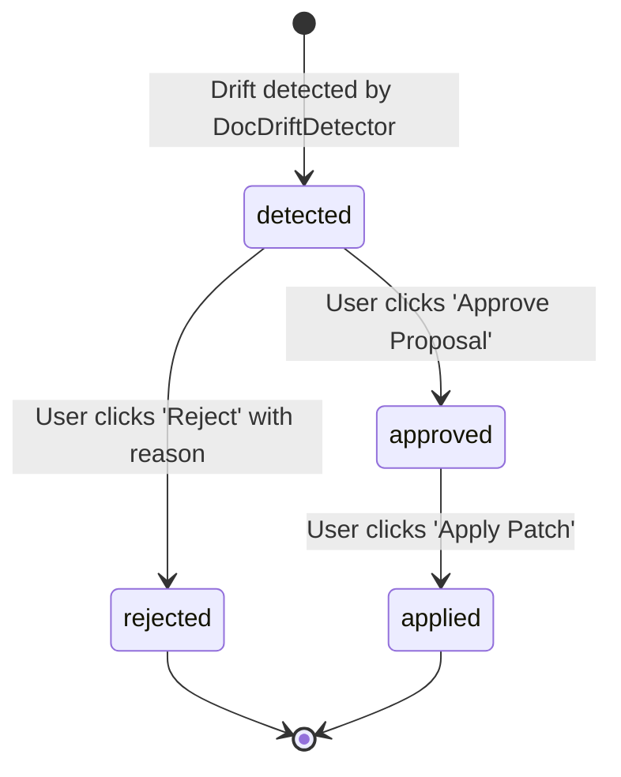

# Bug Memory and Living Documentation Operational Runbook

> **Governing documents:** [docs/01 §7 (CAP-03, CAP-04)](../01-product-requirements.md) · [docs/03 §3.4, §3.5, §11](../03-data-model-and-api.md) · [docs/05 §6.6, §6.7](../05-agents-and-llm-workflows.md) · [docs/07 §3, §10, §15](../07-security-privacy-and-threat-model.md) · [docs/09 §9](../09-testing-and-quality-strategy.md#9-retrieval-and-answer-quality-evaluation-baselines) · [docs/10 §11](../10-deployment-and-operations.md) · [ADR-015 (Approval Gates)](../12-architecture-decisions-and-open-questions.md#adr-015-github-integration-path) · [ADR-046 (Free-Only)](../12-architecture-decisions-and-open-questions.md#adr-046-free-only-constraint-and-free-deployment-profile) · [ADR-047 (Public Repo)](../12-architecture-decisions-and-open-questions.md#adr-047-repository-ownership-and-visibility).
> **Non-negotiable security:** Never log raw exception traces containing customer secrets or decrypted tokens. All queries scoped by `workspace_id` and `project_id`. Documentation patches require human approval before application.

---

## 1. Subsystem overview

Release 1.2 introduces two collaborative maintenance capabilities designed to prevent knowledge loss and keep technical documentation synchronized with codebase evolution:

1. **Bug Memory (CAP-03):** An institutional knowledge store that identifies, normalizes, deduplicates, and retrieves recurring bugs alongside verified resolutions and modified code references:
   - **Deterministic Normalization (`ErrorNormalizer`):** Strips variable execution pointers (such as memory addresses `0x7ffd...`, line numbers in dynamic frames, timestamps, and request IDs) to generate canonical error signatures and deterministic SHA-256 fingerprints.
   - **Persistence & Deduplication (`BugRecord`):** Records errors per `(project_id, fingerprint)`. Recurring occurrences increment `occurrence_count` and update `last_seen_at` without fragmenting the database.
   - **Resolution Memory (`BugResolution`):** Stores documented root causes, architectural fix summaries, and affected file/symbol citations.
   - **Specialist Agent (`BugMemoryAgent`):** Performs hybrid similarity retrieval (exact fingerprint matching + semantic vector search) and synthesizes actionable explanations comparing incoming errors with past resolutions.
2. **Living Documentation & DocsAlive (CAP-04):** Continuous synchronization between technical documentation and codebase state:
   - **Document Parsing (`DocParser`):** Deterministically parses Markdown files (`docs/`, `README.md`, OpenAPI specs), extracting section hierarchies, declared HTTP routes (`METHOD /path`), and code symbols (`function`, `class`, `interface`).
   - **Drift Detection (`DocDriftDetector`):** Compares documentation content against active AST symbols and registered routes to identify missing symbols, removed endpoints, undocumented active routes, and stale section references.
   - **Patch Generation & Approval Gate (`DocsAliveAgent`):** Generates unified diff patch proposals (`diff_content`) with structured confidence scores and rationale. Enforces strict human approval (`status == "approved"`) before any patch can be written to repository documentation.

---

## 2. Architecture and data flow

```mermaid
flowchart TD
    subgraph BugMemory["Bug Memory (CAP-03)"]
        ErrIn[Incoming Error Trace] --> Norm[ErrorNormalizer]
        Norm --> FP[SHA-256 Fingerprint]
        FP --> DB_Bugs[("bug_records")]
        DB_Bugs --> Dedup{Existing Record?}
        Dedup -->|Yes| Incr[Increment Occurrence Count]
        Dedup -->|No| Insert[Insert Bug Record]
        Insert --> AgentBM[BugMemoryAgent]
        Incr --> AgentBM
        AgentBM --> Match[Hybrid Search & Fix Synthesis]
    end

    subgraph LivingDocs["Living Documentation & DocsAlive (CAP-04)"]
        MD[Markdown Documents] --> DocParse[DocParser]
        DocParse --> DocDB[("documentation_records")]
        CodeState[Active AST & Routes] --> DriftDet[DocDriftDetector]
        DocDB --> DriftDet
        DriftDet --> DriftDB[("doc_drift_items")]
        DriftDB --> AgentDA[DocsAliveAgent]
        AgentDA --> Proposal[Unified Diff Proposal]
        Proposal --> Gate{Human Approval Gate}
        Gate -->|Approved| Apply[Apply Patch to Doc]
        Gate -->|Rejected| Rej[Record Rejection Reason]
    end
```



---

## 3. Data model and lifecycle states

### 3.1 Bug Memory (`bug_records` & `bug_resolutions`)

- **`bug_records`**:
  - `id`: UUIDv7 primary key.
  - `workspace_id`, `project_id`: Multi-tenant ownership foreign keys.
  - `fingerprint`: `String(64)` SHA-256 hash of normalized error signature. Unique per `(project_id, fingerprint)`.
  - `error_signature`: Canonical stack trace and normalized exception representation.
  - `occurrence_count`: Monotonically incremented counter for repeated errors.
  - `first_seen_at`, `last_seen_at`: ISO 8601 UTC timestamps.
- **`bug_resolutions`**:
  - `id`: UUIDv7 primary key.
  - `bug_record_id`: Cascading foreign key to `bug_records.id`.
  - `cause`: Root cause explanation.
  - `fix_summary`: Human or agent documented fix rationale.
  - `files`: JSONB array of modified file paths and line ranges.
  - `resolved_by`: User UUID or `null` for automated assistant resolution.

### 3.2 Living Documentation (`documentation_records` & `doc_drift_items`)

- **`documentation_records`**:
  - `id`: UUIDv7 primary key.
  - `path`: Workspace-relative file path (e.g., `docs/api.md`).
  - `current_version_hash`: SHA-256 hash of raw Markdown content.
  - `content_snapshot`: Cached snapshot of text content.
  - `extracted_symbols`: JSONB structure containing route specifications and code declarations.
- **`doc_drift_items` lifecycle states**:
  - `detected`: Drift detected by `DocDriftDetector` or manual scan trigger; proposal formulated.
  - `approved`: Human maintainer reviewed the diff proposal and approved application.
  - `rejected`: Human maintainer rejected proposal with documented rationale.
  - `applied`: Approved patch written to `documentation_records` content snapshot.



> [!IMPORTANT]
> Calling `/api/v1/docs/drift/{drift_id}/apply` on a drift item in `detected` or `rejected` state raises RFC 9457 `409 ConflictError`. A proposal **must** transition through `approved` first.

---

## 4. Operational playbooks

### 4.1 High-volume duplicate error surges

**Symptom:** High rate of recurring error submissions for a single project causing database write load.
**Diagnostic:**
1. Check top occurring bugs in project:
   ```bash
   curl -s -H "Authorization: Bearer $AUTH_TOKEN" \
     "https://api.devmind.warishlabs.in/api/v1/projects/$PROJECT_ID/bugs?limit=10" | jq .
   ```
2. Inspect `occurrence_count` and `last_seen_at` for the spike fingerprint.
3. Verify if a resolution has already been documented in `resolutions`:
   ```bash
   curl -s -H "Authorization: Bearer $AUTH_TOKEN" \
     "https://api.devmind.warishlabs.in/api/v1/bugs/$BUG_ID" | jq .resolutions
   ```
**Remediation:**
- If known resolution exists: deploy the cited code fix to silence recurring error triggers.
- If new error: submit resolution via UI (`BugsTable` -> `+ Resolution`) or API endpoint `POST /api/v1/bugs/{bug_id}/resolutions` with root cause and fix summary so downstream developers immediately receive match recommendations.

### 4.2 Stale documentation drift backlog

**Symptom:** Accumulation of `detected` drift items on public APIs or core architecture documents.
**Diagnostic:**
1. Query pending drift items for project:
   ```bash
   curl -s -H "Authorization: Bearer $AUTH_TOKEN" \
     "https://api.devmind.warishlabs.in/api/v1/projects/$PROJECT_ID/docs/drift?status=detected" | jq .
   ```
2. Identify whether drift items represent removed endpoints or undocumented active routes.
**Remediation:**
- Open Web Screen S-16 (`/projects/[projectId]/docs`).
- Click **Review Proposal** on pending items.
- Inspect the color-coded unified diff preview.
- If diff correctly documents the active interface: click **Approve Proposal**, then click **Apply Patch to Documentation**.
- If drift is intentional (e.g., deprecated internal endpoint not meant for public reference): click **Reject Proposal** and supply rationale (e.g., `Internal diagnostic endpoint - excluded from public docs`).

### 4.3 Reversing an erroneously applied documentation patch

**Symptom:** A documentation patch was approved and applied, but contained inaccurate parameter explanations.
**Remediation:**
1. Retrieve documentation record detail:
   ```bash
   curl -s -H "Authorization: Bearer $AUTH_TOKEN" \
     "https://api.devmind.warishlabs.in/api/v1/projects/$PROJECT_ID/docs/$DOC_ID" | jq .content_snapshot
   ```
2. Submit corrected Markdown content via register endpoint:
   ```bash
   curl -s -X POST -H "Authorization: Bearer $AUTH_TOKEN" \
     -H "Content-Type: application/json" \
     -d '{"path": "docs/api.md", "title": "API Reference", "kind": "api_reference", "content": "# Restored Content..."}' \
     "https://api.devmind.warishlabs.in/api/v1/projects/$PROJECT_ID/docs"
   ```
3. Re-trigger drift detection to confirm convergence:
   ```bash
   curl -s -X POST -H "Authorization: Bearer $AUTH_TOKEN" \
     -H "Content-Type: application/json" \
     -d '{"known_routes": ["/api/v1/projects"]}' \
     "https://api.devmind.warishlabs.in/api/v1/projects/$PROJECT_ID/docs/detect-drift"
   ```

### 4.4 Cross-tenant isolation verification

**Symptom:** Security audit requires validating that Workspace A cannot query or mutate Workspace B's bug records or documentation.
**Verification Command:**
```bash
# Run automated multi-tenant isolation integration tests
uv run --directory server pytest \
  tests/test_e2e_bug_memory.py::test_e2e_bug_memory_multi_tenant_isolation \
  tests/test_e2e_living_docs.py::test_e2e_living_docs_multi_tenant_isolation -v
```
Expected output: `2 passed in < 1s`. Cross-tenant queries return RFC 9457 `404 Not Found` (preventing ID enumeration).

---

## 5. Benchmark evaluations and quality gates

Bug Memory and Living Docs are evaluated on every pull request touching backend analysis, orchestration, or domain services:

```bash
# Run dedicated Bug Memory & Living Docs evaluation harness
npm run eval:bug-docs
```

**Recorded Baseline Quality Gate ([docs/09 §9](../09-testing-and-quality-strategy.md#9-retrieval-and-answer-quality-evaluation-baselines)):**
- **Bug Memory:**
  - Top-1 Accuracy: $\ge 90\%$ (Baseline: $100\%$)
  - Recall@3: $\ge 95\%$ (Baseline: $100\%$)
  - MRR: $\ge 0.90$ (Baseline: $1.0000$)
  - Fingerprint Accuracy: $\ge 98\%$ (Baseline: $100\%$)
  - Negative Rejection Rate: $\ge 95\%$ (Baseline: $100\%$)
- **Living Docs:**
  - Drift Precision: $\ge 90\%$ (Baseline: $100\%$)
  - Drift Recall: $\ge 90\%$ (Baseline: $100\%$)
  - Drift F1-Score: $\ge 0.90$ (Baseline: $1.0000$)
  - Patch Diff Validity: $100\%$ (Baseline: $100\%$)
