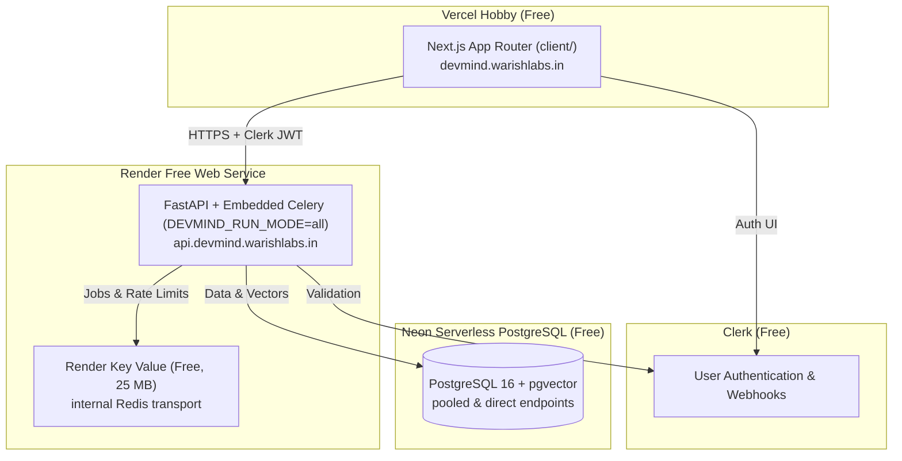

# Deploying DevMind on Render & Vercel (Free Profile)

This runbook documents the deployment procedures for DevMind's production and staging environments under the **free deployment profile** ([ADR-046](../12-architecture-decisions-and-open-questions.md#adr-046-free-only-constraint-and-free-deployment-profile) and [docs/10 §22](../10-deployment-and-operations.md#22-free-deployment-profile-active-adr-046)).

---

## 1. Architecture Overview

Under the free deployment profile, operational costs are strictly zero:



| Component | Host | Tier | Key Constraints |
|---|---|---|---|
| **Website (`client/`)** | Vercel | Hobby | Non-commercial, automatic Next.js build, 100 GB bandwidth |
| **Backend (`server/`)** | Render | Free Web Service | 512 MB RAM, sleeps after 15m idle, wakes in ~60s |
| **Queue (`devmind-redis`)** | Render | Free Key Value | 25 MB RAM, no persistence, internal only |
| **Database** | Neon | Free | 0.5 GB storage cap, compute suspends after 5m idle |
| **Auth** | Clerk | Free | 10,000 monthly active users |

---

## 2. Pre-Deployment Setup Checklist

Before deploying, ensure the required cloud accounts are configured:

1. **Clerk Authentication**:
   - Create project in [Clerk Dashboard](https://dashboard.clerk.com).
   - Retrieve `NEXT_PUBLIC_CLERK_PUBLISHABLE_KEY` and `CLERK_SECRET_KEY`.
2. **Neon Serverless PostgreSQL**:
   - Create project `devmind-prod` on [Neon Console](https://console.neon.tech).
   - Copy **Pooled** URL (port 5432, host contains `-pooler`) for `DEVMIND_DATABASE_URL`.
   - Copy **Direct** URL (pooling disabled) for `DEVMIND_DATABASE_URL_DIRECT`.
3. **Generate Security Secrets**:
   ```bash
   openssl rand -base64 32 # For DEVMIND_EXT_TOKEN_PEPPER
   openssl rand -base64 32 # For DEVMIND_ENCRYPTION_KEYS (format: ["<key>"])
   ```

---

## 3. Deploying Backend via Render Blueprint

The backend is configured as code in [`render.yaml`](../../render.yaml).

### Step 1: Connect GitHub Repository
1. Log into [Render Dashboard](https://dashboard.render.com).
2. Click **New +** → **Blueprint**.
3. Select `Warish-Labs/DevMind` repository on branch `main`.

### Step 2: Configure Environment Secrets
Render will detect two resources in `render.yaml`:
- `devmind-api` (Web Service)
- `devmind-redis` (Key Value store)

When prompted for un-synced variables (`sync: false`), supply:
- `DEVMIND_DATABASE_URL`: Neon pooled connection string.
- `DEVMIND_DATABASE_URL_DIRECT`: Neon direct connection string.
- `CLERK_SECRET_KEY`: Clerk secret key (`sk_live_...`).
- `CLERK_PUBLISHABLE_KEY`: Clerk publishable key (`pk_live_...`).
- `CLERK_WEBHOOK_SECRET`: Webhook signing secret (`whsec_...`).
- `DEVMIND_ENCRYPTION_KEYS`: JSON array with generated base64 key.
- `DEVMIND_EXT_TOKEN_PEPPER`: Generated base64 pepper string.

### Step 3: Apply Blueprint and Verify Probes
1. Click **Apply Blueprint**.
2. Watch build and deploy logs in Render console.
3. Test operational probes once deployed:
   ```bash
   curl -i https://<service-name>.onrender.com/healthz
   # Expect: HTTP/2 200, {"status": "ok"}

   curl -i https://<service-name>.onrender.com/readyz
   # Expect: HTTP/2 200, {"status": "ready", "database": "ok", "redis": "ok"}
   ```

---

## 4. Deploying Website on Vercel Hobby

### Step 1: Import Project
1. Log into [Vercel Dashboard](https://vercel.com).
2. Click **Add New...** → **Project**.
3. Select `Warish-Labs/DevMind` public repository.

### Step 2: Configure Monorepo Settings
- **Root Directory**: `client`
- **Include files outside root directory**: Enabled (checked)
- **Framework Preset**: Next.js
- **Build Command**: `pnpm build`
- **Install Command**: `pnpm install --frozen-lockfile`

### Step 3: Configure Environment Variables
Set the following variables for **Production** and **Preview**:
- `NEXT_PUBLIC_CLERK_PUBLISHABLE_KEY`: `pk_live_...`
- `CLERK_SECRET_KEY`: `sk_live_...`
- `NEXT_PUBLIC_API_BASE_URL`: `https://api.devmind.warishlabs.in` (or your Render URL)
- `NEXT_PUBLIC_SITE_URL`: `https://devmind.warishlabs.in`

Click **Deploy**.

---

## 5. Custom Domain Configuration (`warishlabs.in`)

Per [ADR-049](../12-architecture-decisions-and-open-questions.md#adr-049-domain-plan):

1. **Website (`devmind.warishlabs.in`)**:
   - In Vercel: Project Settings → **Domains** → add `devmind.warishlabs.in`.
   - Add CNAME record at your DNS provider pointing to `cname.vercel-dns.com`.
2. **API (`api.devmind.warishlabs.in`)**:
   - In Render: `devmind-api` Service → **Settings** → **Custom Domains** → add `api.devmind.warishlabs.in`.
   - Add CNAME record pointing to your Render service address (`<service>.onrender.com`).

---

## 6. Sleep Tolerance & Operational Invariants

Because Render free instances spin down after 15 minutes of inactivity and Neon compute suspends after 5 minutes:

1. **Waking State**: The Next.js client shows a graceful waking message on the first request if the server takes ~60 seconds to wake.
2. **Startup Re-enqueuer Sweep**: On every boot, the API sweeps stranded jobs in PostgreSQL and re-enqueues them into Redis.
3. **Database Reconnect**: Database queries employ connection retry backoff to absorb Neon compute resumption latency.

---

## 7. Incident Diagnosis & Rollback

| Symptom | Diagnostic Step | Remediation |
|---|---|---|
| **API returns 503** | Check `GET /readyz` | Verify Neon status and Render Key Value connectivity |
| **Worker tasks not progressing** | Inspect Render logs for Celery runner | Check if Redis memory cap (25 MB) was exceeded |
| **Bad Release / Failed Startup** | Check Render Deploys tab | Click **Rollback** to immediately reactivate previous image digest |
