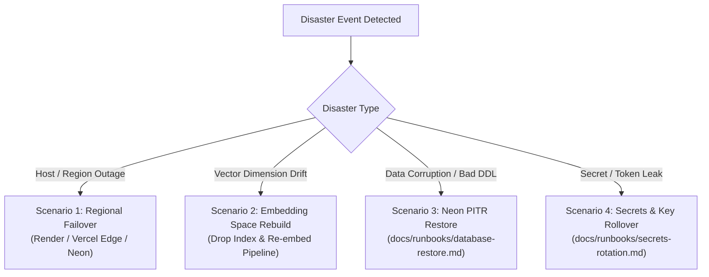

# Runbook: Business Continuity & Disaster Recovery Playbooks

**Owner**: Engineering / Operations  
**Governing Documents**: [docs/10 §16, §21, §22](../10-deployment-and-operations.md), [ADR-046](../12-architecture-decisions-and-open-questions.md), [ADR-047](../12-architecture-decisions-and-open-questions.md)  
**Status**: Confirmed & Tested (Milestone 10, Task M10-08)

---

## 1. Disaster Recovery Overview

This runbook defines recovery procedures for catastrophic disaster events per [docs/10 §16](../10-deployment-and-operations.md#16-backup-and-recovery):
1. **Regional / Infrastructure Outage (Render, Neon, Vercel)**
2. **Corrupted or Incompatible Embedding Space**
3. **Accidental Destructive Migration or Database Loss**
4. **Credential & Encryption Key Compromise**



---

## 2. Disaster Recovery Scenarios

### Scenario 1: Regional / Infrastructure Outage

**Trigger:** Primary hosting region suffers catastrophic multi-hour outage (e.g. Render Oregon region or Neon AWS us-east-2 outage).

**Architecture Resilience (ADR-046):**
- **Client (Vercel):** Global Anycast edge network with automatic multi-region origin routing. If one edge POP degrades, requests route automatically to neighboring regions.
- **Database (Neon):** Multi-AZ Paxos-replicated storage engine. Compute instances can be recreated in an alternate AZ/region attached to the same storage timeline.
- **Server Monolith (Render):** Stateless Docker container deployable to secondary regions via Render Blueprint (`render.yaml`).

**Step-by-Step Restoration Procedure:**
1. **Verify Outage Scope:**
   - Check Render Status (`status.render.com`) and Neon Status (`neonstatus.com`).
2. **Provision Alternate Web Service:**
   - In Render Dashboard, click **New > Blueprint** and select `render.yaml`.
   - Select alternate region (e.g. `Frankfurt` or `Ohio` if `Oregon` is down).
   - Inject platform secrets (`DEVMIND_DATABASE_URL`, `DEVMIND_REDIS_URL`, `CLERK_SECRET_KEY`) into the new service.
3. **Update Vercel Client Proxy:**
   - In Vercel Project Settings > Environment Variables, update `NEXT_PUBLIC_API_URL` to point to the new service URL (`https://devmind-api-backup.onrender.com`).
   - Trigger instant zero-downtime redeployment in Vercel.
4. **Post-Failover Verification:**
   - Execute health check: `curl -f https://devmind-api-backup.onrender.com/healthz`.

---

### Scenario 2: Corrupted or Incompatible Embedding Space

**Trigger:**
- Embedding model version upgrade (e.g. migrating from 768-dim `text-embedding-004` to updated model).
- Vector indexing corruption causing empty search results or pgvector index crashes.

**Step-by-Step Rebuild Procedure:**
1. **Activate Embedding Kill Switch:**
   - Set `DEVMIND_KILL_EMBED=true` to switch real-time search queries to lexical (BM25) fallback mode.
2. **Drop Corrupted Vector Index:**
   - In Neon SQL Console, drop the existing index to prevent corrupt query plans:
     ```sql
     DROP INDEX IF EXISTS idx_chunks_embedding;
     ```
3. **Trigger Project Brain Re-Embedding:**
   - devmind provides an asynchronous batch worker task to regenerate embeddings across all active project chunks:
     ```bash
     # From Render Shell or backend container
     uv run python -c "
     import asyncio
     from app.db.session import async_session_factory
     from app.workers.tasks import reembed_project_brain
     # Trigger for affected projects
     asyncio.run(reembed_project_brain(async_session_factory))
     "
     ```
4. **Rebuild pgvector Index:**
   - Once chunk embeddings are re-calculated, rebuild the IVFFlat / HNSW index concurrently:
     ```sql
     CREATE INDEX CONCURRENTLY idx_chunks_embedding
     ON chunks USING hnsw (embedding vector_cosine_ops);
     ANALYZE chunks;
     ```
5. **Revert Kill Switch:**
   - Set `DEVMIND_KILL_EMBED=false` to restore semantic vector search.

---

### Scenario 3: Accidental Destructive Migration or Database Loss

**Trigger:**
- DDL migration accidentally drops tables, alters schema incompatibly, or corrupts tenant data.

**Restoration Procedure:**
- DevMind implements a fully automated, drill-tested **Neon Point-In-Time Restore (PITR)** workflow ([docs/10 §16](../10-deployment-and-operations.md#16-backup-and-recovery), [database-restore.md](database-restore.md)).
- **RTO:** < 5 minutes (branch creation < 10 seconds, Alembic check < 3 seconds).
- **RPO:** Defined by Neon PITR storage timeline (zero data loss up to the exact transaction before the bad migration).
- **Steps:**
  1. Halt writes with `DEVMIND_KILL_INDEXING=true` and `DEVMIND_PAUSE_QUEUES=true`.
  2. In Neon Console, create a recovery branch at the timestamp immediately preceding the incident.
  3. Validate schema integrity on the recovery branch.
  4. Update `DEVMIND_DATABASE_URL` in Render.
  5. Restart web service and run `sweep_stranded_jobs`.
  6. Revert kill switches.

*Detailed runbook instructions:* See [database-restore.md](database-restore.md).

---

### Scenario 4: Critical Secret & Credential Disclosure

**Trigger:**
- Accidental secret commit to public repository, leak in error telemetry, or compromised vendor token.

**Restoration Procedure:**
- DevMind adheres to zero-downtime dual-key rotation protocols ([docs/10 §11.1](../10-deployment-and-operations.md#111-secret-handling-and-rotation), [secrets-rotation.md](secrets-rotation.md)):
  1. **Triage:** Identify leaked secret (Neon URL, Redis URL, Clerk secret, Encryption keys, Extension pepper).
  2. **Zero-Downtime Envelope Encryption Rotation:**
     - Add new key to `DEVMIND_ENCRYPTION_KEYS` while retaining existing key for decryption.
     - Deploy service (encrypts with new key, decrypts with either).
     - Trigger background re-encryption task over stored credentials.
     - Remove retired key once all records reference the new key ID.
  3. **Revocation & Invalidation:**
     - Revoke compromised credential at provider (Clerk Dashboard, Neon Console, Upstash Console).
     - Update environment variable in Render.

*Detailed rotation instructions:* See [secrets-rotation.md](secrets-rotation.md).
