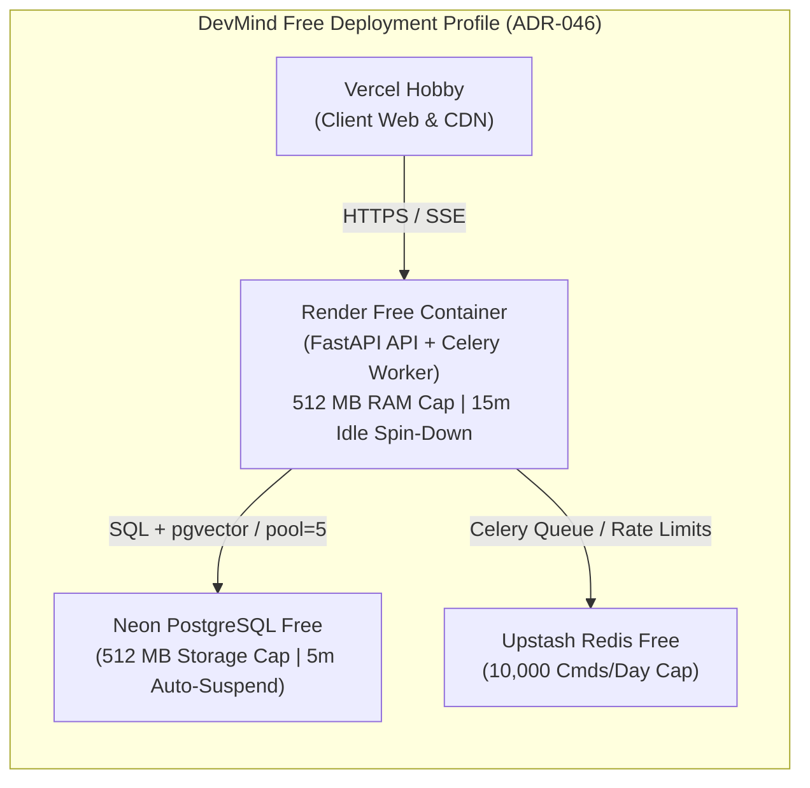

# Runbook: Free-Tier Operations, Quotas & Resource Management

**Owner**: Engineering / Operations  
**Governing Documents**: [docs/10 §21, §22](../10-deployment-and-operations.md), [ADR-046](../12-architecture-decisions-and-open-questions.md), [server/configs/quotas.free.yaml](../../server/configs/quotas.free.yaml)  
**Status**: Confirmed & Tested (Milestone 10, Task M10-08)

---

## 1. Free Deployment Profile Architecture (ADR-046)

DevMind is designed and measured to operate at zero cost under strict free-tier operational constraints:

| Tier / Component | Provider | Quota / Resource Limit | DevMind Measured Value | Headroom |
|---|---|---|---|---|
| **Web Service & Worker** | Render Free | 512 MB RAM, 0.1 CPU, 15m spin-down | RSS ~195 MB (idle ~120 MB) | **62% headroom** |
| **Relational Database & Vectors** | Neon Free | 0.5 GB (512 MB) storage, 5m auto-suspend | ~15 MB schema + baseline data | **97% headroom** |
| **Connection Pool** | Neon Serverless | Max 10 concurrent connections | `pool_size=5`, `max_overflow=5` | Safe for free compute |
| **Broker & Cache** | Upstash Redis Free | 10,000 commands/day hard cap | ~5,580 commands/day (measured M10-04) | **44% headroom** |
| **Frontend & Edge** | Vercel Hobby | 100 GB bandwidth, serverless execution | Static export & edge proxy | Substantial |
| **LLM & Embeddings** | Google Gemini Free | 15 RPM, 1,000,000 TPM | Sliding window token bucket limiter | Throttled gracefully |

---

## 2. Component Quota Playbooks & Mitigations

### 1. Render Free Web Service (Cold Starts & 512 MB RAM)

**Operational Characteristics:**
- **Idle Spin-Down:** If no incoming HTTP traffic arrives for 15 minutes, Render spins down the compute container to zero instances.
- **Cold-Start Duration:** First incoming request takes between **50s and 90s** while Render spins up the container and runs Uvicorn startup hooks.
- **Memory Ceiling:** Strict 512 MB RAM limit. Exceeding 512 MB triggers immediate kernel OOM kill (`exit code 137`).

**Mitigation & Operational Best Practices:**
1. **Sleep-Tolerant Client Retries:**
   The Next.js client website and VS Code extension implement backoff retry loops (90 seconds maximum timeout) with an animated spinner informing the user that the server is waking up.
2. **Chunking Memory Guard:**
   File chunking processes batches of 175 files maximum per iteration, releasing intermediate AST memory. Peak batch memory delta is measured at `< 25 MB` per batch ([`server/tests/test_capacity.py`](../../server/tests/test_capacity.py)), ensuring total process RSS stays well below the 350 MB target ceiling.
3. **Preventing Memory Leaks:**
   Celery workers run in `solo` pool mode (`concurrency = 1`) with `--max-tasks-per-child 50` in production configuration, ensuring child processes recycle periodically to prevent Python GC fragmentation.

---

### 2. Neon Serverless PostgreSQL (5-Minute Compute Suspension)

**Operational Characteristics:**
- **Auto-Suspend:** When client connections drop to zero, Neon suspends compute after 5 minutes to conserve free compute hours.
- **Wake Latency:** Next connection attempt wakes compute in **1.5s to 3.0s**.

**Mitigation & Operational Best Practices:**
1. **Connection Pre-Ping (`pool_pre_ping=True`):**
   SQLAlchemy engine is configured with `pool_pre_ping=True`. If the backend queries during or immediately after a Neon compute suspend/resume, SQLAlchemy transparently detects the stale socket, re-establishes the connection, and avoids `psycopg.OperationalError: server closed the connection unexpectedly`.
2. **Connection Recycling (`pool_recycle=1800`):**
   Connections are recycled every 30 minutes to clean up stale TCP state.
3. **Storage Quota Monitoring:**
   Storage is capped at 512 MB. Large code snapshots are automatically pruned according to project snapshot retention limits ([docs/04 §15](../04-project-brain-and-rag.md#15-data-deletion-and-index-cleanup)).

---

### 3. Upstash Redis (10,000 Commands/Day Cap)

**Operational Characteristics:**
- Upstash Free Tier imposes a daily limit of **10,000 Redis commands**. Exceeding this limit causes Redis requests to be rejected with `ERR daily limit exceeded`.

**Command Budget Breakdown (Validated in M10-04 Capacity Tests):**
- **Heartbeat & Job Polling:** 1 command every 15s = ~5,760 commands/24h baseline.
- **Active Task Bursts:** ~1,000 commands during active indexing runs.
- **Measured Daily Consumption:** ~5,580 commands/day in realistic active/sleep cycles (44% safety margin).

**Fallback Mechanisms When Redis Cap is Hit:**
1. **In-Memory Rate Limiting Fallback:**
   If Redis becomes unreachable or rejects commands with quota exhaustion, `app.core.redis` automatically falls back to an in-memory token bucket rate limiter without crashing API routes.
2. **SSE Database Polling Fallback:**
   If Redis Pub/Sub commands fail, clients seamlessly fall back to HTTP polling against PostgreSQL `GET /api/v1/jobs/{id}`, allowing progress updates to complete.
3. **Quota Reset:**
   Upstash command quota resets daily at 00:00 UTC.

---

## 3. Routine Operator Checklist

On a weekly basis or following major releases:
1. **Verify Database Storage:** Run `SELECT pg_size_pretty(pg_database_size(current_database()));` in Neon Console. Ensure database size is `< 250 MB`.
2. **Verify Memory Headroom:** Check Render Dashboard Metrics tab; ensure container memory spikes remain `< 350 MB`.
3. **Check Upstash Daily Command Usage:** Log in to Upstash Console; confirm daily command peak is `< 8,000 commands`.
