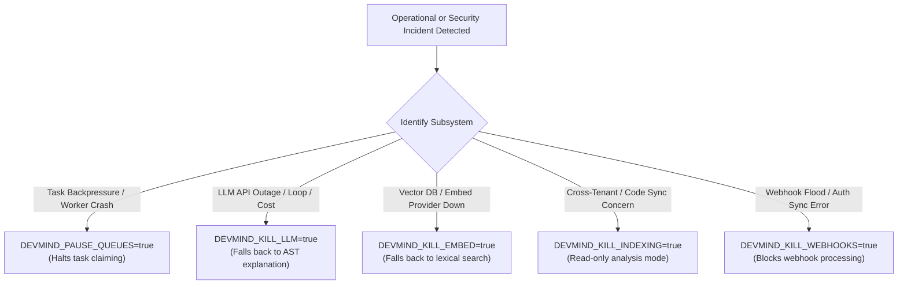

# Runbook: Incident Diagnosis, Triage & Response Playbooks

**Owner**: Engineering / Operations  
**Governing Documents**: [docs/10 §18, §12, §14, §15](../10-deployment-and-operations.md), [docs/07 §17](../07-security-privacy-and-threat-model.md), [ADR-046](../12-architecture-decisions-and-open-questions.md), [ADR-047](../12-architecture-decisions-and-open-questions.md)  
**Status**: Confirmed & Tested (Milestone 10, Task M10-08)

---

## 1. Incident Severity Matrix & Communication

DevMind classifies operational and security incidents into four severity tiers:

| Severity | Definition | Target Response (Free Profile) | Escalation & Notification |
|---|---|---|---|
| **SEV-1 (Critical Outage)** | Complete service unavailability, confirmed cross-tenant data exposure, or widespread unauthenticated access. | **< 15 minutes** | Trigger emergency kill switches immediately; notify repository maintainers via GitHub Issues/Discussions. |
| **SEV-2 (Major Degradation)** | Core workflow impaired: worker queue stalled, LLM provider outage with no fallback, or authentication webhooks failing. | **< 1 hour** | Isolate affected subsystem via kill switches; initiate provider status check. |
| **SEV-3 (Minor Degradation)** | Non-critical degradation: SSE streaming fallback to polling, rate-limit backpressure, or cold-start latency spike. | **< 4 hours** | Inspect structured telemetry; adjust thresholds or restart worker pool. |
| **SEV-4 (Low / Advisory)** | Cosmetic UI issue, non-blocking warning log spike, or isolated client-side timeout. | Next business day | Log incident ticket; address in routine release cycle. |

> [!IMPORTANT]
> **Privacy and Source Code Rule:** Never request, export, or log user source code, customer tokens, or raw prompts to diagnose an incident ([ADR-047](../12-architecture-decisions-and-open-questions.md#adr-047-repository-ownership-and-visibility)). Diagnose solely using `request_id`, `job_id`, `workspace_id`, `project_id`, counts, hashes, and RFC 9457 Problem Details error codes.

---

## 2. Emergency Subsystem Kill Switch Catalog

DevMind provides five zero-downtime subsystem kill switches configured in the platform environment ([docs/07 §17](../07-security-privacy-and-threat-model.md#17-incident-response), [docs/10 §11](../10-deployment-and-operations.md#11-environment-variables-and-secrets)). Setting any switch to `true` takes effect immediately or on service restart:



| Switch Name | Environment Variable | Subsystem Effect | Graceful Fallback Behavior |
|---|---|---|---|
| **Indexing / Code Sync** | `DEVMIND_KILL_INDEXING=true` | Blocks `/api/v1/projects/{id}/snapshots` chunk ingestion and file uploads. | Returns RFC 9457 error `feature_disabled`. Existing indexed snapshots remain queryable in read-only mode. |
| **LLM Gateway** | `DEVMIND_KILL_LLM=true` | Disables external LLM inference gateway calls across all agent workflows. | Finding explanation gracefully falls back to deterministic AST and rule-based explanations. |
| **Vector Embedding** | `DEVMIND_KILL_EMBED=true` | Halts embedding calls to Google Vertex / Gemini text-embedding models. | Retrieval falls back to lexical (BM25 / Trigram) search; API returns `is_degraded: true`. |
| **External Webhooks** | `DEVMIND_KILL_WEBHOOKS=true` | Halts Clerk and GitHub webhook ingestion endpoints. | Webhooks respond with `503 Service Unavailable` (`webhook_ingestion_paused`), allowing providers to retry. |
| **Worker Queue Consumption** | `DEVMIND_PAUSE_QUEUES=true` | Workers cease popping jobs from Celery / Redis queues. | Jobs remain safely buffered in PostgreSQL `jobs` table until resumed; prevents poison-pill retry churn. |

---

## 3. Incident Playbooks (docs/10 §18)

### Playbook 1: Worker Stall, Backpressure & Stranded Tasks

**Symptoms:**
- Alert `devmind_queue_depth > 50` or `devmind_queue_age_seconds > 300` triggers ([docs/10 §14](../10-deployment-and-operations.md#14-queue-monitoring)).
- Worker heartbeat becomes stale: `devmind_worker_heartbeat_stale_seconds > 120`.
- Jobs remain in `running` or `queued` status without progress updates.

**Diagnosis Steps:**
1. Check Render API/Worker service logs for unhandled worker crashes or OOM events (`exit code 137`).
2. Inspect worker heartbeat records in PostgreSQL:
   ```sql
   SELECT worker_id, hostname, last_heartbeat, is_healthy, active_jobs
   FROM worker_heartbeats
   ORDER BY last_heartbeat DESC;
   ```
3. Check for stuck or timed-out tasks in PostgreSQL:
   ```sql
   SELECT id, project_id, task_type, status, created_at, started_at
   FROM jobs
   WHERE status = 'running' AND started_at < NOW() - INTERVAL '10 minutes';
   ```

**Remediation Steps:**
1. **Reclaim Stranded Jobs:**
   The background sweeper automatically reaps orphaned tasks whose worker heartbeats expired. To trigger an immediate manual reap:
   ```bash
   # From Render Shell or server CLI
   uv run python -c "
   import asyncio
   from app.db.session import async_session_factory
   from app.workers.sweeper import sweep_stranded_jobs
   asyncio.run(sweep_stranded_jobs(async_session_factory))
   "
   ```
2. **Isolate Poison Pill Tasks:**
   If a specific malicious or malformed task is crashing the worker:
   - Identify the offending `job_id` from logs.
   - Mark the task failed with RFC 9457 code `task_execution_failed`:
     ```sql
     UPDATE jobs
     SET status = 'failed', error_code = 'task_execution_failed',
         error_detail = 'Manual operator isolation: poison task', completed_at = NOW()
     WHERE id = '<job_id>';
     ```
3. **Restart Worker Process:**
   In Render Dashboard, navigate to the web/worker service and trigger **Manual Deploy > Clear build cache & deploy** or restart compute.

---

### Playbook 2: Retrieval Degradation & Embedding Provider Outage

**Symptoms:**
- Query latency spikes above 2,000ms on `/api/v1/projects/{id}/brain/query`.
- Logs report `429 Too Many Requests` or `RESOURCE_EXHAUSTED` from Google Gemini / Vertex embedding API.
- PostgreSQL logs show slow queries or high CPU on `chunks` pgvector searches.

**Diagnosis Steps:**
1. Check embedding provider health and current rate-limit exhaustion:
   ```bash
   grep -i "embed_rate_limited\|RESOURCE_EXHAUSTED" /var/log/server.log
   ```
2. Verify pgvector index status and dead tuples in Neon PostgreSQL:
   ```sql
   SELECT relname, n_dead_tup, last_vacuum, last_analyze
   FROM pg_stat_user_tables
   WHERE relname = 'chunks';
   ```

**Remediation Steps:**
1. **Enable Vector Kill Switch:**
   Set `DEVMIND_KILL_EMBED=true` in Render environment variables. This instantly activates lexical keyword search fallback without dropping requests.
2. **Vacuum & Analyze pgvector Table:**
   If table bloat or index fragmentation causes slow recall, run in Neon SQL Console:
   ```sql
   VACUUM ANALYZE chunks;
   REINDEX INDEX CONCURRENTLY idx_chunks_embedding;
   ```
3. **Re-enable Embedding:**
   Once provider quota resets (typically at the start of the next hour/day for free tier), set `DEVMIND_KILL_EMBED=false`.

---

### Playbook 3: Real-Time SSE Disconnects & Proxy Timeouts

**Symptoms:**
- Web client displays "Connection to analysis server lost; retrying..." banner.
- Upstream HTTP proxies (Render, Cloudflare) emit `504 Gateway Timeout` on `/api/v1/jobs/{id}/events`.
- SSE streams disconnect after exactly 100 seconds (Render proxy idle timeout).

**Diagnosis Steps:**
1. Check if the server keep-alive ping loop is operating (must emit `: keep-alive\n\n` every 15 seconds per [docs/03 §11](../03-data-model-and-api.md#11-endpoint-families)).
2. Inspect Redis connection pool for dropped Pub/Sub subscribers:
   ```bash
   # Verify Redis connectivity
   uv run python -c "
   import asyncio
   from app.core.redis import get_redis_client
   async def check():
       r = await get_redis_client()
       print('Redis ping:', await r.ping())
   asyncio.run(check())
   "
   ```

**Remediation Steps:**
1. **Client Long-Polling Fallback:**
   The DevMind web client automatically falls back from SSE to HTTP polling (`GET /api/v1/jobs/{id}`) every 3 seconds if SSE fails 3 consecutive times. Confirm the client switched over cleanly.
2. **Verify Proxy Keep-Alive Interval:**
   Ensure `DEVMIND_SSE_PING_INTERVAL_SECONDS` is set to `15` (well beneath Render's 100s proxy idle timeout).
3. **Flush Stale Redis Subscribers:**
   If Redis Pub/Sub channels leak subscribers due to abrupt client drops, restart the web service container to reset connection pools.

---

### Playbook 4: Cross-Tenant Isolation Suspicion or Security Incident

**Symptoms:**
- Suspicious query patterns detected: requests attempting to access `project_id` belonging to another `workspace_id`.
- Alert `devmind_cross_tenant_denied_total` spikes.
- User report of seeing another project's symbols or findings.

**Immediate Containment Protocol (docs/07 §17):**
1. **Activate Ingestion & Processing Kill Switches:**
   Immediately freeze all mutating endpoints to prevent any further exfiltration:
   ```bash
   DEVMIND_KILL_INDEXING=true
   DEVMIND_KILL_LLM=true
   DEVMIND_PAUSE_QUEUES=true
   ```
2. **Preserve Forensic Evidence:**
   Extract and archive relevant structured access logs without modifying database state:
   ```bash
   # Filter structured JSON logs by affected workspace/project
   cat /var/log/server.log | jq 'select(.workspace_id == "<affected_workspace_id>" or .project_id == "<affected_project_id>")' > forensic_audit.jsonl
   ```
3. **Validate Row-Level & Repository Tenant Isolation:**
   Verify that all repository queries enforce explicit `workspace_id` AND `project_id` matching ([docs/02 §4](../02-system-architecture.md#4-component-responsibilities-backend)):
   ```sql
   -- Verify project ownership
   SELECT id, workspace_id, name, created_at
   FROM projects
   WHERE id = '<project_id>';
   ```
4. **Invalidate Active Sessions & Tokens:**
   - If an extension token is suspected compromised, revoke it immediately in the web dashboard or database:
     ```sql
     UPDATE extension_tokens
     SET revoked_at = NOW(), revocation_reason = 'security_containment'
     WHERE project_id = '<project_id>';
     ```
   - For web users, force session revocation via the Clerk Dashboard.

---

### Playbook 5: Duplicate Task Execution & Stale Idempotency Locks

**Symptoms:**
- Multiple background tasks executed for a single user action (e.g. duplicate analysis jobs created).
- Database contains identical duplicate findings with different IDs.
- Logs show repeated `IntegrityError` on unique constraint or lock contention.

**Diagnosis Steps:**
1. Check task visibility timeout vs task execution duration:
   - If a background job takes longer than Celery's `visibility_timeout` (default: 3600s), the broker re-delivers the message to another worker.
2. Check `processed_events` or idempotency records:
   ```sql
   SELECT idempotency_key, route, status, created_at, response_code
   FROM idempotency_keys
   WHERE created_at > NOW() - INTERVAL '1 hour';
   ```

**Remediation Steps:**
1. **Enforce Atomic Claim:**
   Verify the job claiming state machine uses `SELECT ... FOR UPDATE SKIP LOCKED` so concurrent workers cannot double-claim:
   ```sql
   SELECT id FROM jobs
   WHERE status = 'queued'
   ORDER BY created_at ASC
   LIMIT 1
   FOR UPDATE SKIP LOCKED;
   ```
2. **Purge Duplicate In-Flight Tasks:**
   If a task is stuck in a loop, mark older duplicate runs as `superseded`:
   ```sql
   UPDATE jobs
   SET status = 'failed', error_code = 'task_superseded',
       error_detail = 'Cancelled due to newer duplicate run'
   WHERE project_id = '<project_id>' AND status = 'queued'
     AND created_at < (SELECT MAX(created_at) FROM jobs WHERE project_id = '<project_id>');
   ```
