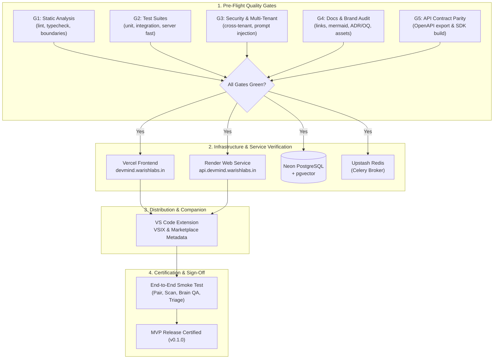

# Runbook: MVP Release Checklist & Launch Verification

**Owner**: Engineering / Operations  
**Governing Documents**: [docs/01 §17](../01-product-requirements.md#17-acceptance-criteria-summary), [docs/09 §15](../09-testing-and-quality-strategy.md#15-quality-gates), [docs/10 §17, §22](../10-deployment-and-operations.md), [docs/11 §M13](../11-mvp-and-implementation-roadmap.md), [ADR-046](../12-architecture-decisions-and-open-questions.md#adr-046-free-only-constraint-and-free-deployment-profile), [AGENTS.md](../../AGENTS.md)  
**Status**: Confirmed & Tested (Milestone 13, Task M13-06)

---

## 1. Overview & Release Philosophy

This runbook defines the mandatory verification protocol required to certify and launch the **DevMind MVP Release** (`v0.1.0`).

The DevMind MVP delivers the foundational vision: **Code Intelligence (CAP-01)** and **Security Intelligence (CAP-02)** anchored by the **Project Brain**, accompanied by the **privacy-first VS Code companion extension** and the **Next.js authenticated web application**.

Per [ADR-046](../12-architecture-decisions-and-open-questions.md#adr-046-free-only-constraint-and-free-deployment-profile), the release operates exclusively within verified free-tier constraints (Vercel Hobby, Render Free Web Service, Neon PostgreSQL Free, and Upstash Redis Free).

---

## 2. Pre-Flight Quality Gates Verification

All five quality gates ([docs/09 §15](../09-testing-and-quality-strategy.md#15-quality-gates)) must pass before release tagging:

- [ ] **Gate 1 — Static Analysis & Architecture Boundaries**:
  - Run: `pnpm lint && pnpm typecheck && pnpm -C server run ruff check . && python3 scripts/check-import-boundaries.py`
  - Pass Criteria: Zero ESLint errors, zero TypeScript errors across all packages (`client`, `extension`, `common`), zero Ruff lint errors, and zero architectural import boundary violations.
- [ ] **Gate 2 — Automated Test Suites**:
  - Run: `node scripts/test-all.mjs --fast`
  - Pass Criteria: 13 test suites pass cleanly (0 failed):
    - `docs:links` (includes Mermaid, ADR, OQ, brand audit)
    - `brand:check`
    - `typecheck:root`
    - `test:common`
    - `build:common`
    - `typecheck:client`
    - `test:client`
    - `build:extension`
    - `test:extension`
    - `package:extension`
    - `lint:server`
    - `boundaries:server`
    - `test:server`
- [ ] **Gate 3 — Security & Tenant Isolation**:
  - Run: `pnpm -C server run pytest tests/test_security_multitenant.py tests/test_redaction.py`
  - Run: `python3 server/.venv/bin/python evals/injection/harness.py`
  - Pass Criteria: 100% of cross-tenant data leak probes return 404/403; prompt injection defenses maintain 100% block rate on injection benchmarks.
- [ ] **Gate 4 — Documentation & Brand Integrity**:
  - Run: `npm run docs:audit && npm run brand:check`
  - Pass Criteria: All 56 Markdown files, 720+ relative links/anchors, 36 Mermaid diagrams, 50 ADRs, 18 OQs, and 10 brand assets verified with 0 issues.
- [ ] **Gate 5 — API Contract Parity**:
  - Run: `npm run gen:api && git diff --exit-code common/src/api/schema.d.ts`
  - Pass Criteria: Exported OpenAPI 3.1 specification matches backend router endpoints; generated TypeScript client types show zero uncommitted diffs.

---

## 3. Deployment & Cloud Topology Checklist

Verify operational readiness on each platform per [docs/10 §22](../10-deployment-and-operations.md):

### 3.1 Vercel Frontend (`client/`)
- [ ] Target URL: `https://devmind.warishlabs.in`
- [ ] Environment variables configured:
  - `NEXT_PUBLIC_CLERK_PUBLISHABLE_KEY` (Clerk production key)
  - `CLERK_SECRET_KEY` (Clerk server key)
  - `NEXT_PUBLIC_API_URL` (`https://api.devmind.warishlabs.in`)
- [ ] Security headers active: Content Security Policy (CSP), Strict-Transport-Security (HSTS), X-Content-Type-Options: `nosniff`, X-Frame-Options: `DENY`.
- [ ] Production build succeeds without warnings: `pnpm -C client run build`.

### 3.2 Render Web Service (`server/`)
- [ ] Target URL: `https://api.devmind.warishlabs.in`
- [ ] Service configuration:
  - Docker runtime targeting `server/Dockerfile`.
  - Service plan: Free Web Service (512 MB RAM, free instance).
  - Environment variables:
    - `DEVMIND_RUN_MODE=all` (FastAPI + Celery embedded worker per ADR-046).
    - `DEVMIND_ENV=production`
    - `DATABASE_URL` (Neon PostgreSQL pooled connection string with `sslmode=require`).
    - `DATABASE_DIRECT_URL` (Neon direct endpoint for migrations/DDL).
    - `REDIS_URL` (Upstash Redis TLS connection string `rediss://...`).
    - `CLERK_ISSUER` & `CLERK_AUDIENCE`
    - `CLERK_SECRET_KEY`
    - `DEVMIND_EXTENSION_TOKEN_SECRET` (256-bit secret)
    - `OPENAI_API_KEY` or `GEMINI_API_KEY` (Free/BYOK tier)
- [ ] Health check endpoint `/healthz` returns `{"status": "ok", "version": "0.1.0"}` within 200ms.

### 3.3 Neon PostgreSQL Database
- [ ] Database version: PostgreSQL 16+ with `vector` extension enabled.
- [ ] Schema head verified: `cd server && uv run alembic current` reports `0005_... (head)`.
- [ ] Connection pooling enabled via PgBouncer / Neon pooled port 6543 for API traffic; direct port 5432 for Alembic DDL.

### 3.4 Upstash Redis
- [ ] Connection scheme: `rediss://` with TLS encryption enabled.
- [ ] Max memory policy: `noeviction` (Celery task queue reliability).
- [ ] Celery ping check: worker processes background tasks and acknowledges heartbeats.

---

## 4. VS Code Companion Extension Distribution Checklist

Verify marketplace readiness per [docs/06 §18](../06-vscode-extension-and-local-scanning.md#18-packaging-and-release):

- [ ] **Manifest Metadata Compliance**:
  - `name`: `devmind-vscode`
  - `publisher`: `WarishLabs`
  - `version`: `0.1.0` (Semantic Versioning)
  - `displayName`: `DevMind Companion`
  - `icon`: `media/icon.png` (128x128px PNG)
  - `repository`: `https://github.com/Warish-Labs/DevMind.git`
  - `homepage`: `https://devmind.warishlabs.in`
  - `bugs`: `https://github.com/Warish-Labs/DevMind/issues`
  - `qna`: `https://github.com/Warish-Labs/DevMind/discussions`
  - `license`: `MIT`
- [ ] **Bundling & Artifact Verification**:
  - Production build: `npm run build:extension`
  - Package artifact: `vsce package --no-dependencies --out dist/devmind-vscode.vsix`
  - VSIX package size verified: ~55 KB (strictly under the 5 MB limit).
  - Package contents: Contains only `dist/extension.js`, `media/*`, `package.json`, `README.md`, `CHANGELOG.md`, `LICENSE.txt`.
- [ ] **Zero Live DB Enforcement**:
  - Verified that extension code contains zero SQL client imports (`pg`, `mysql`, `sqlite3` direct sockets). All cloud sync is mediated through HTTPS API (`/api/v1/ext/...`).

---

## 5. End-to-End Post-Deployment Smoke Protocol

Execute the standard manual acceptance walkthrough on the deployed system:

1. **User Onboarding & Session**:
   - Navigate to `https://devmind.warishlabs.in`.
   - Sign up / sign in via Clerk auth.
   - Verify redirect to default workspace.
2. **Extension Pairing**:
   - Open VS Code with `devmind-vscode` extension installed.
   - Run `DevMind: Connect to DevMind Cloud`.
   - Verify browser opens token authorization URL; approve pairing.
   - Confirm VS Code status bar displays `DevMind: Connected`.
3. **Local AST Scan & Privacy Consent**:
   - Open a TypeScript or Python project folder in VS Code.
   - Trigger `DevMind: Scan Workspace`.
   - Confirm diagnostics appear in VS Code Problems panel.
   - Verify consent prompt appears before any file metadata is uploaded.
4. **Project Brain Snapshot & Graph Explorer**:
   - In the web app, open the Project Brain view (`/projects/[projectId]/brain`).
   - Confirm symbol graph renders modules, functions, and relationships.
   - Click a node; confirm symbol metadata, callers, and callees display in the inspector.
5. **Security Sentinel & Finding Triage**:
   - Open Security Findings view (`/projects/[projectId]/findings`).
   - Confirm detected findings display evidence tier badges (`E0`, `E1`, `E2`).
   - Open finding detail modal; verify maintainer permission gate allows status update to `confirmed` or `dismissed`.
6. **Project AI Assistant (BrainQA)**:
   - Open AI Assistant view (`/projects/[projectId]/chat`).
   - Submit prompt: `"How is authentication token verification implemented?"`.
   - Verify streaming SSE response completes with:
     - Clickable inline evidence citations `[1]`.
     - Code snippets linked to Project Brain files.
     - Structured reasoning trace accordion.

---

## 6. Known Limitations Ledger (MVP v0.1.0)

Per [docs/01 §17](../01-product-requirements.md#17-acceptance-criteria-summary), every release must disclose its explicit boundaries:

| Dimension | MVP Boundary (v0.1.0) | Post-MVP Roadmap (v1.1–v1.4) |
|---|---|---|
| **Language Support Tiers** | **Tier 1 (Full AST & Symbols)**: TypeScript, JavaScript, Python. **Tier 2 (Structural & Secrets)**: Go, Java, Rust, SQL, YAML, Markdown. | Additional Tier 1 languages (Go, Java, Rust full Tree-sitter symbol graphs) scheduled for v1.2. |
| **Database Connections** | **Zero live DB connections** (ADR-034 strictly enforced). Extension never connects directly to Neon/PostgreSQL. | Schema inference via uploaded migration DDL or consented snapshot metadata. |
| **In-Extension Chat** | **No conversational AI inside VS Code** (ADR-034). Extension provides local scanning, diagnostics, and consent controls. | Conversational intelligence resides in the web app shell; deep links connect IDE to web traces. |
| **Evidence Tiers** | **E0/E1**: Local pattern-engine match / AST heuristic. **E2**: Server-validated policy solver with resolvable trace. | **E3 (Dynamic sandbox execution)**: Deferred to v1.4 with isolated virtualization and human approval. |
| **Pull Request Review** | PR summarization and ReviewBuddy checklists deferred. | **Release 1.1 (M11)**: GitHub App webhooks, PRAgent impact analysis, and review rules. |
| **Bug Memory & Living Docs** | Workspace-wide bug recurrence memory deferred. | **Release 1.2–1.3 (M12)**: Living documentation sync and semantic incident memory. |
| **Infrastructure Profile** | **Free Tier limits** (ADR-046): Render free web service sleeps after 15m idle; Neon 0.5 CU limits. | Optional self-hosted Docker Compose deployment and funded cloud profiles. |

---

## 7. Rollback & Emergency Runbook References

If critical regressions occur during launch:

- **Frontend Rollback**: In Vercel Dashboard, select previous instant deployment and promote to Production (< 10 seconds).
- **Backend Rollback**: In Render Dashboard, redeploy previous tagged Docker image commit.
- **Database Disaster Recovery**: Follow [Runbook: Database Backup and Restore](database-restore.md) using Neon branch point-in-time recovery.
- **Secrets Compromise**: Follow [Runbook: Secrets and Credential Rotation](secrets-rotation.md).
- **Incident Escalation**: Follow [Runbook: Incident Response and Severity Matrix](incident-response.md).
