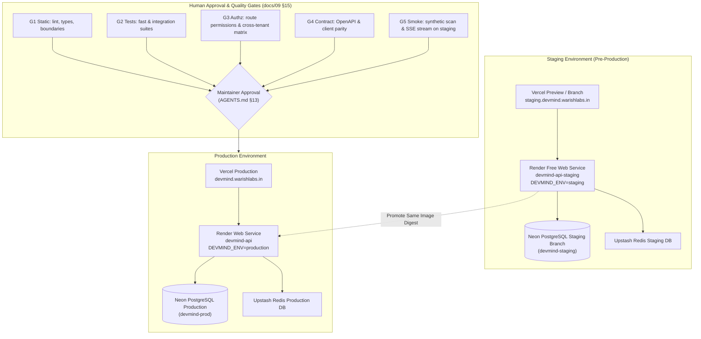
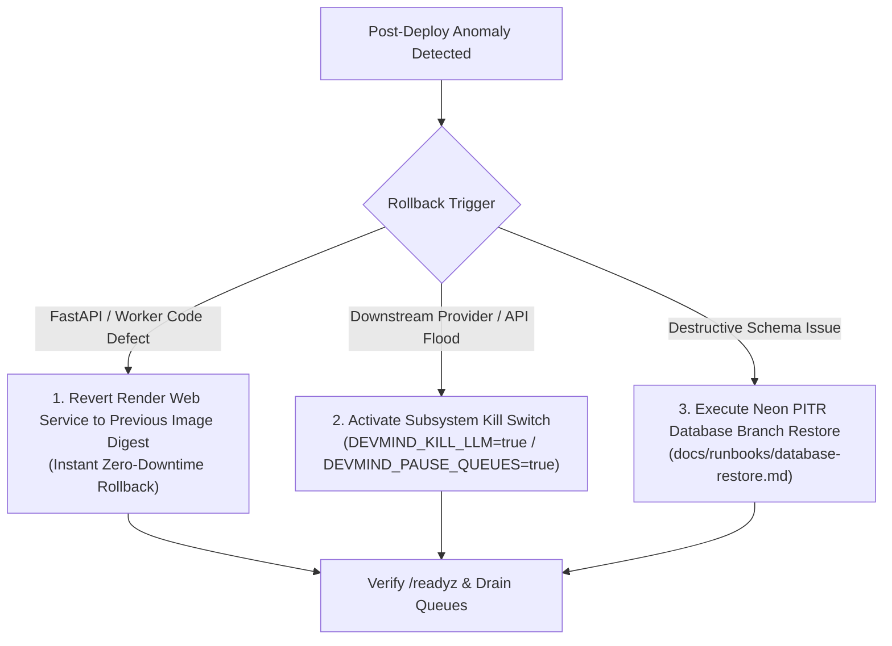

# Runbook: Staging Promotion Rehearsal & Release Verification

**Owner**: Engineering / Operations  
**Governing Documents**: [docs/10 §2, §17, §22](../10-deployment-and-operations.md), [docs/09 §15](../09-testing-and-quality-strategy.md), [ADR-046](../12-architecture-decisions-and-open-questions.md), [AGENTS.md](../../AGENTS.md)  
**Status**: Confirmed & Tested (Milestone 10, Task M10-10)

---

## 1. Overview & Promotion Philosophy

DevMind enforces an immutable-artifact promotion model: **the exact Docker image digest tested and verified on the staging environment is promoted to production** ([docs/10 §17](../10-deployment-and-operations.md#17-cicd-and-rollbacks)).

Under the free deployment profile ([ADR-046](../12-architecture-decisions-and-open-questions.md#adr-046-free-only-constraint-and-free-deployment-profile)), the staging environment strictly mirrors production architecture at zero cost:



---

## 2. Environment Parity Matrix (ADR-046)

| Parameter | Staging Environment | Production Environment | Isolation Guarantee |
|---|---|---|---|
| **Environment Flag** | `DEVMIND_ENV=staging` | `DEVMIND_ENV=production` | Strict runtime separation |
| **Frontend Host** | Vercel Preview (`staging.devmind.warishlabs.in`) | Vercel Production (`devmind.warishlabs.in`) | Isolated Vercel domains |
| **API & Worker** | Render Web Service (`devmind-api-staging`) | Render Web Service (`devmind-api`) | Separate Render compute instances |
| **Database** | Neon branch `staging` or `devmind-staging` | Neon root branch `production` | Complete storage isolation |
| **Redis / Queue** | Upstash Redis `devmind-redis-staging` | Upstash Redis `devmind-redis-prod` | Separate keys & Celery broker |
| **Authentication** | Clerk Development Instance (`pk_test_...`) | Clerk Production Instance (`pk_live_...`) | Separate user accounts & keys |
| **LLM & Embeddings** | Google Gemini Free API (`fake` or low-quota key) | Google Gemini Free API (`terms_reviewed: true`) | Provider quota separation |

---

## 3. Staging Promotion Rehearsal Sequence

### Phase 1: Build & Tag Immutable Container Image
1. Build the multi-stage Docker container image tagged with the short Git commit SHA:
   ```bash
   export COMMIT_SHA=$(git rev-parse --short HEAD)
   docker build -t ghcr.io/warish-labs/devmind-api:${COMMIT_SHA} -f server/Dockerfile server/
   ```
2. Verify image labels contain `DEVMIND_BUILD_SHA`:
   ```bash
   docker inspect --format '{{ index .Config.Labels "org.opencontainers.image.revision" }}' ghcr.io/warish-labs/devmind-api:${COMMIT_SHA}
   ```

---

### Phase 2: Deploy & Migrate Staging Environment
1. Deploy the new image digest to the staging Render service (`devmind-api-staging`).
2. Run database migrations under an advisory lock during container startup:
   ```bash
   # Automatically executed by server/app/core/lifecycle.py on startup
   alembic upgrade head
   ```
3. Verify migration head matches Alembic history:
   ```bash
   alembic current
   ```

---

### Phase 3: Automated Staging Smoke Verification

Execute the pre-promotion smoke harness against the staging endpoint:

1. **Liveness & Readiness Probes:**
   ```bash
   # Liveness check (must return 200 and matching build_sha)
   curl -f https://devmind-api-staging.onrender.com/healthz

   # Readiness check (verifies PostgreSQL, Redis, and Alembic migrations)
   curl -f https://devmind-api-staging.onrender.com/readyz
   ```
   *Expected response:*
   ```json
   {
     "status": "ready",
     "database": "ok",
     "redis": "ok",
     "migrations": "ok",
     "kill_switches": {
       "indexing": false,
       "llm": false,
       "embed": false,
       "webhooks": false,
       "pause_queues": false
     },
     "active_alerts_count": 0
   }
   ```

2. **Synthetic Project Scan & Analysis Workflow:**
   Run the staging smoke workflow ([`server/tests/test_staging_promotion.py`](../../server/tests/test_staging_promotion.py)):
   - Create synthetic test project (`POST /api/v1/projects`).
   - Ingest small 10-file snapshot (`POST /api/v1/projects/{id}/snapshots`).
   - Trigger analysis job (`POST /api/v1/projects/{id}/analyses`).
   - Subscribe to SSE event stream (`GET /api/v1/jobs/{job_id}/events`) and assert terminal `completed` status.
   - Assert zero unhandled worker exceptions and clean job progress.

3. **Queue Health & Worker Heartbeat Drain:**
   - Confirm Celery queue depth returns to 0.
   - Verify `devmind_worker_heartbeat_stale_seconds < 30`.

---

### Phase 4: Promotion Decision Gate (Human Sign-Off)

Before triggering the production deployment, verify the Quality Gates Checklist ([docs/09 §15](../09-testing-and-quality-strategy.md#15-quality-gates)):

- [ ] **G1 (Static Checks):** `lint:server`, `typecheck:client`, `typecheck:root`, `boundaries:server` all pass.
- [ ] **G2 (Tests):** `test:common`, `test:client`, `test:server`, `test:extension` all pass.
- [ ] **G3 (Authorization):** Route permission registry and cross-tenant isolation matrix pass on 100% of routes.
- [ ] **G4 (Contract):** OpenAPI schema is backward-compatible and additive; client types generated.
- [ ] **G5 (Smoke):** Staging `/readyz` is green; synthetic project analysis completed via SSE.
- [ ] **G6 (Security Review):** Zero unresolved SEV-1/SEV-2 findings; threat model reviewed ([docs/07 §18](../07-security-privacy-and-threat-model.md#18-threat-model)).
- [ ] **Human Sign-Off:** Maintainer explicitly approves promotion per [AGENTS.md](../../AGENTS.md) §13.

---

### Phase 5: Production Deployment & Zero-Downtime Rollout

1. **Deploy Order:**
   - Database migrations apply non-destructive backward-compatible DDL (expand phase per [docs/10 §8](../10-deployment-and-operations.md#8-migrations)).
   - Promote verified image digest to production Render Web Service (`devmind-api`).
   - Web container restarts with new image; Celery worker embedded processes begin handling new tasks.
2. **Post-Deploy Production Verification:**
   - Verify `/healthz` returns new `build_sha`.
   - Verify `/readyz` returns status `ready`.
   - Monitor error rates for 15-minute observation window.

---

## 4. Emergency Rollback Rehearsal

If post-deploy verification detects anomalies (e.g. rising 500s or database deadlocks):



### Rollback Procedures:
1. **Application Code Rollback:**
   In Render Dashboard, select **History > Previous Deploy** and click **Rollback to this deploy**.
   *Invariants Guarantee:* Because DevMind migrations follow the expand-contract pattern, the database schema remains backward-compatible with the previous image version, allowing instantaneous code rollback without database downgrades.
2. **Kill Switch Isolation:**
   If a specific subsystem (e.g. LLM or Celery queue) is misbehaving, toggle the corresponding kill switch in Render environment variables:
   - `DEVMIND_KILL_LLM=true` (disables LLM, falls back to AST)
   - `DEVMIND_PAUSE_QUEUES=true` (halts worker task consumption)
3. **Database Restoration:**
   If unrecoverable data corruption occurred, follow [`docs/runbooks/database-restore.md`](database-restore.md) to branch Neon storage at the exact pre-deploy LSN/timestamp.
